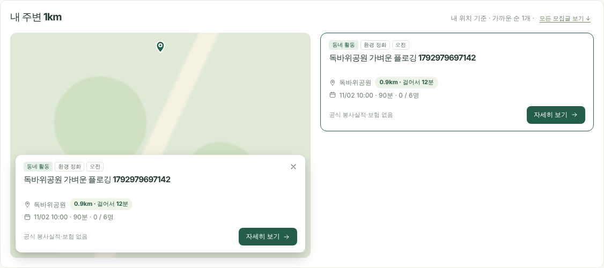

# Volink

**가까운 곳에서, 함께 만드는 작은 변화.**

Volink는 지역 주민이 짧은 봉사활동을 직접 열고, 주변 이웃과 함께 참여하는 웹 플랫폼입니다. **2~10명·3시간 이내** 활동을 중심으로 신청, 정원·대기열, 현장 출석, 완료 기록과 안전 관리를 연결합니다.

> 활동 기록은 **플랫폼 내부 기록**입니다. 공식 봉사실적으로 인정되지 않으며 자원봉사 종합보험이 적용되지 않습니다.

| 프로젝트 | 내용 |
|---|---|
| 학교·조명 | 경동대학교 · Volink |
| 팀원 | 오준원 · 박용빈 · 김병수 |
| 현재 단계 | **3주차 회원가입·로그인·활동 개설 저장·위험도 검사 완료** (신청·대기열은 5주차) |
| 저장소 | [lov22eee/Volink](https://github.com/lov22eee/Volink) |
| 개발 방식 | 한 명이 한 주차 전체를 맡고, 다음 담당자에게 **main**으로 전달 |

## 빠른 안내

- **[3주차 직접 확인 목록](docs/manual-test-week03.md)** — 테스트 담당이 화면에서 눌러볼 20개 항목. 로그인·저장은 **내 PC나 개발 서버에서 실행한 서비스**에서만 됩니다(공개 Pages는 미리보기).
- **[2주차 명세 확정 · 한 장 요약](docs/design/week02.html)** — 회원·권한, 상태 흐름, 입력 규칙, 17개 테이블, 위험 키워드. main 반영 후 공개 주소 `/design/week02.html`.
- **[계획서 텍스트 변환본](docs/plan.md)** — 기능·규칙·일정의 기준 원본(연락처 제외). 주차 이어받기는 [RELAY 절차](docs/RELAY.md).
- **[1주차 설계 정리 · 한 페이지](https://lov22eee.github.io/Volink/design/week01.html)** — 제출 보고서의 흐름·권한·UI·ERD/API·테스트 계획을 보여주는 자료입니다. [파일로 열기](docs/design/week01.html)도 가능합니다.
- **[선택한 세 항목 PDF 다운로드](docs/design/Volink_1주차_설계요약.pdf)** — 회원 유형·권한, UI 구조, 시연 자료·기본 테스트 계획만 담은 A4 1장입니다.
- **[지금 만든 서비스 화면 열기 · HTML 파일](docs/ui/Volink_서비스화면.html)** — 파일을 저장해 Chrome·Edge로 열면 설치 없이 화면을 직접 눌러볼 수 있습니다.
- [지금 동작하는 것](#현재-구현-상태)
- [내 PC에서 실행하기](#실행하기)
- [발표 화면과 보고서](#발표-화면과-보고서)
- [주차별 계획](#주차별-계획)
- [다음 담당자 인수인계](#인수인계)
- [문서와 코드 구조](#문서와-코드-구조)

### 화면만 확인하고 싶다면

`docs/ui/Volink_서비스화면.html`은 **현재 React 화면을 그대로 묶은 단일 파일**입니다. 저장한 파일을 더블클릭하거나 Chrome·Edge에 끌어다 놓으세요. 서버·MySQL·Node 설치 없이 활동 찾기, 상세, 만들기, 내 활동, 로그인, 회원가입을 직접 볼 수 있습니다.

활동 정보는 파일에 포함된 예시입니다. 공개 화면에는 서비스 메뉴만 두고, 하단에 예시 활동·신청 및 로그인 미제공 안내를 표시합니다. 학교·팀원·주차·발표·개발 진행 상황은 서비스에 넣지 않습니다.

화면 코드를 변경한 뒤에는 `frontend/`에서 `npm run ui:export`로 다시 만드세요. 외부 연결 없이 작동하는지 검증하는 브라우저 테스트도 포함됩니다.

주소로 접속해 발표하려면 [AWS 화면 공개 안내](docs/aws-ui-preview.md)를 따르세요. S3·CloudFront에 HTML 하나를 올리는 방식이며 전체 서버·DB 배포 없이 현재 화면을 공개합니다. [화면 파일 검증 결과](docs/verification-offline-ui.md)도 기록했습니다.

현재 공개 경로는 [GitHub Pages](https://lov22eee.github.io/Volink/)입니다. 화면 변경을 main에 푸시하면 자동 배포하도록 구성했습니다. 배포 결과는 [Actions](https://github.com/lov22eee/Volink/actions/workflows/pages.yml)에서 확인합니다. 처음 설정하는 방법은 [배포 안내](docs/github-pages-ui.md)를 참고하세요.

## 현재 구현 상태

### 지금 동작합니다 (2026-10-21 기준 · 4주차 + 4주차 보완)

- **홈(4주차 보완 5):** 첫 화면. 소개 문구 + ‘내 주변 활동 찾기 / 활동 만들기’, 로그인하면 내 활동 요약, 실제 숫자(모집 중·이번 주말·1365 활동), 위치를 허락한 적 있으면 가까운 활동 3개(없으면 모집 중 3개), 참여 방법 4단계와 공식 실적·보험 안내. 메뉴는 홈 / 활동 찾기 / 활동 만들기 / 내 활동.
- **회원가입·로그인:** 일반·기관회원 가입이 실제로 저장됩니다. 비밀번호는 BCrypt로 암호화하고, 로그인하면 30분짜리 JWT와 14일짜리 HttpOnly 쿠키를 받습니다. 새로고침해도 로그인이 유지되고, 로그아웃하면 쿠키가 무효가 됩니다.
- **서버 검사:** 만 14세 미만 가입 거부, 가입 요청에 관리자 역할을 넣어도 일반 회원으로 저장, 같은 이메일 중복 거부, 로그인 5회 연속 실패 시 1분 제한.
- **활동 개설 저장:** 로그인한 회원이 활동을 등록하면 서버가 화면과 같은 규칙(정원 2~10명, 30~180분, 24시간 뒤~60일 안, 06:00~22:00)을 다시 검사하고 저장합니다.
- **위험도 검사:** 위험 단어·분야·종료 시각으로 바로 공개(LOW) / 관리자 검토(REVIEW) / 등록 불가(BLOCKED)를 나누고 결과와 이유를 화면에 보여줍니다. 등록 불가 활동은 저장하지 않고, 검토 활동은 승인 전까지 목록과 상세에서 숨깁니다(본인·관리자만 보임).
- **기관회원:** 기관 확인 전에는 기관 주관 활동을 열 수 없고, 관리자가 승인하면 기관 이름으로 열 수 있습니다.
- **관리 화면:** 관리자 로그인 시에만 ‘관리’ 메뉴가 생기며 기관 확인·검토 활동을 승인하거나 사유를 적어 반려합니다. 모든 처리는 `admin_actions`, 활동 상태 변경은 `activity_logs`에 기록합니다.
- **내 활동:** 내 정보(회원 유형·관심 분야·기관 상태)와 개설한 활동의 공개 상태·검토 이유·반려 사유를 보여줍니다.
- **활동 찾기:** 실제로 공개된 활동(‘모집 중’)과 예시 활동 3건을 함께 보여주며 검색어·날짜(오늘·이번 주·주말)·시간대(오전·오후)·분야·유형 필터가 둘 다에 적용됩니다.
- **시연 계정:** 개발 환경에서만 11명의 시연 인물이 로그인 계정이 됩니다(`{코드}@demo.volink.kr`, 비밀번호는 커밋하지 않는 `.env`의 `DEMO_ACCOUNT_PASSWORD`).
- **내 주변 찾기(4주차·보완):** 처음 들어오면 ‘내 주변 활동을 찾을까요?’를 한 번 묻고(허용했다는 사실만 브라우저에 기억해 다음부터는 바로 지도로 시작, 위치 자체는 저장 안 함), 위는 ‘내 주변’(지도 + 가까운 5개), 아래는 ‘모든 모집글’(거리순 카드)로 보여 줍니다. 내 위치 또는 직접 고른 지역(동네·역·건물 이름 검색)을 기준으로 반경 1·3·5·10·20km 안의 활동을 지도+목록으로 가까운 순으로 보여줍니다. 거리와 대략 이동 시간(걸어서/차로 몇 분, 직선거리 계산)을 표시하고, 고른 반경 안에 없으면 3→5→10→20km로 스스로 넓힙니다. 지도 핀을 누르면 미리보기가 뜨고, Kakao 지도에서 지도를 옮기면 ‘이 지역에서 다시 찾기’가 나옵니다. 내 위치는 그 검색에만 쓰고 저장·기록하지 않습니다.
- **글 수정·삭제(4주차 보완 2):** 내가 만든 활동 상세에 ‘수정하기·삭제’가 보입니다. 신청자가 없고 시작 전이면 전부 고칠 수 있고, 고칠 때 위험도 검사를 다시 합니다(위험 단어면 저장 안 함, 검토 대상이면 다시 관리자 확인). 신청자가 생기면 소개·만나는 곳만 고칠 수 있고 삭제는 막힙니다(신청은 5주차). 삭제한 글은 기록만 남고 모든 목록에서 사라집니다.
- **위험 단어 보완(4주차 보완 2):** 띄어쓰기를 무시하고 비교해 ‘전기 배관 작업’, ‘전기배관’도 잡습니다. 등록 불가에 배관·전선·고압·용접, 관리자 검토에 전기·가스를 더했습니다(V5.2).
- **장소 검색·분류(4주차 보완):** 활동 만들기에서 장소 칸의 돋보기를 누르면 ‘장소 찾기’ 창이 열리고 Kakao 장소 검색 또는 지도 가운데 핀 주변 장소에서 고릅니다. 서버가 Kakao 분류로 공원·카페·식당·도서관·공공기관은 바로 공개, 요양·병원·반려동물·학교 등은 관리자 검토, 주유소·술집 등은 고를 수 없게 나누고(`docs/rules.md` 장소 분류), 결과에 서명해 브라우저가 장소·분류를 바꾸지 못하게 합니다. Kakao REST 키가 없으면 관리자가 좌표를 넣은 장소만 고릅니다.
- **활동 만들기 화면(4주차 보완):** 장소 칸 하나 + 검색 창, ‘일정’ 카드(날짜 먼저 → 굴리는 시작 시간 선택 06:00~21:30·10분 단위)와 ‘활동 시간’ 카드(22:00 전에 끝나는 길이만 10분 단위로 표시, 끝나는 시각 함께), 정원 드롭다운, **준비물 버튼**(장갑·집게·봉투·물·모자·편한 신발을 눌러 켜고, 직접 추가, 그중 모집자가 나눠 주는 것 표시 · 최대 6개 · 분야별 기본값), 자주 하는 활동 불러오기, 오른쪽 미리보기와 ‘바로 공개/관리자 확인’ 예상 안내. 활동 상세에는 ‘챙겨 올 것 / 모집자가 준비해요’ 칩, 목록 카드에는 2개 + 나머지 개수로 보입니다. 준비물 이름도 위험 단어 검사에 들어갑니다(예: 사다리 → 등록 불가).
- **1365 봉사활동 함께 보기(4주차 보완):** 행정안전부 봉사참여정보서비스(공공데이터포털) 키가 있으면 지도 위치의 시·군·구 1365 활동을 받아 ‘1365 활동’으로 같은 지도·목록에 보여주고, ‘자세히’를 누르면 Volink 안에서 요약 창(기관·장소·기간·모집·분야 + 1365에서 신청하기·지도에서 보기·링크 복사)을, ‘1365에서 신청 ↗’은 새 탭으로 1365 그 활동 페이지를 엽니다. 신청·실적·보험은 1365 기준이며 Volink는 정보만 보여줍니다. 담당자 이름·전화·이메일 등 연락처는 저장·표시하지 않습니다. 키가 없으면 이 부분은 보이지 않습니다.
- **공간 인덱스:** 활동 위치를 `activity_locations.location`(POINT, SRID 4326)에 두고 공간 인덱스로 먼저 좁힌 뒤 구면 거리로 정확히 거릅니다. 검토 중(REVIEW)·반려 활동은 거리 검색에도 나오지 않습니다.
- **장소 좌표 입력:** 관리자 화면 ‘장소 좌표’에서 지도 앱의 좌표(위도, 경도)를 붙여넣고 만남 지점을 적으면 그 장소의 기존·새 활동이 지도와 거리 검색에 나옵니다. 처리 내용은 `admin_actions`에 남습니다.
- **지도:** Kakao 지도 키(`VITE_KAKAO_JS_KEY`)가 있으면 Kakao 지도에 핀·검색 반경을 그립니다. 키가 없으면 좌표의 상대 위치만 그린 간단한 그림으로 대신합니다(실제 지도 아님).
- Flyway가 V1~V5와 V5.1(4주차 보완: 검색 장소 저장·만나는 곳·준비물·1365 캐시), V5.2(위험 단어 추가·삭제 상태)를 적용합니다. 재실행 시 데이터와 이력을 보존합니다.

### 아직 구현하지 않았습니다

참가 신청·승인·대기열·알림(5주차), 배포 서버에 Kakao·공공데이터 키를 넣은 뒤 실제 지도·장소 검색·1365 응답 확인(이 개발 환경에서는 두 서비스에 접속할 수 없어 확인하지 못함), 1365 조건 저장·새 활동 알림(5주차 알림과 함께), QR·위치 체크인·완료 기록(6주차), 신고·증빙·이의제기·제재·추천(7주차), 관심 분야 수정 화면(서버 API만 있음). **GitHub Pages는 서버 없이 예시 데이터만 담은 미리보기**라서 가입·로그인·저장이 되지 않습니다. 실제 동작은 배포 서버 https://3-104-31-169.sslip.io 에서 확인합니다.

> Kakao REST 키가 없으면 장소는 관리자가 등록한 후보 3곳에서만 고릅니다. 장소 분류는 Kakao 카테고리로 정하는 보조 수단이며 현장 이용 허가를 확인한 것이 아닙니다. 위험 단어 검사는 위험 가능성을 골라내는 보조 수단이며 활동이 안전하다고 보증하지 않습니다.

### 4주차 화면



더 보기: [활동 만들기](docs/screenshots/week-04-create.png) · [장소 찾기 창](docs/screenshots/week-04-place-dialog.png) · [시간 선택](docs/screenshots/week-04-create-errors.png) · [반경 자동 넓히기](docs/screenshots/week-04-widen.png) · [준비물 칩](docs/screenshots/week-04-detail-supplies.png) · [위치 묻기](docs/screenshots/week-04-ask.png) · [관리자 장소 좌표](docs/screenshots/week-04-admin-places.png) · [홈](docs/screenshots/week-04-home.png) · [공개 완료](docs/screenshots/week-04-published.png) · [모바일](docs/screenshots/week-04-mobile.png) · 이전 주차 캡처는 `docs/screenshots/week-01-*`~`week-03-*`에 보관

## 개발환경

| 구분 | 버전·도구 | 현재 사용 |
|---|---|---|
| 프론트엔드 | React 19.3.0 · Vite 8.3.3 · TypeScript 5.9.3 | 화면·개발 서버·빌드 |
| Node.js | **24.19.0** 검증, 최소 22.12.0 | 프론트 의존성 설치 |
| 백엔드 | Java **21** · Spring Boot **3.5.16** | API·DB 연결 |
| 빌드 | Maven **3.9.11** · Wrapper **3.3.4** | 별도 Maven 설치 불필요 |
| 보안 | Spring Security | 읽기 API 외 접근 제한, JWT는 3주차 |
| DB | MySQL **8.4** · Flyway | Docker 이미지 고정·마이그레이션 |
| 테스트 | JUnit·Testcontainers / Playwright 1.63.0 | 실제 MySQL 통합 / 브라우저 검증 |
| 로컬 도구 | Git · Docker + Compose v2 · Python 3 · curl | DB 실행·설정·연결 확인 |
| 서버 | EC2(시드니)/Ubuntu/Nginx/Let's Encrypt | 2026-10-13 배포: https://3-104-31-169.sslip.io ([docs/deploy.md](docs/deploy.md)) |
| 지도·장소 | Kakao 지도 JavaScript API · Kakao 로컬 REST API | 지도 표시(JS 키) · 장소 검색·주소 위치 찾기(REST 키, 서버만). 키가 없으면 위치 그림·등록 장소로 대신 |
| 공공데이터 | 행정안전부 봉사참여정보서비스(data.go.kr) | 1365 활동 목록·상세(서버만, 하루 1000회/기능 · 서버가 900회에서 멈춤) |
| 추후 연동 | Amazon S3 | 아직 설정하지 않음 |

Java 21의 **JDK**를 설치하세요. Docker Desktop(Windows/macOS) 또는 Docker Engine+Compose(Linux)가 실행되어 있어야 합니다. Windows에서는 WSL2 또는 Git Bash를 사용하며, 이 저장소의 통합 실행 스크립트는 Bash·Python 3가 필요합니다. 현재 검증 환경은 Linux입니다.

## 실행하기

### 1. 저장소 준비

처음 사용하는 PC:

```bash
git clone https://github.com/lov22eee/Volink.git
cd Volink
```

이미 내려받은 PC는 **기존 변경을 먼저 확인**합니다.

```bash
git status
git switch main
git pull --ff-only origin main
```

미커밋 변경이나 원격과 갈라진 커밋이 있으면 보존·통합한 뒤 진행하세요. `reset --hard`나 force push로 맞추지 않습니다.

### 2. 로컬 설정과 의존성 설치

저장소 최상위 `Volink/`에서:

```bash
./scripts/setup-env.sh
cd frontend
npm ci
cd ..
```

`setup-env.sh`는 무작위 로컬 DB 비밀번호를 **Git에서 제외된 `.env`**에 생성합니다. 기존 `.env`는 덮어쓰지 않습니다. 직접 설정하려면 `.env.example`의 변수명을 참고하고, 비밀번호를 비워 둔 상태로 DB를 시작하지 마세요.

| 변수 | 기본값·설정 | 설명 |
|---|---|---|
| `MYSQL_DATABASE` | `volink` | DB 이름 |
| `MYSQL_USER` | `volink` | 앱용 DB 사용자 |
| `MYSQL_PASSWORD` | 스크립트가 생성 | 앱용 DB 비밀번호 |
| `MYSQL_ROOT_PASSWORD` | 스크립트가 생성 | 로컬 MySQL 관리 비밀번호 |
| `MYSQL_PORT` | `3307` | PC에서 DB에 접근하는 포트 |
| `SERVER_PORT` | `8080` | 백엔드 포트 |
| `DB_HOST` | 기본 `127.0.0.1` | 별도 DB 이용 시 설정 |
| `JAVA_HOME` | Java 21 JDK | 여러 JDK 설치 시 명시적으로 지정 |
| `JWT_SECRET` | 스크립트가 생성 | 로그인 토큰 서명 키(Base64 32바이트). 비우면 서버를 껐다 켤 때마다 바뀜 |
| `DEMO_ACCOUNT_PASSWORD` | 스크립트가 생성 | 개발 환경 시연 계정 11명의 비밀번호. 비우면 시연 계정을 만들지 않음 |

기존 `.env`가 있으면 `./scripts/setup-env.sh`가 **빠진 값만 추가**하고 기존 값은 바꾸지 않습니다. Kakao·AWS 키는 아직 필요 없습니다. 시연 계정 비밀번호는 `.env`에서 확인하고 화면·문서·채팅에 붙여넣지 마세요. 개발 서버는 기본적으로 PC의 루프백에만 바인딩합니다. Vite의 API 프록시는 기본 백엔드 `8080`을 사용하므로 포트를 바꾸면 프록시와 검증 스크립트도 함께 조정해야 합니다.

Codex 클라우드처럼 HTTPS 프록시가 있는 환경에서만 추가 실행:

```bash
./scripts/configure-cloud.sh
```

이 명령은 제공된 프록시와 CA를 Maven에 연결합니다. 인증서 검증을 끄지 않습니다. `.cache/`의 로컬 설정은 커밋하지 않습니다.

클라우드 기본 이미지에 Java 실행환경만 있고 `javac`가 없다면, Debian 클라우드 전용 보완 명령으로 전체 JDK를 설치합니다.

```bash
./scripts/install-cloud-jdk.sh
```

서명된 Debian 저장소의 패키지를 검증해 Git에서 제외된 `.tools/`에 추출합니다. 이 프로젝트의 백엔드 스크립트가 해당 JDK를 사용하므로 이후 작업에서도 유지됩니다. 개인 PC에서는 운영체제에 맞는 Java 21 JDK를 설치하세요.

### 3. 전체 서비스 실행

```bash
./scripts/start-dev.sh
./scripts/check-dev.sh
```

스크립트는 MySQL 준비 → 백엔드 빌드·시작 → 프론트엔드 시작 → 연결 확인 순으로 실행합니다. 첫 Maven 설치·빌드는 시간이 걸릴 수 있습니다. `check-dev.sh`는 화면 프록시를 거쳐 실제 API와 DB를 확인합니다.

일반 개발자 PC에서는 브라우저에서 `http://127.0.0.1:5173`에 접속합니다. **클라우드 온보딩 UI는 로컬 주소를 여는 웹 미리보기를 제공하지 않습니다.** 발표는 팀 PC에서 같은 명령으로 실행하세요.

### 따로 실행할 때

DB · 저장소 최상위:

```bash
docker compose up -d --wait db
```

백엔드 · 저장소 최상위:

```bash
./scripts/backend.sh spring-boot:run
```

프론트엔드 · 별도 터미널:

```bash
cd frontend
npm run dev
```

서버 준비 확인은 `GET /actuator/health`의 `UP`, `GET /api/project/status`의 `database: UP`입니다. API 목록과 응답 범위는 [구조 문서](docs/architecture.md#현재-api)를 참고하세요.

### DB 초기화·시연 데이터

첫 백엔드 시작 시 Flyway가 `V1__core_schema.sql`, `V2__demo_catalog.sql`, `V3__week2_members_safety_schema.sql`, `V4__week3_auth_activity.sql`을 적용합니다. 수동 SQL 실행은 필요 없습니다. DB는 Docker의 `volink_mysql-data` 볼륨에 유지되며 저장소 안에 DB 파일을 만들지 않습니다.

**기존 V1~V4를 수정하지 말고 새 `V5__...sql`을 추가하세요.** DB 비밀번호를 바꾸어도 이미 생성된 DB 사용자 비밀번호가 자동 변경되지는 않습니다. 기존 DB를 보존하면서 사용자 비밀번호를 변경해야 합니다.

### 종료·문제 확인

```bash
./scripts/stop-dev.sh       # 이 스크립트가 시작한 화면·서버만 종료
docker compose stop db      # 필요할 때 DB 중지 · 데이터 보존
```

- 실행 로그: `.run/backend.log`, `.run/frontend.log`
- DB 상태: `docker compose ps`, `docker compose logs db`
- 포트 충돌: 기존 프로세스를 확인한 뒤 이 프로젝트가 시작한 프로세스만 종료
- Maven 다운로드 실패: Java 21, 프록시·CA 설정, 네트워크를 확인
- DB 연결 실패: Docker 상태, `.env`와 기존 DB 사용자 비밀번호 일치 여부를 확인

일반 개발·인수인계에서 DB 볼륨 삭제 명령을 사용하지 않습니다.

## 테스트

Docker를 켜고 다음 명령을 실행합니다.

```bash
# 실제 별도 MySQL 컨테이너로 DB·API·제약 검증
./scripts/backend.sh test

# 프론트 타입 검사 및 배포용 빌드
cd frontend
npm run build
cd ..

# 실행 중인 전체 서비스 기능 확인
./scripts/check-dev.sh
```

브라우저 테스트는 전체 서비스가 실행 중이어야 합니다.

```bash
cd frontend
npx playwright install chromium
npm run test:e2e
```

클라우드의 기존 Chromium을 사용할 때는 설치 대신:

```bash
cd frontend
PLAYWRIGHT_CHROMIUM_EXECUTABLE_PATH=/usr/bin/chromium npm run test:e2e
```

브라우저 테스트는 가입·로그인·개설·관리·내 주변 찾기 흐름과 모바일 캡처(`week-04-*.png`, 이번 주차 이름)를 `docs/screenshots/`에 갱신합니다. UI 수정 후 변경된 캡처도 검토하고 전달하세요. 테스트 결과는 주차별 검증 기록([1주차](docs/verification-week-01.md) · [2주차](docs/verification-week-02.md) · [3주차](docs/verification-week-03.md) · [4주차](docs/verification-week-04.md))에 구분해서 적습니다. 테스트 케이스 전체 목록은 [test-cases.md](docs/test-cases.md)입니다. Docker 데몬이 꺼져 있으면 백엔드 테스트가 “Docker 환경 없음”으로 실패하니 먼저 켜세요.

## 발표 화면과 보고서

**제출한 1주차의 설계 내용을 설명할 때는 [설계 정리 페이지](https://lov22eee.github.io/Volink/design/week01.html)를 여세요.** 서비스 흐름·회원 권한·6개 화면 와이어프레임·개념 ERD·예정 API·상태 전환·위험 분류·기본 테스트 계획을 한 페이지에 정리했습니다. 업무 기능이 구현·검증된 자료로 설명하지 않습니다. 실제 서비스 메뉴에는 이 설계 자료를 넣지 않습니다.

발표할 때는 **실제 서비스 화면**을 엽니다. 활동 찾기 → 상세 → 만들기 → 내 활동 → 로그인 → 회원가입 순서로 이번에 정리한 화면 구조를 보여주세요. 일반회원·기관회원은 회원가입에서 구분합니다. 서비스 안에 발표 메뉴나 개발 현황 화면은 없습니다.

- [제출한 1주차 보고서 기준과 화면 대응](docs/service-ui-week01.md)
- [2주차 발표 순서·5분 대본·예상 질문](docs/presentation.md)
- [2주차 보고서 복사용](docs/reports/week-02.md)
- [1주차 보고서 복사용 · 제출 내용 기준](docs/reports/week-01.md)
- [이후 주차 보고서 템플릿](docs/reports/template.md)

1주차 보고서의 **‘전주까지 개발 현황’은 비워 둡니다**. 제출 기간 2026.09.28~10.05는 설계 기간이며 10월 8일 화면 수정을 그 기간의 구현 실적으로 소급하지 않습니다. 예전 슬라이드는 `docs/archive/`와 `docs/slides/`에 보관하고 공개 서비스에서 제외했습니다.

## 주차별 계획

분야는 작업 범위이며, **해당 주차 담당자 한 명이 세 분야 전체를 구현**합니다. 다음 사람이 다음 주차 전체를 이어받습니다. 실제 담당자 이름은 인수인계에서 기록하세요.

| 주차 | 화면 | 서버 | 데이터·테스트 |
|---|---|---|---|
| **1주차** | ☑ 개발환경 구성<br>☑ 사용자별 화면 흐름도<br>☑ 주요 서비스 UI 초안 | ☑ 개발환경·DB 구성<br>☑ 핵심 테이블·ERD 초안<br>☑ 역할·권한 초안 | ☑ 장소 후보 3곳 선정<br>☑ 시연 계정 구성 정의<br>☑ 데이터 항목 정리·연결 확인 |
| **2주차** | ☑ 지도·목록 레이아웃 정리<br>☑ 입력·오류 규칙 (만 14세 미만 제한·관심분야 포함)<br>☑ API 화면 요구사항<br>☑ 기관회원 가입·확인 단계 화면 | ☑ ERD·API 확정 (기관·관심분야·알림·신고·이의제기·제재 테이블)<br>☑ 상태 전이·권한표 (기관회원·상태 변경 기록 포함)<br>☑ 보안·비용 기준 | ☑ 계정 정의 확정 (기관회원 2 추가)<br>☐ 장소 확정 (좌표·허용 미확인)<br>☑ 위험 키워드 초안<br>☑ 구조·데이터 일치 확인 |
| **3주차** | ☑ 활동 개설 화면 연동<br>☑ 위험도 결과 표시<br>☑ 인증·활동 API 연결 (일반·기관 가입, 관심분야 저장) | ☑ 인증·JWT·권한 (14세 미만 거부, 관리자 가입 불가)<br>☑ 활동 개설 API (자율·기관 주관)<br>☑ 위험도 검사·기관 확인 API | ☑ 인증·권한 테스트<br>☑ 개설·위험도·기관 확인 테스트<br>☑ 정상·오류 입력 |
| **4주차** | ☑ 주변 목록·위치 그림<br>☐ Kakao 지도 표시(키 넣은 뒤 확인)<br>☑ 반경·날짜·분야 검색<br>☑ 보완: 장소 찾기 창·일정 카드·지도+목록·반경 자동 넓히기<br>☐ 배포 화면·API 확인 | ☑ 위치 검색 API<br>☑ 공간 인덱스<br>☑ 첫 배포·HTTPS(3주차에 앞당김)<br>☑ 보완: 장소 검색·분류·서명, 1365 연동(가짜 응답으로만 확인) | ☑ 위치 검색 테스트<br>☑ REVIEW 비공개·BLOCKED 차단<br>☑ 보완: 장소 분류·위조 거부·1365 캐시 테스트<br>☐ 첫 배포 검증 |
| 5주차 | ☐ 신청·승인<br>☐ 대기·승격 제안<br>☐ 취소·응답 제한시간<br>☐ 화면 안 알림 목록 | ☐ 정원 잠금·중복 방지<br>☐ 대기열·승격 API<br>☐ 만료·마감 스케줄러<br>☐ 상태 변경 기록·알림 생성 | ☐ 동시 신청·정원 초과<br>☐ 취소·승격·만료<br>☐ 상태 기록·알림 확인 |
| 6주차 | ☐ QR 표시·스캔<br>☐ 체크인 결과 안내<br>☐ 완료 확인·활동 기록 화면<br>☐ 개설→신청→체크인→**완료** 연결 | ☐ QR 발급·검증<br>☐ 시간·위치 검증<br>☐ 수동 체크인·사유<br>☐ 완료·노쇼 처리 | ☐ QR 만료·시간·반경<br>☐ 수동 사유·완료 전 거부<br>☐ 완료까지 기본 흐름 테스트 |
| 7주차 | ☐ 마이페이지·관심분야 추천<br>☐ 신고(증빙 업로드)·7일 이의제기<br>☐ 관리자 화면(신고·제재·기관)·사용성 개선 | ☐ 신고·증빙 S3·조치 로그<br>☐ 이의제기 7일·기록 보류/무효<br>☐ 제재(노쇼 누적 제한)·추천 점수<br>☐ 백업·복구 | ☐ 신고·이의·제재·권한<br>☐ 사용성 평가 기록<br>☐ 회귀 테스트 |
| 8주차 | ☐ 화면 오류 수정<br>☐ 최종 시연<br>☐ 발표 자료 | ☐ 장애·배포 점검<br>☐ 운영 매뉴얼<br>☐ 최종 백업 | ☐ 전체 통합 검증<br>☐ 결과 정리<br>☐ 시연 리허설 |

※ 1주차 ‘장소 선정’은 후보 선정이며 실제 좌표·이용 조건 검증이 아닙니다. ‘계정 구성 정의’는 시연 계정 정의이며 로그인 기능 구현이 아닙니다.

※ 2주차 ☑는 **명세·DB 구조·화면 입력 규칙**을 확인했다는 뜻입니다. 기관 확인·알림·신고 등 테이블을 만들었지만 기능은 해당 주차에 구현합니다. 장소 확정은 현장·관리기관 확인이 필요해 ☐로 남깁니다(3주차 담당자가 4주차 전까지 이어서 확인).

※ 계획서 대조로 빠진 기능 배치(2026-10-11): 기관회원 2·3주차, 관심분야 2(규칙)·3(저장)·7(추천), 만 14세 미만 제한 2(화면)·3(서버), 상태 변경 기록 2(설계)·5(구현), 알림 5, 추천 7, 신고 증빙 업로드 7, 7일 이의제기 6(기록 생성)·7(신청), 제재 7. 봉사 크루는 계획서의 선택 항목으로 일정 여유 시 추가합니다.

※ 3주차 ☑는 실제 MySQL 백엔드 테스트 25개와 브라우저 테스트 16개로 확인했습니다(2026-10-13). 2주차 ‘장소 확정’은 좌표를 받지 못해 아직 ☐이며 4주차 거리 검색 전에 필요합니다.

※ 4주차 보완 ☑는 실제 MySQL 백엔드 테스트 53개와 브라우저 테스트 18개로 확인했습니다(2026-10-21). Kakao·data.go.kr 실제 응답은 이 환경에서 접속이 막혀 확인하지 못해 ‘Kakao 지도 표시’는 ☐입니다.

※ 4주차 ☑는 실제 MySQL 백엔드 테스트 29개(위치 검색 4개 추가)와 브라우저 테스트 17개로 확인했습니다(2026-10-16, 4주차 브랜치). 실제 좌표·Kakao 키가 없어 Kakao 지도 표시와 배포 서버 반영은 ☐입니다. 공간 인덱스 사용은 `EXPLAIN`(range · `sx_activity_location`)으로 확인했습니다.

※ **6주차 목표는 ‘완료까지’로 정했습니다**(계획서 8.1 “6주 차까지 개설→신청→체크인→완료”와 맞춤). 완료·노쇼를 7주차에서 6주차로 옮겼고, 7주차는 신고·이의제기·제재·추천에 집중합니다.

## 인수인계

### 매주 작업을 마치는 순서

**2026-10-11부터는 [docs/RELAY.md](docs/RELAY.md) 절차를 따릅니다**(작업 브랜치 → PR). 아래는 요약입니다.

1. 이번 주차 전체 범위를 구현하고 화면·API·DB를 함께 확인합니다.
2. 관련 테스트를 실행합니다. 실패·미실행은 이유를 남깁니다.
3. 이 README의 **현재 구현 상태**와 해당 주차의 `☐`를 **확인한 항목만 `☑`**로 바꿉니다.
4. 아래 인수인계에 **완료·실행 결과·미완료·다음 작업·환경 변경·발표 화면**을 적습니다.
5. 보여줄 실제 서비스 화면과 주차 보고서·발표 가이드를 갱신합니다. 발표 내용을 서비스 메뉴에 넣지 않습니다.
6. 소스·README·문서·보고서를 **같은 커밋으로 main에 푸시**합니다.

```bash
git status
git pull --ff-only origin main
git add README.md AGENTS.md frontend backend scripts docs compose.yaml .gitignore .env.example
git diff --cached --stat
git diff --cached                # 비밀값·불필요한 파일 포함 여부 검토
git commit -m "feat: complete week N and update handoff"
git push origin main
```

팀원은 동시에 main을 수정하기보다 담당자 교대 시점에 전달합니다. 원격이 바뀌면 기존 작업을 보존하며 통합하고 다시 검증하세요. AI 작업자는 [AGENTS.md](AGENTS.md)도 먼저 읽습니다.

### 1주차 · 2026-10-07

| 항목 | 인수인계 내용 |
|---|---|
| 작업자 | AI 구현 지원, 팀 담당자 이름은 팀에서 기록 |
| 완료 | React·Vite·TS, Spring Boot·Security 기반, MySQL·Flyway, 읽기 API, UI 초안·발표, ERD·권한·흐름, 시연 정의 |
| 실제 연결 | 브라우저→Vite 프록시→Spring Boot→MySQL, 활동 시안·페르소나·장소 조회 |
| 실행·테스트 | [검증 기록](docs/verification-week-01.md)의 실제 실행 명령·결과 확인 |
| DB·환경 변경 | V1 핵심 테이블, V2 시연 전용 데이터, `.env` 로컬 생성, MySQL 볼륨 보존, 기본 포트 5173/8080/3307 |
| 미완료 | 모든 2~8주차 업무 기능, 장소 좌표·이용 조건, 로그인 계정, 실제 지도·AWS·배포 |
| 주의 | 양주 메트로폴 기준 장소 후보. 다른 캠퍼스면 교체. V1/V2 수정 금지. 장소·계정 확정 전 실서비스 데이터로 사용 금지 |
| 다음 작업 | 2주차 전체: API·ERD·상태 전이·권한·오류 규칙·장소 검증·위험 키워드·보안·배포비용 |
| 발표·보고서 | 실제 서비스의 주요 화면 6개, `docs/presentation.md`, `docs/reports/week-01.md` |

**2026-10-07 추가 인수인계:** 이미 제출한 20261006 HWP를 기준으로 7장 발표 HTML·PDF·대본을 추가했습니다. 서비스 메뉴의 ‘제출 보고서 발표’로 열거나 HTML 파일만 저장해 오프라인 발표합니다. 원본 제출 보고서는 변경하지 않았습니다. 기관회원·기관 승인·기관 주관 활동은 제출본의 설계 항목이며 기존 코드에는 미구현입니다. 다음 담당자는 이 요구사항을 명세에 반영하되 업무 기능을 완료로 체크하지 않습니다. 브라우저 검증 및 출력 결과는 `docs/verification-submitted-report.md`를 확인하세요.

**2026-10-08 화면 확인 경로 추가:** 사용자가 설치 없이 기존 서비스 UI를 직접 확인할 수 있도록 `docs/ui/Volink_서비스화면.html`을 추가했습니다. 실제 React 빌드·CSS·시연 데이터를 한 파일에 포함하며 서버 연결 없이 클릭할 수 있습니다. 기본 API 연결 실행은 유지하고, 단일 파일에서만 저장된 예시 모드를 사용합니다. 기관회원·인증·신청 등 미구현 범위는 그대로입니다. 화면 수정 시 `npm run ui:export`로 갱신하며 CI도 브라우저 검증 전에 이 파일을 생성합니다.

**2026-10-08 GitHub Pages 인수인계:** 사용자가 GitHub Pages 공개를 요청하여 수동 배포 워크플로를 추가했고 main 푸시를 확인했습니다 (`3c7ada5`). 화면 테스트 11개와 기존 API·DB 연결 확인은 통과했습니다. GitHub 설정 API 접근은 Forbidden으로 차단되어 Pages 활성화·원격 배포는 미완료입니다. `docs/github-pages-ui.md`의 설정과 수동 실행을 저장소 소유자가 진행해야 합니다. 배포가 성공하기 전에 공개 주소가 동작한다고 말하지 마세요.

**2026-10-08 서비스 화면 정리 · 최신 기준:** 제출한 1주차 보고서에 맞춰 활동 찾기·상세·만들기·내 활동·로그인·회원가입을 연결했습니다. 졸업작품·학교·팀원·주차·발표 메뉴·개발 현황·페르소나·API/DB 표시와 위험도 내부 처리표를 공개 화면에서 제거했습니다. 일반/기관 회원 구분은 입력 화면 구조이며 인증·기관 승인·활동 저장·개인 기록은 미구현입니다. 보고서 원본은 수정하지 않았습니다. 발표 HTML은 `docs/archive/`로 이동했습니다. Pages는 프론트 변경의 main 푸시 시 자동 배포합니다. 서비스 커밋 `3b08228`의 [배포 실행 #2](https://github.com/lov22eee/Volink/actions/runs/37649906335)가 Success인 것을 확인했습니다. 검증 결과와 실제·미구현 구분은 `docs/service-ui-week01.md`를 확인하세요. 위 과거 인수인계의 발표 메뉴·진행 현황 안내는 현재 서비스에 적용하지 않습니다.

**2026-10-08 설계 자료 인수인계(1주차 추가):** 사용자가 제출 보고서의 네 설계 항목을 간단히 보여줄 자료를 요청하여 `docs/design/week01.html`을 추가했습니다. 공개 주소는 `/design/week01.html`이며 서비스 홈·메뉴와 분리됩니다. 화면 구조는 와이어프레임, API·기관 관련 ERD·상태·테스트는 초안/계획으로 표시합니다. 이 작업으로 다음주 업무 기능을 완료 처리하지 않습니다. 원본 보고서는 변경하지 않았습니다.

### 2주차 · 2026-10-11 · 박용빈

- **완료사항:** CLAUDE.md·`docs/RELAY.md`(주차 이어받기 절차)·`docs/plan.md`(계획서 변환, 연락처 제외) 추가. 주차표에 빠진 기능 배치, 6주차 목표 ‘완료까지’ 반영. V3 마이그레이션(회원 유형·생년월일·기관·관심 분야·알림·신고·증빙·이의제기·제재·관리자 조치·위험 키워드 32개·분야 base_risk·체크인 반경, 시연 계정 정의 11명). API 명세(`docs/api.md`), 입력·오류·위험 규칙(`docs/rules.md`), 권한표·상태 전이 확정(`docs/architecture.md`), 보안·비용 기준(`docs/security-cost.md`), 테스트 케이스(`docs/test-cases.md`). 화면: 입력 규칙·칸별 오류, 만 14세·관심 분야·기관 확인 단계, 지도 보기 장소 필터, 활동 유형 필터, 신청 상태 안내.
- **실행·테스트 결과:** `./scripts/backend.sh test` 14/14 통과 · `check-dev.sh` 통과 · `npm run ui:export` 통과 · Playwright 12/12 통과 (2026-10-11, [검증 기록](docs/verification-week-02.md)). 가입·개설은 여전히 전송·저장하지 않습니다.
- **DB·환경·설치 변경:** V3 추가(기존 DB에 자동 적용, 볼륨 보존). `/api/project/status`의 week=2, 시연 카탈로그에 `activityType`·`scenario` 추가. 새 비밀값 없음. Pages 워크플로가 `design/week02.html`도 복사.
- **미완료·알려진 문제:** 장소 좌표·만남 지점·활동 허용 여부 미확인(☐). 위험 키워드 ‘칼’ 같은 짧은 단어 오탐 가능(REVIEW로 넘김). 월 예산 상한·도메인 구매는 팀 결정 필요. Pages의 `week02.html`은 main 병합 후 배포됩니다.
- **가정:** 개설은 24시간 뒤~60일 안, 22:00 전 종료(일몰 이후 종료는 서버에서 REVIEW). 거절 후 재신청 불가, 취소 후 1회 재신청. 제안 중 자리도 정원 포함. 모집자는 정원 미포함. 계획서 테이블 이름(applications 등)은 V1 이름을 유지하고 대응표로 관리.
- **다음 담당자 작업(3주차):** ① JWT 인증·가입 API(만 14세 서버 재검사, `role` 무시) ② 활동 개설 API + 위험도 검사(`risk_keywords`, `categories.base_risk`) ③ 관리자 기관 확인·REVIEW 검토 API ④ 화면 연결(`frontend/src/rules.ts` 문구와 서버 `fieldErrors` 맞추기) ⑤ test-cases.md A-01~R-02. 결정할 것: 장소 확정, 예산.
- **발표 화면·주차 보고서:** [2주차 요약](docs/design/week02.html) + 실제 서비스(활동 만들기 오류 → 회원가입 기관·14세 → 지도 보기), [발표 대본](docs/presentation.md), [보고서](docs/reports/week-02.md).

### 3주차 · 2026-10-13

역할: 코딩(박용빈) · 테스트([확인 목록](docs/manual-test-week03.md)) · 확인·발표 자료. 2026-10-13부터 담당자 이름을 따로 적지 않습니다.

- **완료사항:** 회원가입·로그인(JWT 30분 + HttpOnly 리프레시 쿠키 14일, 회전·로그아웃 무효화), 만 14세 미만·관리자 역할 서버 차단, 로그인 실패 제한, 관심 분야 저장, 활동 개설 저장(서버 규칙 재검사), 위험도 LOW/REVIEW/BLOCKED(키워드·분야·일몰 근사), 관리자 기관 확인·검토 활동 승인/반려(사유 필수·기록), 확인된 기관만 기관 주관 활동, 내 활동(내 정보·개설 활동 상태), 활동 찾기에 공개 활동 표시, 시연 계정 11명(개발 환경 전용).
- **실행·테스트 결과:** `./scripts/backend.sh test` 25/25 통과 · `check-dev.sh` 통과 · `npm run ui:export` 통과 · Playwright 16/16 통과 (2026-10-13, [검증 기록](docs/verification-week-03.md)). 작업 중 **저장 시각이 9시간 밀리는 버그**(서버 시간대 UTC)를 화면 캡처에서 발견해 고치고 테스트를 추가했습니다.
- **DB·환경·설치 변경:** V4(활동 장소·위험 이유·검토 메모, `refresh_tokens`). 백엔드 의존성 `spring-boot-starter-oauth2-resource-server`. `.env`에 `JWT_SECRET`, `DEMO_ACCOUNT_PASSWORD` 추가(`setup-env.sh`가 빠진 값만 추가). `/api/project/status` week=3.
- **미완료·알려진 문제:** 장소 좌표 미입력(2주차 ☐ 유지). 공개 Pages에서는 가입·로그인 불가(서버 미배포). 일몰 시각은 월별 근사값. 위험 단어 ‘칼’ 등 짧은 단어 오탐 가능(REVIEW로 넘김). 관심 분야 수정 화면 없음. 운영 배포 시 `JWT_SECRET` 필수 설정·`AUTH_COOKIE_SECURE=true` 확인 필요.
- **2026-10-13 배포 앞당김:** 3주차 발표 라이브 시연을 위해 4주차 '첫 배포'만 먼저 진행합니다. AWS 무료 플랜 지역 제한으로 시드니 리전을 씁니다. https://3-104-31-169.sslip.io 에서 HTTPS 접속과 서버 상태(UP)를 확인해 4주차 '첫 배포·HTTPS'만 ☑했습니다. 가입·로그인 등 '첫 배포 검증'은 ☐입니다. 방법과 기록은 [docs/deploy.md](docs/deploy.md).
- **다음 작업(4주차):** 장소 좌표 → POINT·공간 인덱스, 반경·날짜·분야 검색 API, Kakao 지도, EC2·Nginx·HTTPS 첫 배포, REVIEW 비공개·BLOCKED 차단 검색 테스트. 결정할 것: 월 예산 상한, 도메인 구매 여부, 장소 좌표.
- **발표 화면·주차 보고서:** [발표 순서·대본](docs/presentation.md), [보고서](docs/reports/week-03.md), [테스트 담당 확인 목록](docs/manual-test-week03.md).

### 4주차 · 2026-10-16 (미리 작업 · 4주차 발표 후 main 병합)

- **완료사항:** V5(장소 좌표·만남 지점, `activity_locations.location` POINT SRID 4326 + 공간 인덱스, `admin_actions` 대상에 PLACE). 관리자 장소 좌표 입력 API·화면(`PUT /api/admin/places/{id}`, 붙여넣기 형식 검사, 기존 활동 위치도 함께 이동). 공개 장소 API(`GET /api/places`). 활동 검색 API에 반경(기본 3km, 0.5~10km)·날짜·분야·유형 조건과 거리순 정렬·`distanceKm`. 화면: ‘내 주변 찾기’(위치 거부 시 활동 장소 중심), 반경 선택, 카드 거리 표시, 지도 보기(Kakao 키가 있으면 Kakao 지도, 없으면 위치 그림), 만들기 화면에 만남 지점. 배포 스크립트가 서버의 `/etc/volink/kakao_js_key`를 읽어 빌드에 넣음.
- **실행·테스트 결과:** `./scripts/backend.sh test` 29/29 통과 · `check-dev.sh` 통과 · `npm run ui:export` 통과 · Playwright 17/17 통과 (2026-10-16, [검증 기록](docs/verification-week-04.md)). 3.4km 장소는 3km 검색에서 빠지고 2.9km는 남는 것(S-01), 검토 중 활동은 승인 전 거리 검색에서도 빠지는 것(R-02·R-03)을 확인했습니다.
- **DB·환경·설치 변경:** V5 추가(기존 DB에 자동 적용). 새 의존성 없음. 선택: `frontend/.env.local`(로컬) 또는 서버 `/etc/volink/kakao_js_key`에 Kakao JavaScript 키. `/api/project/status` week=4. 테스트 도우미를 `ApiTestSupport`로 분리.
- **미완료·알려진 문제:** 실제 장소 좌표 미입력(관리자 화면에서 입력 필요, 2주차 ‘장소 확정’ ☐ 유지). Kakao 키 미등록이라 Kakao 지도 경로는 실제로 확인하지 못함. 배포 서버 미반영(main 병합 후 `server-setup.sh`). 브라우저 테스트가 로컬 개발 DB의 독바위공원에 시험 좌표를 넣으므로 로컬에서는 실제 좌표로 다시 입력해야 합니다.
- **다음 작업(5주차):** 참가 신청·승인·대기열·승격 제안·취소·알림, 정원 행 잠금(P-01~P-07). 결정할 것: 실제 좌표·Kakao 키.
- **발표 화면·주차 보고서:** [발표 대본](docs/presentation.md), [보고서](docs/reports/week-04.md), [테스트 담당 확인 목록](docs/manual-test-week04.md).

### 4주차 보완 · 2026-10-21 · 박용빈 (main 기준 · 5~7주차 PR은 그대로 대기)

- **완료사항:** V5.1(`demo_places`에 검색 장소 저장: source CURATED/KAKAO·kakao_place_id·category_name·place_class OPEN/REVIEW, `activities.meeting_point`, `volunteer_programs` 1365 캐시). 서버: Kakao 로컬 REST 연동(`KakaoLocalClient`, 키 없으면 꺼짐), 장소 분류(`PlaceClassifier`), 서명된 장소 선택(`PlaceSearchService`, 3시간 유효·HMAC), `GET /api/places/search`·`/api/places/nearby`(분당 40회 제한), 활동 개설에 `place`·`meetingPoint`(REVIEW 장소는 관리자 검토, 이유 ‘장소가 ○○’), 활동 검색에 `q`·`from`·`to`·`part`·반경 최대 20km, 1365 연동(`VolunteerService`: 위치→시·군·구 코드→목록 3시간 캐시→새 상세만 저장→Kakao로 위치 찾기, 하루 900회 제한, XML 외부 개체 차단, 연락처 미저장), `GET /api/volunteer-programs`, 관리자 점검 `GET /api/admin/volunteer-programs/check`(필드 이름만). 화면: 새 활동 찾기(위치 묻기·지역 직접 고르기·지도+목록·핀 미리보기·반경 자동 넓히기·출처/청소년 필터·필터 초기화), 새 활동 만들기(장소 찾기 창·일정 카드·굴리는 시간 선택·22시 전 길이만·미리보기), 아이콘 세트(`icons.tsx`). 배포: `scripts/aws/set-keys.sh`(키 3개를 화면에 안 보이게 입력 → `/etc/volink` root 전용), `server-setup.sh`가 서버 전용 키를 `/etc/volink/api-keys.env`로 API에 전달.
- **추가(같은 날):** 준비물 버튼·칩(V5.1에 `activities.supplies` JSON 추가 · 아직 어디에도 적용 전이라 V5.1을 고쳤음), 1365 ‘자세히’ 요약 창.
- **실행·테스트 결과:** `./mvnw clean test` 53/53 통과(기존 29 + 장소 분류 13 + 장소 선택·검색·준비물 6 + 1365 3 + 파싱 2) · `npm run ui:export` 통과 · Playwright 18/18 통과 (2026-10-21, [검증 기록](docs/verification-week-04.md)). Kakao·data.go.kr는 테스트에서 가짜 응답으로 대신했습니다.
- **DB·환경·설치 변경:** V5.1 추가. 새 의존성 없음. 서버 파일(선택): `/etc/volink/kakao_js_key`, `/etc/volink/kakao_rest_key`, `/etc/volink/data_go_kr_key` → `sudo bash /opt/volink/scripts/aws/set-keys.sh`로 넣습니다. 로컬은 환경변수 `KAKAO_REST_KEY`·`DATA_GO_KR_KEY`(커밋 금지). 로컬 개발 DB에 5~7주차 V6~V8이 이미 적용돼 있으면 이 브랜치는 시작하지 못하므로 별도 DB(예: `--MYSQL_DATABASE=volink_w4`)로 확인했습니다.
- **미완료·알려진 문제:** 이 개발 환경에서는 dapi.kakao.com·apis.data.go.kr 접속이 막혀 실제 Kakao 검색·지도와 1365 응답을 확인하지 못했습니다. 1365 응답 항목 이름(예: `actPlace`, `progrmSttusSe`)과 경기·서울 시·군·구 코드, 1365 상세 링크 주소는 확인 필요 — 배포 후 관리자로 `/api/admin/volunteer-programs/check?lat=37.82&lng=127.09`를 열어 `listCount`·필드 이름을 보고 다르면 `VolunteerService`·`RegionCodes`를 고칩니다. 1365 ‘조건 저장·새 활동 알림’은 5주차 알림과 함께 합니다. 신청할 때 ‘준비물 확인했어요’ 체크는 5주차 신청 기능과 함께 합니다.
- **다음 작업:** 서버에 키 3개 입력 → 위 점검 → 5주차 PR에 main을 합쳐(V5.1 → V6 순서) 이어서 진행.
- **계획서와 다르게 정한 것:** 계획서 범위 제외의 ‘1365 실적 연계’는 하지 않습니다. 1365 활동은 정보만 보여주고 신청·실적은 1365로 넘깁니다. 장소는 고정 후보 3곳 대신 Kakao 검색 장소도 허용하되, 장소 분류로 공공장소·주간·저위험 원칙을 유지합니다.

### 4주차 보완 2 · 2026-10-21 (main 기준 · 5~7주차 PR은 그대로 대기)

- **계기(배포 서버 확인 중 발견):** ‘전기 배관 작업’이 위험 단어(‘전기 작업’, 띄어쓰기 포함)에 걸리지 않음 / 글쓴이가 고치거나 지울 수 없음 / 위치를 허용해도 매번 다시 물어봄.
- **완료사항:** V5.2(위험 단어 배관·전선·고압·용접 BLOCKED, 전기·가스 REVIEW, 활동 상태에 DELETED). `RiskClassifier`가 공백을 무시하고 비교. `PUT /api/activities/{id}`(전체 수정 · 신청자 0명·시작 전·DRAFT/RECRUITING만, 위험도 재검사), `PATCH /api/activities/{id}/notes`(소개·만나는 곳, 신청자가 있어도 가능), `DELETE /api/activities/{id}`(신청자 0명, DELETED로 숨김·기록 유지), 상세에 모집자에게만 `applicants`. 화면: 상세의 ‘수정하기·삭제’(삭제는 한 번 더 확인), 수정 화면(만들기 화면 재사용, 신청자가 있으면 소개·만나는 곳만), 활동 찾기 위 ‘내 주변’(지도+가까운 5개)·아래 ‘모든 모집글’, 위치 허용 기억(`localStorage`의 허용 여부만).
- **실행·테스트 결과:** `./mvnw clean test` 57/57 · Playwright 18/18 · `npm run ui:export` 통과 (2026-10-21).
- **DB·환경:** V5.2 추가(서버에 적용된 V5.1은 수정하지 않음). 새 의존성·키 없음.
- **추가(같은 날, 배포 확인 후):** 준비물은 ‘챙겨 올 준비물’ 한 줄로 줄이고(모집자 준비 줄은 없앰) 활동 소개 바로 밑으로 옮김. 날짜는 우리 디자인 달력(내일~60일, 주말 색·오늘 점)으로 고름. 시작 시간 휠은 PC 마우스 휠 한 칸에 한 칸씩 움직임. 1365: 공공데이터 ‘Encoding’ 키를 넣어도 동작(한 번 디코딩), 빈 지역·검색어 값은 보내지 않음, JSON·글자 오류 응답 처리, 모집 상태를 모르는 활동은 숨기지 않음, 서버 기록에 지역별 받은 건수(키 없음), 근처에 없으면 화면에 안내.
- **미완료:** 신청자가 있는 활동의 ‘사유 적고 활동 취소’와 신청자 알림은 5주차 신청 기능과 함께 합니다. 이미 공개된 ‘전기배관 청소작업’ 같은 예전 글은 자동으로 내려가지 않으므로 관리자가 확인해야 합니다(관리자 내리기 화면은 7주차 신고 처리와 함께).

### 4주차 보완 3 · 2026-10-21 (배포 확인 후 수정)

- **확인된 것:** 배포 서버에서 1365 활동 46건을 실제로 받아옴(키·지역 코드 동작).
- **문제·수정:** 공공데이터 응답에 글자 방식(charset)이 없어 한글이 깨져 보임 → 응답을 바이트로 받아 UTF-8(또는 XML에 적힌 방식)으로 읽음. 깨진 채 저장된 1365 캐시는 V5.3에서 비움(캐시라 다시 받아옴). 1365 카드의 ‘자세히’ 버튼이 세로로 찌그러지던 것 수정.
- **테스트:** `./mvnw clean test` 58/58 · Playwright 18/18 · `npm run ui:export` 통과 (2026-10-21).
- **DB:** V5.3(1365 캐시 비우기).

### 4주차 보완 4 · 2026-10-21 (지도 사용성)

- 카드에 마우스를 올리면 핀만 강조하고(빼면 원래대로), 미리보기는 핀을 눌렀을 때만 열림.
- 내 위치 표시를 점+흰 테두리+퍼지는 파동+‘내 위치’ 말풍선으로 바꾸고, 반경 원(점선)이 화면에 다 들어오게 자동 확대/축소. 지도 오른쪽 아래 ‘내 위치로’ 버튼.
- 검색·필터: 위쪽을 돋보기·필터 아이콘으로 줄임. 돋보기를 누르면 검색칸이 열리고 치는 대로 찾음(0.3초 기다린 뒤), 필터 아이콘을 누르면 반경·날짜·시간·분야·유형·청소년이 드롭다운 판으로 열리고 켜진 개수가 아이콘에 표시됨.
- 목록 나누기: ‘모든 모집글’·기본 목록은 9개씩(18·30 선택) + ‹ 1 2 3 › 쪽 번호. 예시 활동 3개는 실제 목록과 분리해 ‘참고용 예시’로 따로 보여줌.
- 테스트: Playwright 18/18(카드 hover 후 미리보기가 남지 않는지, 아이콘 검색·필터 추가. 새 글은 검색으로 찾아 확인). 실제 Kakao 지도 모습은 배포 서버에서 확인 필요(이 환경은 지도 키·접속 없음).

### 4주차 보완 5 · 2026-10-22 (홈·활동 찾기 정리)

- 홈 새로 만듦(`frontend/src/home.tsx`). 활동 찾기 위쪽 큰 소개(히어로)는 홈으로 옮김. 기본 주소(`/`)가 홈.
- 활동 찾기: 검색줄을 감싸던 흰 상자와 ‘위치는 이번 검색에만…’ 문구 제거. 카드 크기 통일(제목 2줄 넘으면 …, 버튼은 항상 카드 맨 아래).
- 1365 ‘자세히’ 창: ‘지도에서 보기’ → **‘약도’**. 누르면 위 지도로 가지 않고 창 안에서 주소(위) + 작은 지도(아래) + Kakao 길찾기 링크. 지도 키가 없으면 안내 문구만.
- 서버 설치 스크립트: apt 잠금이 풀릴 때까지 최대 15분 기다림(첫 부팅 자동 업데이트와 겹칠 때).
- **계획과 다른 점:** 공개 화면 6개 → 홈을 더해 7개(사용자 결정 2026-10-22). 홈에도 학교·팀원·주차·개발 현황은 넣지 않음.
- 테스트: `./mvnw clean test` 58/58 · Playwright 18/18(홈 숫자·메뉴 4개·참여 4단계, 약도·길찾기 링크) · `npm run ui:export` 통과. 실제 약도 지도 모습은 배포 서버에서 확인 필요.
- 남은 것: 활동 만들기 화면 정리(미리보기 제거·가운데 한 줄 양식·안전 안내 3줄)는 다음에 논의 후 진행.

### 4주차 보완 6 · 2026-10-25 (탭 숫자·다시 찾기 오류)

- 활동 찾기에서 ‘동네 활동’ 탭을 누르면 ‘1365 활동’·‘전체’ 숫자까지 0이 되던 오류 수정(배포 화면에서 발견). 탭은 보이는 목록만 거르고, 숫자는 탭마다 따로 셈.
- ‘이 지역에서 다시 찾기’를 눌러도 1365 목록이 안 바뀌던 문제: ① 새 결과가 오기 전까지 예전 목록·거리가 남아 있었음 → 누르는 즉시 비우고 ‘불러오는 중’ 표시, 늦게 온 예전 응답은 버림 ② 서버가 지도 중심이 있는 구 하나만 1365에서 찾았음 → 중심에서 동서남북 3km 지점의 구까지 최대 4개 구를 함께 찾음(목록 캐시 3시간이라 호출 수는 크게 늘지 않음).
- `./mvnw clean test` 59/59(구 경계 테스트 추가) · Playwright 18/18(동네 활동 탭에서 1365 숫자 유지 확인 추가) · `npm run ui:export` 통과. 실제 1365 응답으로는 배포 서버에서 확인 필요.

### 5~8주차 · 아직 작업하지 않음

해당 주차 작업 후 아래 형식으로 새 항목을 추가합니다. 미작성 상태를 완료로 바꾸지 마세요.

```text
### N주차 · YYYY-MM-DD
- 완료사항:
- 실행·테스트 결과: 명령 / 통과·실패·미실행 / 확인한 실제 동작
- DB·환경·설치 변경:
- 미완료·알려진 문제:
- 다음 작업: 우선순위 / 수정할 코드·문서 / 결정할 사항
- 발표 화면·주차 보고서:
```

## 문서와 코드 구조

```text
Volink/
├── frontend/          React 화면 · 브라우저 테스트
├── backend/           Spring Boot · Flyway · MySQL 통합 테스트
├── scripts/           환경 설정 · 시작/종료 · 연결 확인
├── compose.yaml       로컬 MySQL · 데이터 볼륨
├── docs/
│   ├── plan.md                  계획서 변환본 (기준 원본)
│   ├── RELAY.md                 주차 이어받기 절차
│   ├── architecture.md          ERD·권한표·상태 전이 (2주차 확정)
│   ├── api.md                   API 명세·화면별 요구사항
│   ├── rules.md                 입력·오류·위험 규칙
│   ├── security-cost.md         보안·비용 기준
│   ├── test-cases.md            테스트 케이스
│   ├── manual-test-week03.md    테스트 담당 직접 확인 목록
│   ├── demo-data.md             장소·계정·시연 데이터 정의
│   ├── presentation.md          주차 발표 가이드
│   ├── design/                  주차별 한 장 요약
│   ├── verification-week-0N.md  실제 검증 결과
│   ├── reports/                HWP 복사용 보고서
│   └── screenshots/            실제 실행 화면
├── AGENTS.md          다음 AI 작업자 지침
└── README.md          실행·진행 상황·팀 인수인계
```

**비밀번호, JWT 서명 비밀키, AWS 키, 개인 API 키, 로컬 DB 파일을 GitHub에 올리지 않습니다.** `.env`, 의존성, 빌드 결과, 로그, DB 파일은 제외합니다. 첨부 계획서 원본의 연락처 등 개인정보도 저장소에 복사하지 않았습니다.
