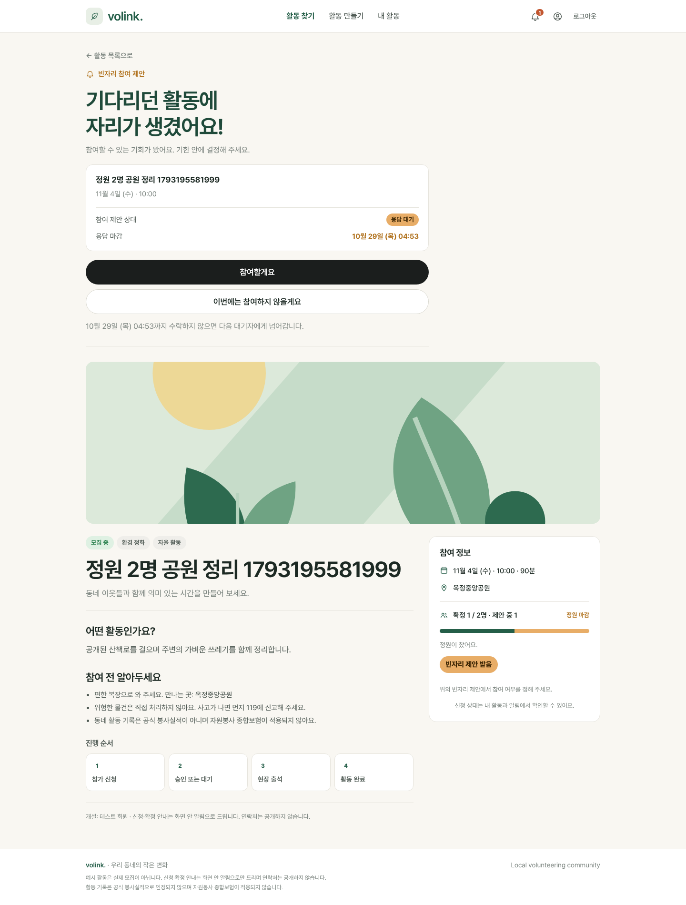

# Volink

**가까운 곳에서, 함께 만드는 작은 변화.**

Volink는 지역 주민이 짧은 봉사활동을 직접 열고, 주변 이웃과 함께 참여하는 웹 플랫폼입니다. **2~10명·3시간 이내** 활동을 중심으로 신청, 정원·대기열, 현장 출석, 완료 기록과 안전 관리를 연결합니다.

> 활동 기록은 **플랫폼 내부 기록**입니다. 공식 봉사실적으로 인정되지 않으며 자원봉사 종합보험이 적용되지 않습니다.

| 프로젝트 | 내용 |
|---|---|
| 학교·조명 | 경동대학교 · Volink |
| 팀원 | 오준원 · 박용빈 · 김병수 |
| 현재 단계 | **3주차 회원가입·로그인·활동 개설 저장·위험도 검사 완료** (신청·대기열은 5주차) |
| 저장소 | [lov22eee/Volink](https://github.com/lov22eee/Volink) |
| 개발 방식 | 한 명이 한 주차 전체를 맡고, 다음 담당자에게 **main**으로 전달 |

## 빠른 안내

- **[3주차 직접 확인 목록](docs/manual-test-week03.md)** — 테스트 담당이 화면에서 눌러볼 20개 항목. 로그인·저장은 **내 PC나 개발 서버에서 실행한 서비스**에서만 됩니다(공개 Pages는 미리보기).
- **[2주차 명세 확정 · 한 장 요약](docs/design/week02.html)** — 회원·권한, 상태 흐름, 입력 규칙, 17개 테이블, 위험 키워드. main 반영 후 공개 주소 `/design/week02.html`.
- **[계획서 텍스트 변환본](docs/plan.md)** — 기능·규칙·일정의 기준 원본(연락처 제외). 주차 이어받기는 [RELAY 절차](docs/RELAY.md).
- **[1주차 설계 정리 · 한 페이지](https://lov22eee.github.io/Volink/design/week01.html)** — 제출 보고서의 흐름·권한·UI·ERD/API·테스트 계획을 보여주는 자료입니다. [파일로 열기](docs/design/week01.html)도 가능합니다.
- **[선택한 세 항목 PDF 다운로드](docs/design/Volink_1주차_설계요약.pdf)** — 회원 유형·권한, UI 구조, 시연 자료·기본 테스트 계획만 담은 A4 1장입니다.
- **[지금 만든 서비스 화면 열기 · HTML 파일](docs/ui/Volink_서비스화면.html)** — 파일을 저장해 Chrome·Edge로 열면 설치 없이 화면을 직접 눌러볼 수 있습니다.
- [지금 동작하는 것](#현재-구현-상태)
- [내 PC에서 실행하기](#실행하기)
- [발표 화면과 보고서](#발표-화면과-보고서)
- [주차별 계획](#주차별-계획)
- [다음 담당자 인수인계](#인수인계)
- [문서와 코드 구조](#문서와-코드-구조)

### 화면만 확인하고 싶다면

`docs/ui/Volink_서비스화면.html`은 **현재 React 화면을 그대로 묶은 단일 파일**입니다. 저장한 파일을 더블클릭하거나 Chrome·Edge에 끌어다 놓으세요. 서버·MySQL·Node 설치 없이 활동 찾기, 상세, 만들기, 내 활동, 로그인, 회원가입을 직접 볼 수 있습니다.

활동 정보는 파일에 포함된 예시입니다. 공개 화면에는 서비스 메뉴만 두고, 하단에 예시 활동·신청 및 로그인 미제공 안내를 표시합니다. 학교·팀원·주차·발표·개발 진행 상황은 서비스에 넣지 않습니다.

화면 코드를 변경한 뒤에는 `frontend/`에서 `npm run ui:export`로 다시 만드세요. 외부 연결 없이 작동하는지 검증하는 브라우저 테스트도 포함됩니다.

주소로 접속해 발표하려면 [AWS 화면 공개 안내](docs/aws-ui-preview.md)를 따르세요. S3·CloudFront에 HTML 하나를 올리는 방식이며 전체 서버·DB 배포 없이 현재 화면을 공개합니다. [화면 파일 검증 결과](docs/verification-offline-ui.md)도 기록했습니다.

현재 공개 경로는 [GitHub Pages](https://lov22eee.github.io/Volink/)입니다. 화면 변경을 main에 푸시하면 자동 배포하도록 구성했습니다. 배포 결과는 [Actions](https://github.com/lov22eee/Volink/actions/workflows/pages.yml)에서 확인합니다. 처음 설정하는 방법은 [배포 안내](docs/github-pages-ui.md)를 참고하세요.

## 현재 구현 상태

### 지금 동작합니다 (2026-10-26 기준 · 4주차 + 4주차 보완 1~9 + 5주차)

- **홈(4주차 보완 5):** 첫 화면. 소개 문구 + ‘내 주변 활동 찾기 / 활동 만들기’, 로그인하면 내 활동 요약, 실제 숫자(모집 중·이번 주말·1365 활동), 위치를 허락한 적 있으면 가까운 활동 3개(없으면 모집 중 3개), 참여 방법 4단계와 공식 실적·보험 안내. 메뉴는 홈 / 활동 찾기 / 활동 만들기 / 내 활동.
- **회원가입·로그인:** 일반·기관회원 가입이 실제로 저장됩니다. 비밀번호는 BCrypt로 암호화하고, 로그인하면 30분짜리 JWT와 14일짜리 HttpOnly 쿠키를 받습니다. 새로고침해도 로그인이 유지되고, 로그아웃하면 쿠키가 무효가 됩니다.
- **서버 검사:** 만 14세 미만 가입 거부, 가입 요청에 관리자 역할을 넣어도 일반 회원으로 저장, 같은 이메일 중복 거부, 로그인 5회 연속 실패 시 1분 제한.
- **활동 개설 저장:** 로그인한 회원이 활동을 등록하면 서버가 화면과 같은 규칙(정원 나를 빼고 1~9명 = 나 포함 2~10명, 30~180분, 24시간 뒤~60일 안, 06:00~22:00)을 다시 검사하고 저장합니다.
- **위험도 검사:** 위험 단어·분야·종료 시각으로 바로 공개(LOW) / 관리자 검토(REVIEW) / 등록 불가(BLOCKED)를 나누고 결과와 이유를 화면에 보여줍니다. 등록 불가 활동은 저장하지 않고, 검토 활동은 승인 전까지 목록과 상세에서 숨깁니다(본인·관리자만 보임).
- **기관회원:** 기관 확인 전에는 기관 주관 활동을 열 수 없고, 관리자가 승인하면 기관 이름으로 열 수 있습니다.
- **관리 화면:** 관리자 로그인 시에만 ‘관리’ 메뉴가 생기며 기관 확인·검토 활동을 승인하거나 사유를 적어 반려합니다. 모든 처리는 `admin_actions`, 활동 상태 변경은 `activity_logs`에 기록합니다.
- **내 활동:** 내 정보(회원 유형·관심 분야·기관 상태)와 개설한 활동의 공개 상태·검토 이유·반려 사유를 보여줍니다.
- **활동 찾기:** 실제로 공개된 활동(‘모집 중’)과 예시 활동 3건을 함께 보여주며 검색어·날짜(오늘·이번 주·주말)·시간대(오전·오후)·분야·유형 필터가 둘 다에 적용됩니다.
- **시연 계정:** 개발 환경에서만 11명의 시연 인물이 로그인 계정이 됩니다(`{코드}@demo.volink.kr`, 비밀번호는 커밋하지 않는 `.env`의 `DEMO_ACCOUNT_PASSWORD`).
- **내 주변 찾기(4주차·보완):** 처음 들어오면 ‘내 주변 활동을 찾을까요?’를 한 번 묻고(허용했다는 사실만 브라우저에 기억해 다음부터는 바로 지도로 시작, 위치 자체는 저장 안 함), 위는 ‘내 주변’(지도 + 가까운 5개), 아래는 ‘모든 모집글’(거리순 카드)로 보여 줍니다. 내 위치 또는 직접 고른 지역(동네·역·건물 이름 검색)을 기준으로 반경 1·3·5·10·20km 안의 활동을 지도+목록으로 가까운 순으로 보여줍니다. 거리와 대략 이동 시간(걸어서/차로 몇 분, 직선거리 계산)을 표시하고, 고른 반경 안에 없으면 3→5→10→20km로 스스로 넓힙니다. 지도 핀을 누르면 미리보기가 뜨고, Kakao 지도에서 지도를 옮기면 ‘이 지역에서 다시 찾기’가 나옵니다. 내 위치는 그 검색에만 쓰고 저장·기록하지 않습니다.
- **글 수정·삭제(4주차 보완 2):** 내가 만든 활동 상세에 ‘수정하기·삭제’가 보입니다. 신청자가 없고 시작 전이면 전부 고칠 수 있고, 고칠 때 위험도 검사를 다시 합니다(위험 단어면 저장 안 함, 검토 대상이면 다시 관리자 확인). 신청자가 생기면 소개·만나는 곳만 고칠 수 있고 삭제는 막힙니다(신청은 5주차). 삭제한 글은 기록만 남고 모든 목록에서 사라집니다.
- **위험 단어 보완(4주차 보완 2):** 띄어쓰기를 무시하고 비교해 ‘전기 배관 작업’, ‘전기배관’도 잡습니다. 등록 불가에 배관·전선·고압·용접, 관리자 검토에 전기·가스를 더했습니다(V5.2).
- **장소 검색·분류(4주차 보완):** 활동 만들기에서 장소 칸의 돋보기를 누르면 ‘장소 찾기’ 창이 열리고 Kakao 장소 검색 또는 지도 가운데 핀 주변 장소에서 고릅니다. 서버가 Kakao 분류로 공원·카페·식당·도서관·공공기관은 바로 공개, 요양·병원·반려동물·학교 등은 관리자 검토, 주유소·술집 등은 고를 수 없게 나누고(`docs/rules.md` 장소 분류), 결과에 서명해 브라우저가 장소·분류를 바꾸지 못하게 합니다. Kakao REST 키가 없으면 관리자가 좌표를 넣은 장소만 고릅니다.
- **활동 만들기 화면(4주차 보완):** 장소 칸 하나 + 검색 창, ‘일정’ 카드(날짜 먼저 → 굴리는 시작 시간 선택 06:00~21:30·10분 단위)와 ‘활동 시간’ 카드(22:00 전에 끝나는 길이만 10분 단위로 표시, 끝나는 시각 함께), 정원 드롭다운, **준비물 버튼**(장갑·집게·봉투·물·모자·편한 신발을 눌러 켜고, 직접 추가, 그중 모집자가 나눠 주는 것 표시 · 최대 6개 · 분야별 기본값), 자주 하는 활동 불러오기, 오른쪽 미리보기와 ‘바로 공개/관리자 확인’ 예상 안내. 활동 상세에는 ‘챙겨 올 것 / 모집자가 준비해요’ 칩, 목록 카드에는 2개 + 나머지 개수로 보입니다. 준비물 이름도 위험 단어 검사에 들어갑니다(예: 사다리 → 등록 불가).
- **1365 봉사활동 함께 보기(4주차 보완):** 행정안전부 봉사참여정보서비스(공공데이터포털) 키가 있으면 지도 위치의 시·군·구 1365 활동을 받아 ‘1365 활동’으로 같은 지도·목록에 보여주고, ‘자세히’를 누르면 Volink 안에서 요약 창(기관·장소·기간·모집·분야 + 1365에서 신청하기·지도에서 보기·링크 복사)을, ‘1365에서 신청 ↗’은 새 탭으로 1365 그 활동 페이지를 엽니다. 신청·실적·보험은 1365 기준이며 Volink는 정보만 보여줍니다. 담당자 이름·전화·이메일 등 연락처는 저장·표시하지 않습니다. 키가 없으면 이 부분은 보이지 않습니다.
- **공간 인덱스:** 활동 위치를 `activity_locations.location`(POINT, SRID 4326)에 두고 공간 인덱스로 먼저 좁힌 뒤 구면 거리로 정확히 거릅니다. 검토 중(REVIEW)·반려 활동은 거리 검색에도 나오지 않습니다.
- **장소 좌표 입력:** 관리자 화면 ‘장소 좌표’에서 지도 앱의 좌표(위도, 경도)를 붙여넣고 만남 지점을 적으면 그 장소의 기존·새 활동이 지도와 거리 검색에 나옵니다. 처리 내용은 `admin_actions`에 남습니다.
- **지도:** Kakao 지도 키(`VITE_KAKAO_JS_KEY`)가 있으면 Kakao 지도에 핀·검색 반경을 그립니다. 키가 없으면 좌표의 상대 위치만 그린 간단한 그림으로 대신합니다(실제 지도 아님).
- **참가 신청(5주차):** 활동 상세에서 신청하면 ‘승인 대기’가 되고, 모집자가 신청자 목록에서 승인하면 ‘참가 확정’입니다. 정원이 차면 승인이 거부되고(409), 그 뒤 신청은 ‘대기 N번’이 됩니다. 같은 활동 중복 신청·내 활동 신청·관리자 신청은 막습니다. 취소는 시작 전까지, 다시 신청은 첫 취소 뒤 한 번만.
- **대기열 자리 제안:** 확정자가 취소하면 대기 1번에게 자리를 제안합니다(시작까지 24시간 이상이면 6시간, 미만이면 1시간 안에 수락). 수락하면 확정, 거절하거나 시간이 지나면 다음 순번에게 넘어갑니다(1분마다 확인). 시작 2시간 전에는 대기를 마감하고 그 뒤 빈자리는 비워 둡니다.
- **정원 잠금:** 모든 신청 변경은 활동 행을 잠근 뒤 확정 인원을 다시 세어 처리합니다. 마지막 1자리에 승인 10건이 동시에 와도 1건만 확정됩니다(자동 테스트).
- **신청자 관리:** 모집자만 자기 활동의 신청자를 봅니다(이름 일부 가림, 이메일·연락처 없음). 다른 사람은 404.
- **알림:** 신청·확정·거절·자리 제안·만료·대기 마감을 화면 안 알림으로 보내고, 위쪽 종 모양에 안 읽은 수를 30초마다 갱신합니다(문자·메일·푸시 없음). 모든 신청 상태 변경은 `activity_logs`에 남습니다.
- Flyway가 V1~V5와 V5.1(4주차 보완: 검색 장소 저장·만나는 곳·준비물·1365 캐시), V5.2(위험 단어 추가·삭제 상태)를 적용합니다. 재실행 시 데이터와 이력을 보존합니다. 5주차 V6(재신청 횟수·변경 시각·인덱스)를 V5.4 다음에 적용합니다.

### 아직 구현하지 않았습니다

배포 서버에 Kakao·공공데이터 키를 넣은 뒤 실제 지도·장소 검색·1365 응답 확인(이 개발 환경에서는 두 서비스에 접속할 수 없어 확인하지 못함), 1365 조건 저장·새 활동 알림(5주차 알림 위에 추가 예정), 추천·감사 카드, 휴대폰 문자 인증(1인 1계정), 관심 분야 수정 화면(서버 API만 있음). **GitHub Pages는 서버 없이 예시 데이터만 담은 미리보기**라서 가입·로그인·저장이 되지 않습니다. 실제 동작은 배포 서버 https://3-104-31-169.sslip.io 에서 확인합니다.

> Kakao REST 키가 없으면 장소는 관리자가 등록한 후보 3곳에서만 고릅니다. 장소 분류는 Kakao 카테고리로 정하는 보조 수단이며 현장 이용 허가를 확인한 것이 아닙니다. 위험 단어 검사는 위험 가능성을 골라내는 보조 수단이며 활동이 안전하다고 보증하지 않습니다.

### 5주차 화면



더 보기: [신청자 관리](docs/screenshots/week-05-applicants.png) · [알림](docs/screenshots/week-05-notifications.png) · [빈자리 제안](docs/screenshots/week-05-offer.png) · [활동 만들기](docs/screenshots/week-04-create.png) · [장소 찾기 창](docs/screenshots/week-04-place-dialog.png) · [시간 선택](docs/screenshots/week-04-create-errors.png) · [반경 자동 넓히기](docs/screenshots/week-04-widen.png) · [준비물 칩](docs/screenshots/week-04-detail-supplies.png) · [위치 묻기](docs/screenshots/week-04-ask.png) · [관리자 장소 좌표](docs/screenshots/week-04-admin-places.png) · [홈](docs/screenshots/week-04-home.png) · [공개 완료](docs/screenshots/week-04-published.png) · [모바일](docs/screenshots/week-04-mobile.png) · 이전 주차 캡처는 `docs/screenshots/week-01-*`~`week-03-*`에 보관

## 개발환경

| 구분 | 버전·도구 | 현재 사용 |
|---|---|---|
| 프론트엔드 | React 19.3.0 · Vite 8.3.3 · TypeScript 5.9.3 | 화면·개발 서버·빌드 |
| Node.js | **24.19.0** 검증, 최소 22.12.0 | 프론트 의존성 설치 |
| 백엔드 | Java **21** · Spring Boot **3.5.16** | API·DB 연결 |
| 빌드 | Maven **3.9.11** · Wrapper **3.3.4** | 별도 Maven 설치 불필요 |
| 보안 | Spring Security | 읽기 API 외 접근 제한, JWT는 3주차 |
| DB | MySQL **8.4** · Flyway | Docker 이미지 고정·마이그레이션 |
| 테스트 | JUnit·Testcontainers / Playwright 1.63.0 | 실제 MySQL 통합 / 브라우저 검증 |
| 로컬 도구 | Git · Docker + Compose v2 · Python 3 · curl | DB 실행·설정·연결 확인 |
| 서버 | EC2(시드니)/Ubuntu/Nginx/Let's Encrypt | 2026-10-13 배포: https://3-104-31-169.sslip.io ([docs/deploy.md](docs/deploy.md)) |
| 지도·장소 | Kakao 지도 JavaScript API · Kakao 로컬 REST API | 지도 표시(JS 키) · 장소 검색·주소 위치 찾기(REST 키, 서버만). 키가 없으면 위치 그림·등록 장소로 대신 |
| 공공데이터 | 행정안전부 봉사참여정보서비스(data.go.kr) | 1365 활동 목록·상세(서버만, 하루 1000회/기능 · 서버가 900회에서 멈춤) |
| 추후 연동 | Amazon S3 | 아직 설정하지 않음 |

Java 21의 **JDK**를 설치하세요. Docker Desktop(Windows/macOS) 또는 Docker Engine+Compose(Linux)가 실행되어 있어야 합니다. Windows에서는 WSL2 또는 Git Bash를 사용하며, 이 저장소의 통합 실행 스크립트는 Bash·Python 3가 필요합니다. 현재 검증 환경은 Linux입니다.

## 실행하기

### 1. 저장소 준비

처음 사용하는 PC:

```bash
git clone https://github.com/lov22eee/Volink.git
cd Volink
```

이미 내려받은 PC는 **기존 변경을 먼저 확인**합니다.

```bash
git status
git switch main
git pull --ff-only origin main
```

미커밋 변경이나 원격과 갈라진 커밋이 있으면 보존·통합한 뒤 진행하세요. `reset --hard`나 force push로 맞추지 않습니다.

### 2. 로컬 설정과 의존성 설치

저장소 최상위 `Volink/`에서:

```bash
./scripts/setup-env.sh
cd frontend
npm ci
cd ..
```

`setup-env.sh`는 무작위 로컬 DB 비밀번호를 **Git에서 제외된 `.env`**에 생성합니다. 기존 `.env`는 덮어쓰지 않습니다. 직접 설정하려면 `.env.example`의 변수명을 참고하고, 비밀번호를 비워 둔 상태로 DB를 시작하지 마세요.

| 변수 | 기본값·설정 | 설명 |
|---|---|---|
| `MYSQL_DATABASE` | `volink` | DB 이름 |
| `MYSQL_USER` | `volink` | 앱용 DB 사용자 |
| `MYSQL_PASSWORD` | 스크립트가 생성 | 앱용 DB 비밀번호 |
| `MYSQL_ROOT_PASSWORD` | 스크립트가 생성 | 로컬 MySQL 관리 비밀번호 |
| `MYSQL_PORT` | `3307` | PC에서 DB에 접근하는 포트 |
| `SERVER_PORT` | `8080` | 백엔드 포트 |
| `DB_HOST` | 기본 `127.0.0.1` | 별도 DB 이용 시 설정 |
| `JAVA_HOME` | Java 21 JDK | 여러 JDK 설치 시 명시적으로 지정 |
| `JWT_SECRET` | 스크립트가 생성 | 로그인 토큰 서명 키(Base64 32바이트). 비우면 서버를 껐다 켤 때마다 바뀜 |
| `DEMO_ACCOUNT_PASSWORD` | 스크립트가 생성 | 개발 환경 시연 계정 11명의 비밀번호. 비우면 시연 계정을 만들지 않음 |

기존 `.env`가 있으면 `./scripts/setup-env.sh`가 **빠진 값만 추가**하고 기존 값은 바꾸지 않습니다. Kakao·AWS 키는 아직 필요 없습니다. 시연 계정 비밀번호는 `.env`에서 확인하고 화면·문서·채팅에 붙여넣지 마세요. 개발 서버는 기본적으로 PC의 루프백에만 바인딩합니다. Vite의 API 프록시는 기본 백엔드 `8080`을 사용하므로 포트를 바꾸면 프록시와 검증 스크립트도 함께 조정해야 합니다.

Codex 클라우드처럼 HTTPS 프록시가 있는 환경에서만 추가 실행:

```bash
./scripts/configure-cloud.sh
```

이 명령은 제공된 프록시와 CA를 Maven에 연결합니다. 인증서 검증을 끄지 않습니다. `.cache/`의 로컬 설정은 커밋하지 않습니다.

클라우드 기본 이미지에 Java 실행환경만 있고 `javac`가 없다면, Debian 클라우드 전용 보완 명령으로 전체 JDK를 설치합니다.

```bash
./scripts/install-cloud-jdk.sh
```

서명된 Debian 저장소의 패키지를 검증해 Git에서 제외된 `.tools/`에 추출합니다. 이 프로젝트의 백엔드 스크립트가 해당 JDK를 사용하므로 이후 작업에서도 유지됩니다. 개인 PC에서는 운영체제에 맞는 Java 21 JDK를 설치하세요.

### 3. 전체 서비스 실행

```bash
./scripts/start-dev.sh
./scripts/check-dev.sh
```

스크립트는 MySQL 준비 → 백엔드 빌드·시작 → 프론트엔드 시작 → 연결 확인 순으로 실행합니다. 첫 Maven 설치·빌드는 시간이 걸릴 수 있습니다. `check-dev.sh`는 화면 프록시를 거쳐 실제 API와 DB를 확인합니다.

일반 개발자 PC에서는 브라우저에서 `http://127.0.0.1:5173`에 접속합니다. **클라우드 온보딩 UI는 로컬 주소를 여는 웹 미리보기를 제공하지 않습니다.** 발표는 팀 PC에서 같은 명령으로 실행하세요.

### 따로 실행할 때

DB · 저장소 최상위:

```bash
docker compose up -d --wait db
```

백엔드 · 저장소 최상위:

```bash
./scripts/backend.sh spring-boot:run
```

프론트엔드 · 별도 터미널:

```bash
cd frontend
npm run dev
```

서버 준비 확인은 `GET /actuator/health`의 `UP`, `GET /api/project/status`의 `database: UP`입니다. API 목록과 응답 범위는 [구조 문서](docs/architecture.md#현재-api)를 참고하세요.

### DB 초기화·시연 데이터

첫 백엔드 시작 시 Flyway가 `V1__core_schema.sql`, `V2__demo_catalog.sql`, `V3__week2_members_safety_schema.sql`, `V4__week3_auth_activity.sql`을 적용합니다. 수동 SQL 실행은 필요 없습니다. DB는 Docker의 `volink_mysql-data` 볼륨에 유지되며 저장소 안에 DB 파일을 만들지 않습니다.

**기존 V1~V4를 수정하지 말고 새 `V5__...sql`을 추가하세요.** DB 비밀번호를 바꾸어도 이미 생성된 DB 사용자 비밀번호가 자동 변경되지는 않습니다. 기존 DB를 보존하면서 사용자 비밀번호를 변경해야 합니다.

### 종료·문제 확인

```bash
./scripts/stop-dev.sh       # 이 스크립트가 시작한 화면·서버만 종료
docker compose stop db      # 필요할 때 DB 중지 · 데이터 보존
```

- 실행 로그: `.run/backend.log`, `.run/frontend.log`
- DB 상태: `docker compose ps`, `docker compose logs db`
- 포트 충돌: 기존 프로세스를 확인한 뒤 이 프로젝트가 시작한 프로세스만 종료
- Maven 다운로드 실패: Java 21, 프록시·CA 설정, 네트워크를 확인
- DB 연결 실패: Docker 상태, `.env`와 기존 DB 사용자 비밀번호 일치 여부를 확인

일반 개발·인수인계에서 DB 볼륨 삭제 명령을 사용하지 않습니다.

## 테스트

Docker를 켜고 다음 명령을 실행합니다.

```bash
# 실제 별도 MySQL 컨테이너로 DB·API·제약 검증
./scripts/backend.sh test

# 프론트 타입 검사 및 배포용 빌드
cd frontend
npm run build
cd ..

# 실행 중인 전체 서비스 기능 확인
./scripts/check-dev.sh
```

브라우저 테스트는 전체 서비스가 실행 중이어야 합니다.

```bash
cd frontend
npx playwright install chromium
npm run test:e2e
```

클라우드의 기존 Chromium을 사용할 때는 설치 대신:

```bash
cd frontend
PLAYWRIGHT_CHROMIUM_EXECUTABLE_PATH=/usr/bin/chromium npm run test:e2e
```

브라우저 테스트는 가입·로그인·개설·관리·내 주변 찾기 흐름과 모바일 캡처(`week-05-*.png`, 이번 주차 이름)를 `docs/screenshots/`에 갱신합니다. UI 수정 후 변경된 캡처도 검토하고 전달하세요. 테스트 결과는 주차별 검증 기록([1주차](docs/verification-week-01.md) · [2주차](docs/verification-week-02.md) · [3주차](docs/verification-week-03.md) · [4주차](docs/verification-week-04.md) · [5주차](docs/verification-week-05.md))에 구분해서 적습니다. 테스트 케이스 전체 목록은 [test-cases.md](docs/test-cases.md)입니다. Docker 데몬이 꺼져 있으면 백엔드 테스트가 “Docker 환경 없음”으로 실패하니 먼저 켜세요.

## 발표 화면과 보고서

**제출한 1주차의 설계 내용을 설명할 때는 [설계 정리 페이지](https://lov22eee.github.io/Volink/design/week01.html)를 여세요.** 서비스 흐름·회원 권한·6개 화면 와이어프레임·개념 ERD·예정 API·상태 전환·위험 분류·기본 테스트 계획을 한 페이지에 정리했습니다. 업무 기능이 구현·검증된 자료로 설명하지 않습니다. 실제 서비스 메뉴에는 이 설계 자료를 넣지 않습니다.

발표할 때는 **실제 서비스 화면**을 엽니다. 활동 찾기 → 상세 → 만들기 → 내 활동 → 로그인 → 회원가입 순서로 이번에 정리한 화면 구조를 보여주세요. 일반회원·기관회원은 회원가입에서 구분합니다. 서비스 안에 발표 메뉴나 개발 현황 화면은 없습니다.

- [제출한 1주차 보고서 기준과 화면 대응](docs/service-ui-week01.md)
- [2주차 발표 순서·5분 대본·예상 질문](docs/presentation.md)
- [2주차 보고서 복사용](docs/reports/week-02.md)
- [1주차 보고서 복사용 · 제출 내용 기준](docs/reports/week-01.md)
- [이후 주차 보고서 템플릿](docs/reports/template.md)

1주차 보고서의 **‘전주까지 개발 현황’은 비워 둡니다**. 제출 기간 2026.09.28~10.05는 설계 기간이며 10월 8일 화면 수정을 그 기간의 구현 실적으로 소급하지 않습니다. 예전 슬라이드는 `docs/archive/`와 `docs/slides/`에 보관하고 공개 서비스에서 제외했습니다.

## 주차별 계획

분야는 작업 범위이며, **해당 주차 담당자 한 명이 세 분야 전체를 구현**합니다. 다음 사람이 다음 주차 전체를 이어받습니다. 실제 담당자 이름은 인수인계에서 기록하세요.

| 주차 | 화면 | 서버 | 데이터·테스트 |
|---|---|---|---|
| **1주차** | ☑ 개발환경 구성<br>☑ 사용자별 화면 흐름도<br>☑ 주요 서비스 UI 초안 | ☑ 개발환경·DB 구성<br>☑ 핵심 테이블·ERD 초안<br>☑ 역할·권한 초안 | ☑ 장소 후보 3곳 선정<br>☑ 시연 계정 구성 정의<br>☑ 데이터 항목 정리·연결 확인 |
| **2주차** | ☑ 지도·목록 레이아웃 정리<br>☑ 입력·오류 규칙 (만 14세 미만 제한·관심분야 포함)<br>☑ API 화면 요구사항<br>☑ 기관회원 가입·확인 단계 화면 | ☑ ERD·API 확정 (기관·관심분야·알림·신고·이의제기·제재 테이블)<br>☑ 상태 전이·권한표 (기관회원·상태 변경 기록 포함)<br>☑ 보안·비용 기준 | ☑ 계정 정의 확정 (기관회원 2 추가)<br>☐ 장소 확정 (좌표·허용 미확인)<br>☑ 위험 키워드 초안<br>☑ 구조·데이터 일치 확인 |
| **3주차** | ☑ 활동 개설 화면 연동<br>☑ 위험도 결과 표시<br>☑ 인증·활동 API 연결 (일반·기관 가입, 관심분야 저장) | ☑ 인증·JWT·권한 (14세 미만 거부, 관리자 가입 불가)<br>☑ 활동 개설 API (자율·기관 주관)<br>☑ 위험도 검사·기관 확인 API | ☑ 인증·권한 테스트<br>☑ 개설·위험도·기관 확인 테스트<br>☑ 정상·오류 입력 |
| **4주차** | ☑ 주변 목록·위치 그림<br>☑ Kakao 지도 표시(AWS 서버, 2026-10-29 사용자 확인)<br>☑ 반경·날짜·분야 검색<br>☑ 보완: 장소 찾기 창·일정 카드·지도+목록·반경 자동 넓히기<br>☐ 배포 화면·API 확인 | ☑ 위치 검색 API<br>☑ 공간 인덱스<br>☑ 첫 배포·HTTPS(3주차에 앞당김)<br>☑ 보완: 장소 검색·분류·서명, 1365 연동(가짜 응답으로만 확인) | ☑ 위치 검색 테스트<br>☑ REVIEW 비공개·BLOCKED 차단<br>☑ 보완: 장소 분류·위조 거부·1365 캐시 테스트<br>☐ 첫 배포 검증 |
| **5주차** | ☑ 신청·승인<br>☑ 대기·승격 제안<br>☑ 취소·응답 제한시간<br>☑ 화면 안 알림 목록 | ☑ 정원 잠금·중복 방지<br>☑ 대기열·승격 API<br>☑ 만료·마감 스케줄러<br>☑ 상태 변경 기록·알림 생성 | ☑ 동시 신청·정원 초과<br>☑ 취소·승격·만료<br>☑ 상태 기록·알림 확인 |
| **6주차** | ☑ QR 표시·스캔(휴대폰 카메라 → 체크인 화면)<br>☑ 체크인 결과 안내<br>☑ 완료 확인·활동 기록 화면<br>☑ 개설→신청→체크인→**완료** 연결 | ☑ QR 발급·검증(30초 교체·60초 유효)<br>☑ 시간·위치 검증<br>☑ 수동 체크인·사유<br>☑ 완료·노쇼 처리 | ☑ QR 만료·시간·반경<br>☑ 수동 사유·완료 전 거부<br>☑ 완료까지 기본 흐름 테스트 |
| 7주차 | ☐ 마이페이지·관심분야 추천<br>☐ 신고(증빙 업로드)·7일 이의제기<br>☐ 관리자 화면(신고·제재·기관)·사용성 개선 | ☐ 신고·증빙 S3·조치 로그<br>☐ 이의제기 7일·기록 보류/무효<br>☐ 제재(노쇼 누적 제한)·추천 점수<br>☐ 백업·복구 | ☐ 신고·이의·제재·권한<br>☐ 사용성 평가 기록<br>☐ 회귀 테스트 |
| 8주차 | ☐ 화면 오류 수정<br>☐ 최종 시연<br>☐ 발표 자료 | ☐ 장애·배포 점검<br>☐ 운영 매뉴얼<br>☐ 최종 백업 | ☐ 전체 통합 검증<br>☐ 결과 정리<br>☐ 시연 리허설 |

※ 1주차 ‘장소 선정’은 후보 선정이며 실제 좌표·이용 조건 검증이 아닙니다. ‘계정 구성 정의’는 시연 계정 정의이며 로그인 기능 구현이 아닙니다.

※ 2주차 ☑는 **명세·DB 구조·화면 입력 규칙**을 확인했다는 뜻입니다. 기관 확인·알림·신고 등 테이블을 만들었지만 기능은 해당 주차에 구현합니다. 장소 확정은 현장·관리기관 확인이 필요해 ☐로 남깁니다(3주차 담당자가 4주차 전까지 이어서 확인).

※ 계획서 대조로 빠진 기능 배치(2026-10-11): 기관회원 2·3주차, 관심분야 2(규칙)·3(저장)·7(추천), 만 14세 미만 제한 2(화면)·3(서버), 상태 변경 기록 2(설계)·5(구현), 알림 5, 추천 7, 신고 증빙 업로드 7, 7일 이의제기 6(기록 생성)·7(신청), 제재 7. 봉사 크루는 계획서의 선택 항목으로 일정 여유 시 추가합니다.

※ 3주차 ☑는 실제 MySQL 백엔드 테스트 25개와 브라우저 테스트 16개로 확인했습니다(2026-10-13). 2주차 ‘장소 확정’은 좌표를 받지 못해 아직 ☐이며 4주차 거리 검색 전에 필요합니다.

※ 4주차 보완 ☑는 실제 MySQL 백엔드 테스트 53개와 브라우저 테스트 18개로 확인했습니다(2026-10-21). Kakao·data.go.kr 실제 응답은 이 환경에서 접속이 막혀 확인하지 못했습니다. ‘Kakao 지도 표시’는 2026-10-29 사용자가 Kakao Developers에 JavaScript 키·서버 도메인을 등록하고 AWS 서버에서 지도가 나오는 것을 확인해 ☑로 바꿨습니다(이 개발 환경에는 키가 없어 직접 보지는 못함).

※ 4주차 ☑는 실제 MySQL 백엔드 테스트 29개(위치 검색 4개 추가)와 브라우저 테스트 17개로 확인했습니다(2026-10-16, 4주차 브랜치). 실제 좌표·Kakao 키가 없어 Kakao 지도 표시와 배포 서버 반영은 ☐입니다. 공간 인덱스 사용은 `EXPLAIN`(range · `sx_activity_location`)으로 확인했습니다.

※ 5주차 ☑는 실제 MySQL 백엔드 테스트 36개(신청 7개 추가, 10건 동시 승인 포함)와 브라우저 테스트 18개로 확인했습니다(2026-10-16, 5주차 브랜치). 스케줄러는 테스트에서 끄고 같은 처리 함수를 직접 불러 확인했습니다.

※ **6주차 목표는 ‘완료까지’로 정했습니다**(계획서 8.1 “6주 차까지 개설→신청→체크인→완료”와 맞춤). 완료·노쇼를 7주차에서 6주차로 옮겼고, 7주차는 신고·이의제기·제재·추천에 집중합니다.

## 인수인계

### 매주 작업을 마치는 순서

**2026-10-11부터는 [docs/RELAY.md](docs/RELAY.md) 절차를 따릅니다**(작업 브랜치 → PR). 아래는 요약입니다.

1. 이번 주차 전체 범위를 구현하고 화면·API·DB를 함께 확인합니다.
2. 관련 테스트를 실행합니다. 실패·미실행은 이유를 남깁니다.
3. 이 README의 **현재 구현 상태**와 해당 주차의 `☐`를 **확인한 항목만 `☑`**로 바꿉니다.
4. 아래 인수인계에 **완료·실행 결과·미완료·다음 작업·환경 변경·발표 화면**을 적습니다.
5. 보여줄 실제 서비스 화면과 주차 보고서·발표 가이드를 갱신합니다. 발표 내용을 서비스 메뉴에 넣지 않습니다.
6. 소스·README·문서·보고서를 **같은 커밋으로 main에 푸시**합니다.

```bash
git status
git pull --ff-only origin main
git add README.md AGENTS.md frontend backend scripts docs compose.yaml .gitignore .env.example
git diff --cached --stat
git diff --cached                # 비밀값·불필요한 파일 포함 여부 검토
git commit -m "feat: complete week N and update handoff"
git push origin main
```

팀원은 동시에 main을 수정하기보다 담당자 교대 시점에 전달합니다. 원격이 바뀌면 기존 작업을 보존하며 통합하고 다시 검증하세요. AI 작업자는 [AGENTS.md](AGENTS.md)도 먼저 읽습니다.

### 1주차 · 2026-10-07

| 항목 | 인수인계 내용 |
|---|---|
| 작업자 | AI 구현 지원, 팀 담당자 이름은 팀에서 기록 |
| 완료 | React·Vite·TS, Spring Boot·Security 기반, MySQL·Flyway, 읽기 API, UI 초안·발표, ERD·권한·흐름, 시연 정의 |
| 실제 연결 | 브라우저→Vite 프록시→Spring Boot→MySQL, 활동 시안·페르소나·장소 조회 |
| 실행·테스트 | [검증 기록](docs/verification-week-01.md)의 실제 실행 명령·결과 확인 |
| DB·환경 변경 | V1 핵심 테이블, V2 시연 전용 데이터, `.env` 로컬 생성, MySQL 볼륨 보존, 기본 포트 5173/8080/3307 |
| 미완료 | 모든 2~8주차 업무 기능, 장소 좌표·이용 조건, 로그인 계정, 실제 지도·AWS·배포 |
| 주의 | 양주 메트로폴 기준 장소 후보. 다른 캠퍼스면 교체. V1/V2 수정 금지. 장소·계정 확정 전 실서비스 데이터로 사용 금지 |
| 다음 작업 | 2주차 전체: API·ERD·상태 전이·권한·오류 규칙·장소 검증·위험 키워드·보안·배포비용 |
| 발표·보고서 | 실제 서비스의 주요 화면 6개, `docs/presentation.md`, `docs/reports/week-01.md` |

**2026-10-07 추가 인수인계:** 이미 제출한 20261006 HWP를 기준으로 7장 발표 HTML·PDF·대본을 추가했습니다. 서비스 메뉴의 ‘제출 보고서 발표’로 열거나 HTML 파일만 저장해 오프라인 발표합니다. 원본 제출 보고서는 변경하지 않았습니다. 기관회원·기관 승인·기관 주관 활동은 제출본의 설계 항목이며 기존 코드에는 미구현입니다. 다음 담당자는 이 요구사항을 명세에 반영하되 업무 기능을 완료로 체크하지 않습니다. 브라우저 검증 및 출력 결과는 `docs/verification-submitted-report.md`를 확인하세요.

**2026-10-08 화면 확인 경로 추가:** 사용자가 설치 없이 기존 서비스 UI를 직접 확인할 수 있도록 `docs/ui/Volink_서비스화면.html`을 추가했습니다. 실제 React 빌드·CSS·시연 데이터를 한 파일에 포함하며 서버 연결 없이 클릭할 수 있습니다. 기본 API 연결 실행은 유지하고, 단일 파일에서만 저장된 예시 모드를 사용합니다. 기관회원·인증·신청 등 미구현 범위는 그대로입니다. 화면 수정 시 `npm run ui:export`로 갱신하며 CI도 브라우저 검증 전에 이 파일을 생성합니다.

**2026-10-08 GitHub Pages 인수인계:** 사용자가 GitHub Pages 공개를 요청하여 수동 배포 워크플로를 추가했고 main 푸시를 확인했습니다 (`3c7ada5`). 화면 테스트 11개와 기존 API·DB 연결 확인은 통과했습니다. GitHub 설정 API 접근은 Forbidden으로 차단되어 Pages 활성화·원격 배포는 미완료입니다. `docs/github-pages-ui.md`의 설정과 수동 실행을 저장소 소유자가 진행해야 합니다. 배포가 성공하기 전에 공개 주소가 동작한다고 말하지 마세요.

**2026-10-08 서비스 화면 정리 · 최신 기준:** 제출한 1주차 보고서에 맞춰 활동 찾기·상세·만들기·내 활동·로그인·회원가입을 연결했습니다. 졸업작품·학교·팀원·주차·발표 메뉴·개발 현황·페르소나·API/DB 표시와 위험도 내부 처리표를 공개 화면에서 제거했습니다. 일반/기관 회원 구분은 입력 화면 구조이며 인증·기관 승인·활동 저장·개인 기록은 미구현입니다. 보고서 원본은 수정하지 않았습니다. 발표 HTML은 `docs/archive/`로 이동했습니다. Pages는 프론트 변경의 main 푸시 시 자동 배포합니다. 서비스 커밋 `3b08228`의 [배포 실행 #2](https://github.com/lov22eee/Volink/actions/runs/37649906335)가 Success인 것을 확인했습니다. 검증 결과와 실제·미구현 구분은 `docs/service-ui-week01.md`를 확인하세요. 위 과거 인수인계의 발표 메뉴·진행 현황 안내는 현재 서비스에 적용하지 않습니다.

**2026-10-08 설계 자료 인수인계(1주차 추가):** 사용자가 제출 보고서의 네 설계 항목을 간단히 보여줄 자료를 요청하여 `docs/design/week01.html`을 추가했습니다. 공개 주소는 `/design/week01.html`이며 서비스 홈·메뉴와 분리됩니다. 화면 구조는 와이어프레임, API·기관 관련 ERD·상태·테스트는 초안/계획으로 표시합니다. 이 작업으로 다음주 업무 기능을 완료 처리하지 않습니다. 원본 보고서는 변경하지 않았습니다.

### 2주차 · 2026-10-11 · 박용빈

- **완료사항:** CLAUDE.md·`docs/RELAY.md`(주차 이어받기 절차)·`docs/plan.md`(계획서 변환, 연락처 제외) 추가. 주차표에 빠진 기능 배치, 6주차 목표 ‘완료까지’ 반영. V3 마이그레이션(회원 유형·생년월일·기관·관심 분야·알림·신고·증빙·이의제기·제재·관리자 조치·위험 키워드 32개·분야 base_risk·체크인 반경, 시연 계정 정의 11명). API 명세(`docs/api.md`), 입력·오류·위험 규칙(`docs/rules.md`), 권한표·상태 전이 확정(`docs/architecture.md`), 보안·비용 기준(`docs/security-cost.md`), 테스트 케이스(`docs/test-cases.md`). 화면: 입력 규칙·칸별 오류, 만 14세·관심 분야·기관 확인 단계, 지도 보기 장소 필터, 활동 유형 필터, 신청 상태 안내.
- **실행·테스트 결과:** `./scripts/backend.sh test` 14/14 통과 · `check-dev.sh` 통과 · `npm run ui:export` 통과 · Playwright 12/12 통과 (2026-10-11, [검증 기록](docs/verification-week-02.md)). 가입·개설은 여전히 전송·저장하지 않습니다.
- **DB·환경·설치 변경:** V3 추가(기존 DB에 자동 적용, 볼륨 보존). `/api/project/status`의 week=2, 시연 카탈로그에 `activityType`·`scenario` 추가. 새 비밀값 없음. Pages 워크플로가 `design/week02.html`도 복사.
- **미완료·알려진 문제:** 장소 좌표·만남 지점·활동 허용 여부 미확인(☐). 위험 키워드 ‘칼’ 같은 짧은 단어 오탐 가능(REVIEW로 넘김). 월 예산 상한·도메인 구매는 팀 결정 필요. Pages의 `week02.html`은 main 병합 후 배포됩니다.
- **가정:** 개설은 24시간 뒤~60일 안, 22:00 전 종료(일몰 이후 종료는 서버에서 REVIEW). 거절 후 재신청 불가, 취소 후 1회 재신청. 제안 중 자리도 정원 포함. 모집자는 정원 미포함. 계획서 테이블 이름(applications 등)은 V1 이름을 유지하고 대응표로 관리.
- **다음 담당자 작업(3주차):** ① JWT 인증·가입 API(만 14세 서버 재검사, `role` 무시) ② 활동 개설 API + 위험도 검사(`risk_keywords`, `categories.base_risk`) ③ 관리자 기관 확인·REVIEW 검토 API ④ 화면 연결(`frontend/src/rules.ts` 문구와 서버 `fieldErrors` 맞추기) ⑤ test-cases.md A-01~R-02. 결정할 것: 장소 확정, 예산.
- **발표 화면·주차 보고서:** [2주차 요약](docs/design/week02.html) + 실제 서비스(활동 만들기 오류 → 회원가입 기관·14세 → 지도 보기), [발표 대본](docs/presentation.md), [보고서](docs/reports/week-02.md).

### 3주차 · 2026-10-13

역할: 코딩(박용빈) · 테스트([확인 목록](docs/manual-test-week03.md)) · 확인·발표 자료. 2026-10-13부터 담당자 이름을 따로 적지 않습니다.

- **완료사항:** 회원가입·로그인(JWT 30분 + HttpOnly 리프레시 쿠키 14일, 회전·로그아웃 무효화), 만 14세 미만·관리자 역할 서버 차단, 로그인 실패 제한, 관심 분야 저장, 활동 개설 저장(서버 규칙 재검사), 위험도 LOW/REVIEW/BLOCKED(키워드·분야·일몰 근사), 관리자 기관 확인·검토 활동 승인/반려(사유 필수·기록), 확인된 기관만 기관 주관 활동, 내 활동(내 정보·개설 활동 상태), 활동 찾기에 공개 활동 표시, 시연 계정 11명(개발 환경 전용).
- **실행·테스트 결과:** `./scripts/backend.sh test` 25/25 통과 · `check-dev.sh` 통과 · `npm run ui:export` 통과 · Playwright 16/16 통과 (2026-10-13, [검증 기록](docs/verification-week-03.md)). 작업 중 **저장 시각이 9시간 밀리는 버그**(서버 시간대 UTC)를 화면 캡처에서 발견해 고치고 테스트를 추가했습니다.
- **DB·환경·설치 변경:** V4(활동 장소·위험 이유·검토 메모, `refresh_tokens`). 백엔드 의존성 `spring-boot-starter-oauth2-resource-server`. `.env`에 `JWT_SECRET`, `DEMO_ACCOUNT_PASSWORD` 추가(`setup-env.sh`가 빠진 값만 추가). `/api/project/status` week=3.
- **미완료·알려진 문제:** 장소 좌표 미입력(2주차 ☐ 유지). 공개 Pages에서는 가입·로그인 불가(서버 미배포). 일몰 시각은 월별 근사값. 위험 단어 ‘칼’ 등 짧은 단어 오탐 가능(REVIEW로 넘김). 관심 분야 수정 화면 없음. 운영 배포 시 `JWT_SECRET` 필수 설정·`AUTH_COOKIE_SECURE=true` 확인 필요.
- **2026-10-13 배포 앞당김:** 3주차 발표 라이브 시연을 위해 4주차 '첫 배포'만 먼저 진행합니다. AWS 무료 플랜 지역 제한으로 시드니 리전을 씁니다. https://3-104-31-169.sslip.io 에서 HTTPS 접속과 서버 상태(UP)를 확인해 4주차 '첫 배포·HTTPS'만 ☑했습니다. 가입·로그인 등 '첫 배포 검증'은 ☐입니다. 방법과 기록은 [docs/deploy.md](docs/deploy.md).
- **다음 작업(4주차):** 장소 좌표 → POINT·공간 인덱스, 반경·날짜·분야 검색 API, Kakao 지도, EC2·Nginx·HTTPS 첫 배포, REVIEW 비공개·BLOCKED 차단 검색 테스트. 결정할 것: 월 예산 상한, 도메인 구매 여부, 장소 좌표.
- **발표 화면·주차 보고서:** [발표 순서·대본](docs/presentation.md), [보고서](docs/reports/week-03.md), [테스트 담당 확인 목록](docs/manual-test-week03.md).

### 4주차 · 2026-10-16 (미리 작업 · 4주차 발표 후 main 병합)

- **완료사항:** V5(장소 좌표·만남 지점, `activity_locations.location` POINT SRID 4326 + 공간 인덱스, `admin_actions` 대상에 PLACE). 관리자 장소 좌표 입력 API·화면(`PUT /api/admin/places/{id}`, 붙여넣기 형식 검사, 기존 활동 위치도 함께 이동). 공개 장소 API(`GET /api/places`). 활동 검색 API에 반경(기본 3km, 0.5~10km)·날짜·분야·유형 조건과 거리순 정렬·`distanceKm`. 화면: ‘내 주변 찾기’(위치 거부 시 활동 장소 중심), 반경 선택, 카드 거리 표시, 지도 보기(Kakao 키가 있으면 Kakao 지도, 없으면 위치 그림), 만들기 화면에 만남 지점. 배포 스크립트가 서버의 `/etc/volink/kakao_js_key`를 읽어 빌드에 넣음.
- **실행·테스트 결과:** `./scripts/backend.sh test` 29/29 통과 · `check-dev.sh` 통과 · `npm run ui:export` 통과 · Playwright 17/17 통과 (2026-10-16, [검증 기록](docs/verification-week-04.md)). 3.4km 장소는 3km 검색에서 빠지고 2.9km는 남는 것(S-01), 검토 중 활동은 승인 전 거리 검색에서도 빠지는 것(R-02·R-03)을 확인했습니다.
- **DB·환경·설치 변경:** V5 추가(기존 DB에 자동 적용). 새 의존성 없음. 선택: `frontend/.env.local`(로컬) 또는 서버 `/etc/volink/kakao_js_key`에 Kakao JavaScript 키. `/api/project/status` week=4. 테스트 도우미를 `ApiTestSupport`로 분리.
- **미완료·알려진 문제:** 실제 장소 좌표 미입력(관리자 화면에서 입력 필요, 2주차 ‘장소 확정’ ☐ 유지). Kakao 키 미등록이라 Kakao 지도 경로는 실제로 확인하지 못함. 배포 서버 미반영(main 병합 후 `server-setup.sh`). 브라우저 테스트가 로컬 개발 DB의 독바위공원에 시험 좌표를 넣으므로 로컬에서는 실제 좌표로 다시 입력해야 합니다.
- **다음 작업(5주차):** 참가 신청·승인·대기열·승격 제안·취소·알림, 정원 행 잠금(P-01~P-07). 결정할 것: 실제 좌표·Kakao 키.
- **발표 화면·주차 보고서:** [발표 대본](docs/presentation.md), [보고서](docs/reports/week-04.md), [테스트 담당 확인 목록](docs/manual-test-week04.md).

### 4주차 보완 · 2026-10-21 · 박용빈 (main 기준 · 5~7주차 PR은 그대로 대기)

- **완료사항:** V5.1(`demo_places`에 검색 장소 저장: source CURATED/KAKAO·kakao_place_id·category_name·place_class OPEN/REVIEW, `activities.meeting_point`, `volunteer_programs` 1365 캐시). 서버: Kakao 로컬 REST 연동(`KakaoLocalClient`, 키 없으면 꺼짐), 장소 분류(`PlaceClassifier`), 서명된 장소 선택(`PlaceSearchService`, 3시간 유효·HMAC), `GET /api/places/search`·`/api/places/nearby`(분당 40회 제한), 활동 개설에 `place`·`meetingPoint`(REVIEW 장소는 관리자 검토, 이유 ‘장소가 ○○’), 활동 검색에 `q`·`from`·`to`·`part`·반경 최대 20km, 1365 연동(`VolunteerService`: 위치→시·군·구 코드→목록 3시간 캐시→새 상세만 저장→Kakao로 위치 찾기, 하루 900회 제한, XML 외부 개체 차단, 연락처 미저장), `GET /api/volunteer-programs`, 관리자 점검 `GET /api/admin/volunteer-programs/check`(필드 이름만). 화면: 새 활동 찾기(위치 묻기·지역 직접 고르기·지도+목록·핀 미리보기·반경 자동 넓히기·출처/청소년 필터·필터 초기화), 새 활동 만들기(장소 찾기 창·일정 카드·굴리는 시간 선택·22시 전 길이만·미리보기), 아이콘 세트(`icons.tsx`). 배포: `scripts/aws/set-keys.sh`(키 3개를 화면에 안 보이게 입력 → `/etc/volink` root 전용), `server-setup.sh`가 서버 전용 키를 `/etc/volink/api-keys.env`로 API에 전달.
- **추가(같은 날):** 준비물 버튼·칩(V5.1에 `activities.supplies` JSON 추가 · 아직 어디에도 적용 전이라 V5.1을 고쳤음), 1365 ‘자세히’ 요약 창.
- **실행·테스트 결과:** `./mvnw clean test` 53/53 통과(기존 29 + 장소 분류 13 + 장소 선택·검색·준비물 6 + 1365 3 + 파싱 2) · `npm run ui:export` 통과 · Playwright 18/18 통과 (2026-10-21, [검증 기록](docs/verification-week-04.md)). Kakao·data.go.kr는 테스트에서 가짜 응답으로 대신했습니다.
- **DB·환경·설치 변경:** V5.1 추가. 새 의존성 없음. 서버 파일(선택): `/etc/volink/kakao_js_key`, `/etc/volink/kakao_rest_key`, `/etc/volink/data_go_kr_key` → `sudo bash /opt/volink/scripts/aws/set-keys.sh`로 넣습니다. 로컬은 환경변수 `KAKAO_REST_KEY`·`DATA_GO_KR_KEY`(커밋 금지). 로컬 개발 DB에 5~7주차 V6~V8이 이미 적용돼 있으면 이 브랜치는 시작하지 못하므로 별도 DB(예: `--MYSQL_DATABASE=volink_w4`)로 확인했습니다.
- **미완료·알려진 문제:** 이 개발 환경에서는 dapi.kakao.com·apis.data.go.kr 접속이 막혀 실제 Kakao 검색·지도와 1365 응답을 확인하지 못했습니다. 1365 응답 항목 이름(예: `actPlace`, `progrmSttusSe`)과 경기·서울 시·군·구 코드, 1365 상세 링크 주소는 확인 필요 — 배포 후 관리자로 `/api/admin/volunteer-programs/check?lat=37.82&lng=127.09`를 열어 `listCount`·필드 이름을 보고 다르면 `VolunteerService`·`RegionCodes`를 고칩니다. 1365 ‘조건 저장·새 활동 알림’은 5주차 알림과 함께 합니다. 신청할 때 ‘준비물 확인했어요’ 체크는 5주차 신청 기능과 함께 합니다.
- **다음 작업:** 서버에 키 3개 입력 → 위 점검 → 5주차 PR에 main을 합쳐(V5.1 → V6 순서) 이어서 진행.
- **계획서와 다르게 정한 것:** 계획서 범위 제외의 ‘1365 실적 연계’는 하지 않습니다. 1365 활동은 정보만 보여주고 신청·실적은 1365로 넘깁니다. 장소는 고정 후보 3곳 대신 Kakao 검색 장소도 허용하되, 장소 분류로 공공장소·주간·저위험 원칙을 유지합니다.

### 4주차 보완 2 · 2026-10-21 (main 기준 · 5~7주차 PR은 그대로 대기)

- **계기(배포 서버 확인 중 발견):** ‘전기 배관 작업’이 위험 단어(‘전기 작업’, 띄어쓰기 포함)에 걸리지 않음 / 글쓴이가 고치거나 지울 수 없음 / 위치를 허용해도 매번 다시 물어봄.
- **완료사항:** V5.2(위험 단어 배관·전선·고압·용접 BLOCKED, 전기·가스 REVIEW, 활동 상태에 DELETED). `RiskClassifier`가 공백을 무시하고 비교. `PUT /api/activities/{id}`(전체 수정 · 신청자 0명·시작 전·DRAFT/RECRUITING만, 위험도 재검사), `PATCH /api/activities/{id}/notes`(소개·만나는 곳, 신청자가 있어도 가능), `DELETE /api/activities/{id}`(신청자 0명, DELETED로 숨김·기록 유지), 상세에 모집자에게만 `applicants`. 화면: 상세의 ‘수정하기·삭제’(삭제는 한 번 더 확인), 수정 화면(만들기 화면 재사용, 신청자가 있으면 소개·만나는 곳만), 활동 찾기 위 ‘내 주변’(지도+가까운 5개)·아래 ‘모든 모집글’, 위치 허용 기억(`localStorage`의 허용 여부만).
- **실행·테스트 결과:** `./mvnw clean test` 57/57 · Playwright 18/18 · `npm run ui:export` 통과 (2026-10-21).
- **DB·환경:** V5.2 추가(서버에 적용된 V5.1은 수정하지 않음). 새 의존성·키 없음.
- **추가(같은 날, 배포 확인 후):** 준비물은 ‘챙겨 올 준비물’ 한 줄로 줄이고(모집자 준비 줄은 없앰) 활동 소개 바로 밑으로 옮김. 날짜는 우리 디자인 달력(내일~60일, 주말 색·오늘 점)으로 고름. 시작 시간 휠은 PC 마우스 휠 한 칸에 한 칸씩 움직임. 1365: 공공데이터 ‘Encoding’ 키를 넣어도 동작(한 번 디코딩), 빈 지역·검색어 값은 보내지 않음, JSON·글자 오류 응답 처리, 모집 상태를 모르는 활동은 숨기지 않음, 서버 기록에 지역별 받은 건수(키 없음), 근처에 없으면 화면에 안내.
- **미완료:** 신청자가 있는 활동의 ‘사유 적고 활동 취소’와 신청자 알림은 5주차 신청 기능과 함께 합니다. 이미 공개된 ‘전기배관 청소작업’ 같은 예전 글은 자동으로 내려가지 않으므로 관리자가 확인해야 합니다(관리자 내리기 화면은 7주차 신고 처리와 함께).

### 4주차 보완 3 · 2026-10-21 (배포 확인 후 수정)

- **확인된 것:** 배포 서버에서 1365 활동 46건을 실제로 받아옴(키·지역 코드 동작).
- **문제·수정:** 공공데이터 응답에 글자 방식(charset)이 없어 한글이 깨져 보임 → 응답을 바이트로 받아 UTF-8(또는 XML에 적힌 방식)으로 읽음. 깨진 채 저장된 1365 캐시는 V5.3에서 비움(캐시라 다시 받아옴). 1365 카드의 ‘자세히’ 버튼이 세로로 찌그러지던 것 수정.
- **테스트:** `./mvnw clean test` 58/58 · Playwright 18/18 · `npm run ui:export` 통과 (2026-10-21).
- **DB:** V5.3(1365 캐시 비우기).

### 4주차 보완 4 · 2026-10-21 (지도 사용성)

- 카드에 마우스를 올리면 핀만 강조하고(빼면 원래대로), 미리보기는 핀을 눌렀을 때만 열림.
- 내 위치 표시를 점+흰 테두리+퍼지는 파동+‘내 위치’ 말풍선으로 바꾸고, 반경 원(점선)이 화면에 다 들어오게 자동 확대/축소. 지도 오른쪽 아래 ‘내 위치로’ 버튼.
- 검색·필터: 위쪽을 돋보기·필터 아이콘으로 줄임. 돋보기를 누르면 검색칸이 열리고 치는 대로 찾음(0.3초 기다린 뒤), 필터 아이콘을 누르면 반경·날짜·시간·분야·유형·청소년이 드롭다운 판으로 열리고 켜진 개수가 아이콘에 표시됨.
- 목록 나누기: ‘모든 모집글’·기본 목록은 9개씩(18·30 선택) + ‹ 1 2 3 › 쪽 번호. 예시 활동 3개는 실제 목록과 분리해 ‘참고용 예시’로 따로 보여줌.
- 테스트: Playwright 18/18(카드 hover 후 미리보기가 남지 않는지, 아이콘 검색·필터 추가. 새 글은 검색으로 찾아 확인). 실제 Kakao 지도 모습은 배포 서버에서 확인 필요(이 환경은 지도 키·접속 없음).

### 4주차 보완 5 · 2026-10-22 (홈·활동 찾기 정리)

- 홈 새로 만듦(`frontend/src/home.tsx`). 활동 찾기 위쪽 큰 소개(히어로)는 홈으로 옮김. 기본 주소(`/`)가 홈.
- 활동 찾기: 검색줄을 감싸던 흰 상자와 ‘위치는 이번 검색에만…’ 문구 제거. 카드 크기 통일(제목 2줄 넘으면 …, 버튼은 항상 카드 맨 아래).
- 1365 ‘자세히’ 창: ‘지도에서 보기’ → **‘약도’**. 누르면 위 지도로 가지 않고 창 안에서 주소(위) + 작은 지도(아래) + Kakao 길찾기 링크. 지도 키가 없으면 안내 문구만.
- 서버 설치 스크립트: apt 잠금이 풀릴 때까지 최대 15분 기다림(첫 부팅 자동 업데이트와 겹칠 때).
- **계획과 다른 점:** 공개 화면 6개 → 홈을 더해 7개(사용자 결정 2026-10-22). 홈에도 학교·팀원·주차·개발 현황은 넣지 않음.
- 테스트: `./mvnw clean test` 58/58 · Playwright 18/18(홈 숫자·메뉴 4개·참여 4단계, 약도·길찾기 링크) · `npm run ui:export` 통과. 실제 약도 지도 모습은 배포 서버에서 확인 필요.
- 남은 것: 활동 만들기 화면 정리(미리보기 제거·가운데 한 줄 양식·안전 안내 3줄)는 다음에 논의 후 진행.

### 4주차 보완 6 · 2026-10-25 (탭 숫자·다시 찾기 오류)

- 활동 찾기에서 ‘동네 활동’ 탭을 누르면 ‘1365 활동’·‘전체’ 숫자까지 0이 되던 오류 수정(배포 화면에서 발견). 탭은 보이는 목록만 거르고, 숫자는 탭마다 따로 셈.
- ‘이 지역에서 다시 찾기’를 눌러도 1365 목록이 안 바뀌던 문제: ① 새 결과가 오기 전까지 예전 목록·거리가 남아 있었음 → 누르는 즉시 비우고 ‘불러오는 중’ 표시, 늦게 온 예전 응답은 버림 ② 서버가 지도 중심이 있는 구 하나만 1365에서 찾았음 → 중심에서 동서남북 3km 지점의 구까지 최대 4개 구를 함께 찾음(목록 캐시 3시간이라 호출 수는 크게 늘지 않음).
- 활동 만들기: 일반(개인) 계정에는 ‘활동 유형’ 선택칸을 없앰(항상 자율 활동). 기관회원에게만 보임. 서버는 원래대로 일반 계정의 기관 주관 요청을 403으로 막음.
- 활동 시간: 드롭다운 → 시작 시간과 같은 굴리는 휠(시간·분) + ‘20:30 시작 → 22:00 종료’ 표시. 22:00 넘게 끝나는 길이는 휠에서 아예 고를 수 없음(예: 20:00 시작이면 최대 2시간).
- 장소 분류: 검토는 ‘종류를 알 수 없는 장소’만, 요양·병원·학교 등 이름이 있는 장소는 바로 공개(사용자 결정, `docs/rules.md`).
- 장소 찾기 창: 처음 한 번 ‘내 위치 주변 장소부터 볼까요?’를 묻고, 허용하면 그 위치 주변 장소로 시작(지도도 내 위치). 활동 찾기와 같은 기억값(`volink.nearby`, 위치 자체는 저장 안 함)을 써서 한쪽에서 허용하면 다른 쪽도 묻지 않음. ‘괜찮아요’를 누르면 다시 묻지 않음.
- `./mvnw clean test` 59/59(구 경계 테스트 추가) · Playwright 19/19(장소 찾기 위치 허용 1개 추가)(동네 활동 탭에서 1365 숫자 유지 확인 추가) · `npm run ui:export` 통과. 실제 1365 응답으로는 배포 서버에서 확인 필요.

### 4주차 보완 7 · 2026-10-25 (1365 빨리 뜨게)

- 처음 찾는 동네의 1365가 몇 초 걸리던 문제: 서버가 카카오 지역 확인(5번)·1365 목록(구마다)·상세(최대 20개)를 하나씩 차례로 묻던 것을 동시에(최대 8개씩) 묻도록 변경. 가장 느린 한 번만큼만 기다림. 하루 호출 한도·캐시는 그대로.
- 활동 만들기 화면 정리: 오른쪽 미리보기·예상 결과·안전 안내 카드를 없애고 가운데 한 줄 양식으로. 활동 이름·분야·장소·일정·소개·준비물 칸 바로 밑에 상태를 표시: (!) ‘검토 후 승인 예정이에요.’ / (⊘) ‘모집을 올릴 수 없어요.’ 아이콘에 마우스를 대거나 Tab으로 가면 말풍선으로 이유(올릴 수 없으면 ‘안전하게 함께해요’ 안내 포함). 문제가 없으면 맨 밑에 (✓) ‘바로 공개될 예정이에요.’ 올릴 수 없는 내용이면 등록 버튼이 꺼짐(서버는 원래대로 저장 시 다시 검사).
- 새 API `POST /api/activities/check`(로그인 필요, 저장 안 함): 입력 중인 제목·소개·준비물의 위험 단어를 칸별로 돌려줌(0.4초 쉬었다가 물어봄). 저장 때 쓰는 것과 같은 `risk_keywords`·띄어쓰기 무시 비교.
- 모집 정원: 계획서의 ‘2~10명 활동’은 모집자 포함이라 정원(나를 빼고)을 2~10 → **1~9명**으로 바꿈(사용자 확인 2026-10-25). 서버 규칙 1~9, DB 제약은 V5.4로 1~10(이미 저장된 정원 10 활동 보존). 5~7주차 PR에 main을 합칠 때 V5.1~V5.4가 V6보다 먼저 적용되는지 확인.
- 분야·모집 정원·(기관회원) 활동 유형: 기본 드롭다운 → 날짜·시간 칸과 같은 모양의 선택 판(분야는 아이콘+설명 목록, 정원은 1~9 숫자 판 + ‘나 포함 N명’).
- 준비물은 처음에 아무것도 켜져 있지 않음(분야별 기본값 제거).
- 장소 찾기 지도: 지도를 한 번 누르면 그곳으로 옮겨 주변 장소를 찾음(두 번 누르기는 원래대로 확대). 찾은 장소를 지도에 핀으로 표시(초록 바로 공개·노랑 검토, 선택 불가 장소는 안 그림), 핀을 누르면 그 장소 선택, 목록에 마우스를 올리면 핀이 커짐. Kakao 키가 없는 이 환경에서는 동작을 확인하지 못해 배포 서버에서 확인 필요.
- `./mvnw clean test` 61/61(상세 동시 받기, 칸별 위험 단어, 정원 1명 허용·10명 거부 추가) · Playwright 19/19. 실제 속도는 배포 서버에서 확인 필요(이 환경은 1365 접속 불가).

### 4주차 보완 8 · 2026-10-26 (장소 검토 기준·지도에서 직접 찍기)

- 장소 분류: 카카오가 종류를 붙인 장소는 ‘고를 수 없음’(주유소·술집·모텔·위험 시설)만 빼고 **모두 바로 공개**(역·편의점·마트·은행 등 규칙표에 없던 종류 포함, 이름표는 카카오 분류 2단계). **검토는 지도에서 직접 찍은 지점(길·골목·공터)만**(사용자 결정).
- 장소 찾기 지도를 한 번 누르면 맨 위에 ‘찍은 위치: ○○로 12 근처’(Kakao 좌표→주소, 검토 후 공개)와 그 주변 이름 있는 장소(바로 공개)가 함께 나옴. 찍은 위치도 서버 서명을 붙이며 `p:위도,경도`(소수 5자리)로 한 번만 저장.
- 새 API `GET /api/places/point?lat&lng`(공개, 검색 횟수 제한 적용).
- 활동 찾기 지도: 한 번 누르면 그곳에 빨간 점이 찍히고 ‘이 위치에서 다시 찾기’ 버튼이 뜸 → 누르면 그 점을 기준(‘찍은 위치 기준 3km’)으로 우리 활동·1365를 다시 찾음. 끌기만 하면 예전처럼 ‘이 지역에서 다시 찾기’(지도 가운데 기준). 두 번 누르기는 확대 그대로.
- `./mvnw clean test` 64/64(역·편의점 바로 공개, 찍은 위치 REVIEW·서명 위조 거부 추가) · Playwright 19/19. 카카오 지도 클릭·주소는 이 환경에서 확인하지 못해 배포 서버에서 확인 필요.

### 4주차 보완 9 · 2026-10-26 (카페가 술집으로 잡히던 오류)

- 배포 화면에서 ‘코베티 양주점’(카페)이 ‘술집·유흥시설’로 고를 수 없게 나옴. 원인: 장소 **이름**에서도 ‘주점’을 찾아서 지점 이름 ‘양주점’(광주점·전주점·청주점도 같음)이 걸림.
- 수정: 이름에서 찾는 단어를 따로 둠(술집·호프·유흥·나이트클럽·단란주점·룸살롱). 카카오 분류가 ‘술집 > 요리주점’인 곳은 그대로 막힘.
- 장소 찾기: 목록에서 장소를 누르면 지도가 그 장소로 바로 옮겨가 가까이(레벨 3) 보여주고, 좁은 화면에서는 지도를 화면 안으로 스크롤. 위치를 지도 준비 전에 받으면 기본 위치에 머물던 문제도 고침(지도 준비 후 다시 이동).
- `./mvnw clean test` 67/67(코베티 양주점=카페, 광주점 김밥=음식점, 이름에 단란주점=고를 수 없음 추가) · Playwright 19/19. 카카오 지도 이동은 배포 서버에서 확인 필요.

### 5주차 · 2026-10-16 미리 작업 → 2026-10-26 main(4주차 보완 1~9) 반영

- **완료사항:** V6(재신청 횟수·변경 시각·인덱스). 신청·승인·거절·취소·자리 수락/거절 API, 신청자 목록(모집자만·이름 가림), 내 신청 목록, 화면 안 알림(목록·읽음·모두 읽음·안 읽은 수), 1분 스케줄러(제안 만료→다음 순번, 시작 2시간 전 대기 마감). 화면: 상세의 신청 버튼·상태·제안 마감 시각, 모집자 신청자 관리, 내 활동 ‘신청한 활동’, 알림 화면과 종 아이콘.
- **실행·테스트 결과:** `./scripts/backend.sh test` 36/36 통과(신청 7개는 3회 반복도 통과) · `check-dev.sh` 통과 · `npm run ui:export` 통과 · Playwright 18/18 통과 (2026-10-16, [검증 기록](docs/verification-week-05.md)).
- **main 반영(2026-10-26):** 4주차 보완 1~9를 이 브랜치에 합침(merge, 기록 유지). 충돌 11개(App·api 타입·보안 설정·DB 이력 테스트·화면 테스트·문서)는 양쪽 기능을 모두 살려 정리: 상세 화면에 준비물 칩·모집자 수정/삭제(OwnerTools)와 신청·신청자 관리를 함께 표시, 메뉴 홈/활동 찾기/활동 만들기/내 활동 + 종 알림, 정원 선택 판(1~9)으로 신청 시나리오 갱신. DB 순서 V5.1~V5.4 → V6 확인(새 DB에서 V1~V6 적용). `./mvnw clean test` **74/74** · Playwright **20/20** · `npm run ui:export` 통과.
- **남은 것:** 신청자가 있는 활동의 모집자 취소(사유·신청자 알림)는 아직 없음 → 6주차 활동 상태 전환과 함께.
- **발견·수정:** ① **동시 승인 버그** — 처음 구현에서는 10건 동시 승인이 모두 성공했습니다. MySQL 기본 격리 수준(REPEATABLE READ)에서는 잠금을 얻은 뒤에도 잠금 전 스냅샷으로 인원을 세기 때문입니다. 신청 처리 트랜잭션을 READ COMMITTED로 바꿔 1건만 성공하게 고쳤습니다. ② **시각 표시 9시간 차이** — `created_at`(TIMESTAMP)이 DB 세션 시간대(UTC)로 보여 ‘신청 00:39’처럼 나왔습니다. 3주차 기관 신청 시각도 같은 문제였습니다. `Sql.kst()`로 한국 시간으로 바꿔 보여주고 테스트를 추가했습니다. ③ 4주차 `check-dev.sh`가 좌표 입력 뒤 실패하던 것을 고쳤습니다(4주차 브랜치에도 반영).
- **DB·환경·설치 변경:** V6 추가. 테스트 프로필에서 `volink.scheduler.enabled=false`. `/api/project/status` week=5.
- **미완료·알려진 문제:** 계획서 그림은 ‘승인 시 정원 초과면 대기’였지만 API 명세·테스트(P-03)대로 **409로 거부**했습니다(대기는 정원이 찬 뒤 새 신청에만). 모집자 활동 취소(RECRUITING→CANCELLED)와 시작·종료 자동 전환은 6주차. 활동 일정 변경 알림 없음. 브라우저 테스트 중 1회 느린 실행에서 검토 활동 테스트가 실패했습니다. 원인은 로그인 복원이 동시에 두 번 나가 리프레시 쿠키가 거부되던 문제였고, 고쳐서 4주차 브랜치부터 반영했습니다.
- **다음 작업(6주차):** QR(60초 서명)·시간·위치 체크인, 수동 체크인 사유, 완료·노쇼, 활동 기록(C-01~C-05).
- **발표 화면·주차 보고서:** [발표 대본](docs/presentation.md), [보고서](docs/reports/week-05.md), [테스트 담당 확인 목록](docs/manual-test-week05.md).

### 6주차 · 2026-11-03 main 기준 이식 + QR·신청 고도화

- **어떻게 진행되나:** 시작 버튼은 없습니다. 서버가 시작 30분 전에 체크인을 열고(확정자·모집자에게 알림), 시작 시각에 ‘진행 중’, 종료 시각에 ‘종료’로 바꿉니다. 현장에서 **모집자 화면의 QR을 참가자가 자기 휴대폰 카메라로 찍으면** 체크인 화면이 열리고, 서버가 시간·QR·위치(200m)를 함께 확인합니다. 위치에 가까워지면 저절로 체크인되는 방식은 쓰지 않습니다(계속 위치를 추적해야 해서 계획서의 ‘실시간 위치 저장·추적 안 함’과 맞지 않음).
- **완료사항:** `claude/week-06`(10/16 작업)의 서버를 지금 main(5주차 최종본) 위로 옮기고 화면은 2.0 디자인으로 새로 만듦. V7(색인), `checkin` 패키지, 스케줄러 단계, 신청자 목록의 출석 정보.
  - 모집자: 활동 당일 상세에 ‘출석 체크’ 칸 — 30초마다 바뀌는 QR(남은 시간 막대), ‘N / M명 출석’, QR 크게 보기, 체크인 시간이 끝나면 수동 확인 안내, 종료 뒤 **‘체크인한 N명 모두 완료’**.
  - 신청자 관리: 출석 방법·시각 표시, **수동 확인(사유 고르기 4개 + 직접 입력)**, 종료 뒤 개별 완료.
  - 참가자: 확정된 활동 상세에 ‘체크인은 9:30부터’ → ‘체크인이 열렸어요’ 안내, 홈에도 체크인 열림 줄. 체크인 화면은 로그인하면 그 화면으로 돌아오고, 실패하면 이유(시간·QR 만료·약 Nm 떨어짐·GPS 정확도 낮음)와 ‘다시 시도하기’.
  - 내 활동 > **활동 기록** 탭: 완료한 활동 수·함께한 시간, 출석 방법. ‘공식 봉사실적이 아니며 보험 미적용’ 안내.
- **활동 소식: 공지·Q&A (2026-11-04 사용자 요청으로 6주차에 추가, 계획서 외 기능):** 모집자는 공지를 올리고 질문에 답하고, 확정된 참가자는 질문을 남깁니다. 실시간 채팅이 아니고 연락처를 주고받지 않는 통로가 필요해서 넣었습니다(계획서 ‘플랫폼 안에서 안내, 연락처 비공개’). 전화번호·이메일·오픈채팅 링크는 서버가 막고, 이름은 일부만 보입니다. 공지·질문·답변은 알림으로 갑니다. V8 `activity_posts`.
- **고도화(브랜치 대비):** QR 30초 교체(찍은 값은 최소 30초 남음) · GPS 오차 최대 50m 보정과 거리 안내 · 모두 완료 · 알림 3종(24시간 전 승인 대기, 체크인 열림, 시작 시 마감된 신청자) · 시작·종료된 활동도 상세가 보이고 신청·취소 버튼은 숨김.
- **발견·수정:** 정원을 셀 때 ‘체크인함·완료’를 빼고 세던 문제 — 체크인 시간에 다른 사람을 승인하면 정원을 넘을 수 있었음. 이제 자리를 계속 차지한 것으로 셈(테스트 추가).
- **실행·테스트 결과(2026-11-04, 로컬):** `./scripts/backend.sh test` **90/90**(체크인 10개: 브랜치 5개 + 고도화 5개, 활동 소식 5개) · Playwright **24/24**(체크인 시나리오 2개 + 활동 소식 1개: 공지→확정자 질문(연락처 거절)→답변) · `npm run ui:export` 통과. 화면 테스트는 로컬 DB에서 활동 시각을 옮겨 확인(`E2E_MYSQL_DATABASE`로 DB 지정 가능).
- **DB·환경·설치 변경:** V7, V8(`activity_posts`). 프론트 `qrcode@1.5.4`(+ `@types/qrcode`). AWS는 `server-setup.sh` 실행 시 V7·V8 적용.
- **미완료:** 모집자 활동 취소·일정 변경(다음 작업 1순위), 이의제기(7주차 — 기록 화면에 버튼 없음), 실제 휴대폰·실제 GPS로 현장 확인(로컬은 브라우저 위치 흉내).
- **발표 화면:** `docs/screenshots/week-06-*.png`(출석 체크, 모집자 전체, 참가자 안내, 체크인 전·후, 수동 확인, 활동 기록) · [보고서](docs/reports/week-06.md)

### 6주차 추가 · 2026-11-04~05 앱(APK) 화면 + 모집자 취소·일정 변경

- **방향(사용자 결정 2026-11-05):** PC 웹 화면은 그대로 두고(창을 줄여도 웹 디자인), **APK 전용 화면**을 따로 만듦. APK는 화면을 사용자가 확인한 뒤 만든다. 자세한 구조는 [docs/app.md](docs/app.md).
- **완료사항(앱 화면, `frontend/src/app/`, `npm run dev:app`):** 로그인 필수 첫 화면, 회원가입 3단계(일반 회원만 · “기관 가입은 PC에서 진행해 주세요.”), 하단 탭 5개(홈/찾기/모집/내 활동/마이, 안전 영역), 홈(지금 할 일·다가오는 활동·맞춤·긴급), 찾기(칩·목록/지도·1365), 모집(3단계 만들기·지난 활동 다시 모집), 내 활동(참여 예정/내가 모집/완료 기록), 마이(통계·저장한 봉사·관심 분야·안내), 상태별 활동 상세(신청 전/대기/제안/확정/당일/출석/완료/취소됨), 모집자 대시보드(신청자·소식·출석, 일정 변경·취소·삭제·다시 모집), 아래에서 올라오는 날짜·시간·생년월일 휠, 키보드가 올라오면 입력칸이 보이도록 스크롤·하단 탭 숨김.
- **완료사항(서버):** V9 — 모집자 활동 취소(사유 필수, 신청자 모두 알림), 일정 변경(활동마다 1회·시작 24시간 전까지, 확정 유지, 알림·하루 전/체크인 알림 다시), 늦어요(10/20/30분 → 모집자 알림), 못 가요(이유를 모집자 알림에), 활동 강도·실내외·처음 환영, 하루 전 ‘내일 함께해요’ 알림, 내 활동 목록에 승인 대기·답변할 질문 수. V10 — 저장한 봉사(`saved_activities`, `/api/me/saved`).
- **정한 것:** 관리자 거절 상태 이름은 그대로 CANCELLED(모집자 취소는 `cancel_reason`으로 구분). 늦어요는 10/20/30분 중 고르기. 감사 카드는 7주차(마이에 넣지 않음).
- **실행·테스트 결과(2026-11-05, 로컬):** `./scripts/backend.sh test` **99/99**(새 9개: 취소·일정 변경·늦어요·못 가요·하루 전 알림·저장한 봉사 등) · Playwright **27/27**(웹 24 + 앱 3: 로그인 필수·가입 3단계, 만들기→신청→승인→일정 변경 알림, 활동 취소 사유) · 360/390/430px 전체 화면 촬영으로 가로 넘침 없음 확인. 실제 휴대폰 키보드·카메라 QR 인식은 APK 뒤 기기 확인 필요(개발 브라우저는 바코드 인식 없음 → ‘휴대폰 기본 카메라로 찍어 주세요’ 안내).
- **DB·환경 변경:** V9, V10. `package.json`에 `dev:app`(5174)·`build:app`(`dist-app/`, git 제외). AWS는 `server-setup.sh`로 V7~V10 적용.
- **커뮤니티(2026-11-05 사용자 요청, V11):** 하단 탭 ‘모집’ 자리를 커뮤니티로 바꾸고 모집은 ‘+ 모집하기’ 버튼으로 옮김. 자유·질문·봉사후기, 최신·인기순, 좋아요·댓글. 봉사후기는 완료한 활동에만(‘참여 확인’), 연락처 거절·이름 가림·글 수 제한, ‘같이 할 사람’ 글은 모집으로 안내. 로그인 화면에 카카오·구글 아이콘(연결 전, 누르면 준비 중 안내). 서버 테스트 4개·앱 화면 테스트 1개 추가. 이어서 V12: 커뮤니티 첫 진입 때 닉네임(추천 버튼, 중복·사칭 금지, 30일에 한 번 변경)과 이용 규칙 동의, 정렬은 ‘✓ 최신순 · 인기순’ 글자. 테스트: 서버 **104/104**, 앱 화면 **4/4**. 이어서 V13 활동 소식 고도화(앱 전용 화면·입구 카드·빠른 공지·읽음 수·모집자에게만 보이는 질문): 서버 **105/105**, 화면 **29/29**(웹 24 + 앱 5). 이어서 V14 출석부(앱 출석 탭: ✅출석/⬜아직, 한 명·여러 명 수동 확인 사유, QR 옆 4자리 출석 코드 — 웹 체크인 화면에서도 입력 가능, 10분 5회 오답 잠금): 서버 **107/107**, 화면 **30/30**(웹 24 + 앱 6).
- **카카오·구글 로그인(V15, 2026-11-05):** PC 웹·앱 모두. **개인 회원만**(기관 회원은 이메일 가입·로그인). 처음 로그인하면 이름·생년월일(만 14세)·관심 분야·안내 동의 화면을 거쳐 일반 회원으로 가입. 서버 전용 키(`KAKAO_LOGIN_CLIENT_ID`=카카오 REST 키, `KAKAO_LOGIN_CLIENT_SECRET`, `GOOGLE_CLIENT_ID`, `GOOGLE_CLIENT_SECRET`, `OAUTH_REDIRECT_BASE`)는 `scripts/aws/set-keys.sh`로 넣고, 카카오·구글 콘솔에 `{사이트}/api/auth/oauth/kakao/callback`·`…/google/callback`을 등록해야 함. 이 개발 환경은 두 곳에 접속할 수 없어 실제 로그인은 미확인(서버 테스트는 가짜 공급자). 테스트: 서버 **111/111**, 화면 **31/31**.
- **CI(2026-11-05):** `scripts/check-dev.sh`가 5주차 값(week 5)을 기대해 11/3 이식 뒤 모든 PR 검사가 그 단계에서 실패했음(화면 테스트는 실행되지 않음) → 6으로 고치고, 검사에서 앱 화면 서버(5174)도 띄우도록 함.
- **미완료:** 커뮤니티 신고·사진(7주차), APK는 아래 ‘안드로이드 APK’ 참고, 웹 화면에 일정 변경·취소 버튼(웹은 기존 화면 유지 결정), 실제 기기 확인.

### 안드로이드 APK(테스트용) · 2026-11-05

- **방향(사용자 결정):** 앱 화면(`frontend/src/app/`)을 APK 안에 넣음(Capacitor 8.5.3, 화면 묶음 방식). 아이콘은 앱의 잎 로고(흰 바탕·초록 잎). 아이폰은 맥·애플 개발자 계정이 필요해 이번에 만들지 않음.
- **완료사항:** `frontend/android/`(앱 이름 Volink, `com.volink.app`, 카메라·위치 권한, 키보드 화면 줄이기, `volink://` 링크), 아이콘·시작 화면(`node scripts/make-app-icons.mjs`), 앱 주소 설정 `capacitor.config.json`. 앱은 `https://localhost`에서 열려 서버를 주소로 부름 → 서버가 **그 주소에서 온 요청에만** CORS를 열고(`AppClients`, `APP_ORIGINS` 기본 `https://localhost`), 리프레시 토큰을 쿠키 대신 응답 본문으로 줌(앱이 보관). 사이트 페이지는 그대로 HttpOnly 쿠키이며 본문 토큰을 쓸 수 없음. 카카오·구글 로그인은 앱에서 휴대폰 브라우저로 열고, 끝나면 서버가 `volink://oauth?code=…`로 앱에 돌려줌(서명된 state에 ‘앱에서 시작’ 표시). 출석 QR은 앱 안 카메라로 읽음(브라우저 바코드 기능이 없으면 jsQR). 앱이 띄우는 출석 QR은 사이트 주소 링크.
- **APK 받기:** GitHub Actions ‘Android APK (test build)’(`.github/workflows/apk.yml`)가 `frontend/**`가 바뀐 푸시마다 디버그 APK를 만들어 실행 결과의 Artifacts(`volink-apk`)에 14일 보관. 서버 주소는 저장소 변수 `VOLINK_SITE`(없으면 현재 AWS 주소).
- **실행·테스트 결과(2026-11-05, 로컬):** 서버 `AppClientIntegrationTest` 3개 추가(앱 주소만 CORS·다른 사이트 응답 헤더 없음·사이트 페이지 거절 안 함 / 본문 토큰 갱신·재사용 불가·로그아웃 / 앱 카카오 로그인 → `intent://…;scheme=volink`), 전체 **114/114** 통과. 앱 묶음을 다른 주소(4175)에서 띄워 로그인 → 새로고침 유지 → 로그아웃 시 토큰 삭제를 브라우저로 확인(쿠키 0개). Playwright **31/31**(웹 25 + 앱 6) — 개발 DB 볼륨이 옛 6주차 브랜치 기록이라(V8 체크섬 다름) 건드리지 않고 임시 MySQL로 확인, 시간을 옮기는 3개는 그 DB로 돌려 통과. **APK 빌드·실제 휴대폰 설치는 이 환경에서 못 함**(`dl.google.com` 막힘) → Actions 결과로 확인.
- **DB·환경 변경:** DB 변경 없음. 새 설정 `APP_ORIGINS`(기본값으로 충분, AWS 추가 작업 없음 — 다음 `server-setup.sh` 때 반영). 프론트 의존성 `@capacitor/core·android·app·browser`, `jsqr`, 개발용 `@capacitor/cli`(iOS용 하위 패키지 `xcode`→`uuid`에 보통 등급 경고 3건, 안드로이드 빌드·앱에는 들어가지 않음).
- **미완료:** 실제 기기 확인(설치·키보드·카메라 QR·GPS·카카오/구글 왕복), 정식 서명 키(지금은 실행마다 다른 디버그 키 → 새 APK 설치 전 기존 앱 삭제 필요할 수 있음), 휴대폰 카메라로 찍은 QR이 앱으로 바로 열리는 App Links, 푸시 알림, 앱 안 카카오 지도(지도 키 미등록 → 그림 지도).

### 모집자 긴급 취소 · 2026-11-05

- **분석:** V9에 이미 ‘활동 취소(사유 2~200자, 신청자 알림)’가 있었고, 삭제는 진행 중 신청(승인 대기·확정·대기·자리 제안)이 0명일 때만 가능(그대로 유지). 신청·승인·자리 제안은 활동 행 `FOR UPDATE`로 묶여 있어 취소와 동시에 와도 둘 중 하나가 먼저 끝남.
- **완료(V18):** `activity_cancellations`(활동당 1개: 사유 코드 5가지·참가자 안내·취소 전 상태·확정/대기/승인 대기 수·시각, 예전 취소는 ‘기타’로 옮김). 취소 API가 사유 코드·안내(5~300자, 연락처 거절)를 받고, 시작 후·출석 기록 있음·이미 취소면 거절. 알림 ‘봉사활동이 취소되었어요’(알림센터 `ACTIVITY_CANCELLED`, 사람마다 한 번). 신청 행은 지우지 않고 CANCELLED(원래 상태는 활동 기록에 남음). 앱: 활동 운영 관리, 취소 시트·미리보기·최종 확인, 모집자·참가자 취소 카드.
- **결정:** 신청 상태는 예전처럼 CANCELLED로 바꿈(진행 중 목록·정원·스케줄러가 모두 ‘활동 취소’를 따로 확인하지 않아도 되도록). 원래 상태는 `activity_logs.from_status`와 취소 기록의 인원 수로 확인. 알림은 취소와 같은 트랜잭션에 저장(따로 재시도할 필요 없음). 푸시는 Firebase 전이라 보내지 않고 보낸 것처럼 표시하지 않음.
- **실행·테스트 결과(2026-11-05, 로컬):** 서버 `ActivityCancellationIntegrationTest` 3개(사유·안내 검증, 남의 활동 404, 스냅샷, 두 번째 409·알림 1번, 참가자 상세, 신청 차단, 참가자 0명, 출석 있음 409·기록 보존, 시작 후 409, 신청 4건과 취소 동시 실행) + 전체 127개(새 마이그레이션 기대값 2곳 고친 뒤 다시 실행해 통과). Playwright: 앱 취소 시나리오(시트·자동 문장·미리보기·최종 확인·취소 카드·알림 → 상세) 통과.
- **후속:** 시작 후 중단·조기 종료 정책, 운영자 인계(P2), 일정 변경 동의 받기(지금은 일정 변경 1회·24시간 전까지·알림, 신청자가 있으면 고치기는 소개·만나는 곳만).

### 커뮤니티 개편 · 입력 매끄럽게 · 2026-11-05

- **사용자 요청:** GPT 제안 화면(글쓰기·게시글)과 세부 UX(나가기 확인·임시 저장, 종류별 안내, 내 글/댓글 수정·삭제, 다른 사람 글/댓글 신고, 좋아요 바로 반영·중복 방지, 키보드). 신고는 7주차라 버튼만.
- **완료(V21):** 글·댓글 `edited_at`, API `PUT /api/community/posts/{id}`·`PUT /api/community/comments/{id}`, 상세에 활동 분야. 앱: 글쓰기(‘어떤 이야기를 나눌까요?’ 칩, 오른쪽 위 등록, 종류별 안내 문구, 내 완료 기록에서 후기 활동 고르기, 연락처 안내, 휴대폰에 임시 저장·다시 열면 불러오기, 내용이 있으면 나가기 확인), 게시글(작성자·수정됨, 좋아요·댓글 한 줄, 함께한 봉사활동 카드, 댓글 등록순/최신순, 빈 댓글 카드, ··· 메뉴: 내 것 수정·삭제 / 남의 것 신고(곧 열려요)), 삭제 확인.
- **입력 렉:** 지난번에 못 바꾼 칸(글쓰기 제목, 모집 활동 소개, 활동 소식 입력, 장소 찾기 검색·만나는 곳)까지 `TextInput`/`TextArea`로 바꿈. 입력칸 맞춤법 검사(안드로이드 WebView가 키마다 키보드 앱에 물어봄) 끔, 앱 상단바 흐림(backdrop-filter) 제거.
- **실행·테스트 결과(2026-11-05, 로컬):** 서버 커뮤니티 6개(글·댓글 수정 권한·연락처 거절·수정됨) 포함, 앱 Playwright 10/10(커뮤니티: 남의 글 메뉴에 수정 없음·신고 버튼, 내 글 수정·수정됨). 실제 삼성 키보드 체감은 휴대폰에서 확인 필요.
- **AWS:** V21 적용(`server-setup.sh`).

### 휴대폰 푸시 (Firebase) · 2026-11-05

- **사용자 준비 완료:** Firebase 프로젝트 volink, 안드로이드 앱 com.volink.app, GitHub Secret `GOOGLE_SERVICES_JSON`, 전화 로그인 사용 설정(테스트 번호), SHA-1·SHA-256 등록, 서비스 계정 키 다운로드(서버에 넣기 전).
- **완료(V20):** `push_tokens`, `PushSender`/`FcmPushSender`(FCM HTTP v1, 서비스 계정 JWT → 액세스 토큰 캐시), `PushService`(커밋 뒤·설정 확인·별도 스레드·사라진 토큰 삭제), API `PUT /api/me/push-token`·`POST /api/me/push-token/remove`, 탈퇴 때 토큰 삭제. 앱: 알림 허용 뒤 토큰 등록, 누르면 해당 화면, 로그아웃 때 해제, 채널 `volink`. APK 빌드가 Secret으로 `google-services.json`을 만들고 `VITE_PUSH=1`. 디버그 서명 키를 main 캐시에 고정(빌드마다 키가 바뀌던 문제 수정).
- **실행·테스트 결과(2026-11-05, 로컬):** 서버 `PushIntegrationTest` 2개(신청 → 모집자 휴대폰 푸시, 토큰 이동·전체 끔·다시 켬·사라진 토큰 삭제·로그아웃 해제). 실제 FCM 전송·휴대폰 수신은 이 환경에서 확인 불가(AWS에 키를 넣은 뒤 휴대폰으로 확인).
- **AWS:** V20 적용 + `/etc/volink/firebase-service-account.json`에 서비스 계정 키를 붙여 넣고 `server-setup.sh`.
- **미완료:** 문자 인증·1인 1계정(Firebase 전화 인증 플러그인 + 서버 ID 토큰 확인), iOS.

### 설정 · 회원 탈퇴 · 2026-11-05

- **사용자 결정 추가:** 탈퇴하면 모집글은 지난 것까지 모두 삭제, 커뮤니티 글은 남김, 커뮤니티 후기에 붙은 모집글 연결은 제거.
- **사용자 요청:** 마이 오른쪽 위 톱니에 설정(앱·계정), 연결된 로그인 계정 확인, 회원 탈퇴. 탈퇴 규칙: 신청자 있는 모집이 있으면 막기, 글은 ‘탈퇴한 회원’으로 남기기(사용자 확정).
- **완료(V19):** `users.status` WITHDRAWN·`withdrawn_at`, `account_withdrawals`(개수만). `AccountService`(계정 보기·탈퇴 미리보기·탈퇴·카카오 연결 끊기), API `GET /api/me/account`·`GET /api/me/withdrawal`·`POST /api/me/withdraw`, `GET /api/me`에 `providers`. 탈퇴 계정의 남은 액세스 토큰 즉시 거절(`SecurityConfig` JWT 확인). 앱: 마이에서 가짜 이메일 숨김·톱니 추가·알림/로그아웃을 설정으로 옮김, 설정 화면(알림 설정·글자 크게 보기·연결된 로그인 계정·로그아웃), 계정 화면, 탈퇴 확인 화면(막는 활동 목록·지워지는 것·체크 확인). 키 `KAKAO_ADMIN_KEY`(선택, `set-keys.sh`).
- **실행·테스트 결과(2026-11-05, 로컬):** 서버 `AccountWithdrawalIntegrationTest` 3개(계정 표시·가짜 이메일 숨김 / 신청자 있으면 409 → 취소 후 탈퇴 / 신청 취소·자리 넘김·지난 모집까지 DELETED·후기의 모집글 연결 사라짐·개인 정보 삭제·토큰 401·로그인 401·카카오 연결 끊기·글 작성자 ‘탈퇴한 회원’) 포함 전체 **130/130** 통과. Playwright 앱 **10/10**(설정·탈퇴 시나리오 추가, 개발 DB 볼륨이 옛 기록이라 임시 MySQL로 확인).
- **DB·환경 변경:** V19. AWS는 `server-setup.sh`로 적용 필요. 카카오 연결 끊기를 쓰려면 카카오 앱 Admin 키를 `set-keys.sh`에 넣기(없어도 탈퇴는 됨).
- **미완료:** 휴대폰 문자 인증·1인 1계정(Firebase 준비 후), 구글 연결 해제(본인이 구글 계정에서), 기관 회원 탈퇴(관리자 문의).

### 분야 7개 통일 · 찾기 상세 필터 · 2026-11-05

- **사용자 결정:** 분야를 환경·교육·복지·문화·예술·동물·지역사회·기타 7개로(서비스 전체). 환경 정화→환경, 생활 지원·지역 돌봄→복지. 이어서 동물·복지 분야와 ‘어르신’ 단어는 검토 없이 바로 공개.
- **완료(서버, V17):** 분야 이름 바꾸기·추가(`active`·`sort_order`·`legacy_name`), 원래 값 `category_changes_v17`, 지운 검토 단어 `risk_keywords_removed_v17`(되돌리는 방법 `docs/rules.md`). 활동 검색에 분야 여러 개·모집 상태(OPEN/WAITLIST/ALL)·시·도/시·군·구, 1365에 지역(위치 없이)·분야 필터, 1365 분야 분류 `ProgramCategory`(공식 분야 → 제목 추정 → 기타).
- **완료(화면):** 공통 분야 목록 `categories.ts`, 분야별 아이콘·색(f1~f7), 웹 만들기·홈·덮개 그림 7개, 앱 찾기 상세 필터 시트·빠른 칩 통합·적용 칩·목록/지도 같은 조건·1365 목록 함께.
- **실행·테스트 결과(2026-11-05, 로컬):** `./scripts/backend.sh test` **124/124**(새 `CategorySearchIntegrationTest` 3개), Playwright **34/34**(새 앱 상세 필터 시나리오, 웹 분야 7개로 기대값 수정). 임시 MySQL 사용.
- **제한:** 시·군·구 선택은 서울·경기만(1365 구 코드가 그 둘만 있음), 1365는 날짜 필터가 없어 받은 목록 안에서 기간 겹침으로 거름, 1365 결과 수는 미리 세지 않음, 1365 srvcClCode 실제 값은 미확인(맞지 않으면 제목 추정), 큐레이션 장소(‘양주 · 옥정동’)는 시·도만 고르면 안 잡힘(시·군·구로 고르면 잡힘). PC 웹 찾기 화면은 그대로.
- **운영 DB 적용:** V16·V17은 아직 AWS에 적용하지 않음(병합·배포는 사용자 승인 뒤).

### 알림센터 A안 · 가입 후 권한 안내 · 2026-11-05 (APK 브랜치 위)

- **요청:** 모집자·참가자 통합 알림센터(필터·날짜 묶음·읽음·모두 읽음·신청 묶기), 휴대폰 푸시(토스 느낌), 가입 뒤 위치→알림 허용 안내, 추천 1~4(아이콘 배지·알림 설정·조용한 시간·당일 아침 안내), 관심 분야는 가입에서 빼기, 만들기 화면 뒤로 가기 무한 반복 수정.
- **완료(서버, V16):** 알림 유형 세분화(새 신청·승인·거절·취소·대기·자리 제안·만료·대기자 확정·공지·질문·답변·일정 변경·취소·하루 전·당일·체크인·출석·종료·기록·후기 안내 등)와 `category`(신청·참여/활동/공지·소통)·`activity_id`·`dedupe_key`(같은 사건은 한 번). 기존 알림은 제목·링크로 새 값을 채움(지우지 않음). `/api/me/notification-center`(20개씩, 칩, 30분 안 같은 활동의 새 신청을 한 줄로), 여러 개 읽음, 푸시 설정(`notification_settings`). 새 알림: 모집자 수동 출석 → 참가자, 활동 기록 → 후기 안내, 당일 07시 이후 ‘오늘 HH:MM 봉사가 있어요’. 가입 때 관심 분야 0개 허용.
- **완료(앱):** 알림센터 화면(시안 1·2를 흰색·민트 디자인으로), 마이 > 알림 설정(휴대폰 알림 전체 켜기·끄기, 종류별, 방해 금지 시간 직접 선택), 가입 직후 위치·알림 허용 안내(알림을 받으면 ‘밤에도 받을까요?’까지 3장)(휴대폰 팝업은 `@capacitor/push-notifications` 권한 요청), 안드로이드 뒤로 키(시트 먼저 닫기·홈에서는 앱을 뒤로), 화면 뒤로 가기가 새로 쌓지 않고 돌아가도록 수정, 가입·간편 가입에서 관심 분야 제거.
- **계획서와 다르게 정한 것:** 계획서 4장은 앱 푸시를 제외했지만 사용자가 2026-11-05에 푸시를 하기로 결정(Firebase 준비 뒤). 관심 분야는 7주차 추천 점수에 쓰므로 DB·마이 화면은 남기고 가입에서만 뺌.
- **실행·테스트 결과(2026-11-05, 로컬):** `./scripts/backend.sh test` **121/121**(새 `NotificationCenterIntegrationTest` 7개: 유형·활동·30분 묶기·여러 개 읽음·남의 알림 제외·모두 읽음 0·칩 검증, 공지·질문·답변·수동 출석·기록·후기 안내·중복 방지, 지워진 활동 표시, 페이지, 설정, 관심 분야 없이 가입, 당일 아침 1회). Playwright **33/33**(웹 25 + 앱 8, 새: 알림 설정 전체 끄기·방해 금지 시간 직접 고르기·가입 뒤 밤 알림 선택, 새: 알림센터 3건 묶음·칩·누르면 읽음·모두 읽음 꺼짐 / 가입 뒤 권한 안내 2장). 뒤로 가기는 브라우저로 ‘찾기→봉사 만들기→만들기→뒤로→뒤로’ = 찾기, 새로 연 만들기 화면 → 봉사 만들기 → 홈 확인. 개발 DB 볼륨이 옛 기록이라 임시 MySQL 사용.
- **미완료:** 휴대폰 푸시 발송·앱 아이콘 숫자 배지(Firebase 프로젝트·`google-services.json`·서버 키 필요 — 사용자 준비), 알림 설정은 푸시 연결 뒤 적용(화면에 ‘준비 중’ 표시), PC 웹 알림 화면은 그대로(웹 유지 결정), 실제 휴대폰에서 권한 팝업 확인.

### 화면 리디자인 · 2026-10-28 (5주차 브랜치 위 · 별도 PR #18)

- **1차:** 공통 토큰 정리, 휴대폰 아래 탭바, 로딩·빈 화면·오류 상태 정리 ([기록](docs/design/redesign-2026-10.md)).
- **Volink 2.0 (사용자 확정 시안 기준):** 홈·활동 찾기·상세·신청·빈자리 제안·내 활동·알림·신청자 관리·로그인/회원가입·관리자·만들기를 시안대로 다시 만듦. Pretendard 직접 포함(OFL, 2,350자 부분 글꼴), 분야별 기본 커버(활동마다 구도가 달라짐, 사진처럼 꾸미지 않음). 기능·API·DB·라우팅 변경 없음(홈 분야 버튼용 `#/explore?category=` 쿼리만 추가). [기록](docs/design/volink-2.0.md), 시안 비교 `docs/screenshots/v2/`.
- **실행·테스트 결과(2026-10-28):** `npx tsc -b` 통과 · Playwright **20/20** 통과 · `npm run ui:export` 후 오프라인 화면 테스트 통과. 백엔드는 바꾸지 않아 다시 돌리지 않음.
- **미완료:** 자동 확정·참여 재확인 대기열(예정 기능, 화면에 연결 안 함), 사용권 있는 히어로 사진(네트워크 정책으로 사진 사이트 접속 불가), 실제 휴대폰 기기 확인.

### Volink 2.0 다듬기 · 2026-10-29 (PR #18 위 별도 PR)

- **완료사항:** 결과 안내(성공/실패/안내 구분), 취소 확인창(키보드·초점 처리), 알림 시각 표시, 홈 히어로에 실제 '곧 열리는 활동' 카드, 분야 커버 다시 그림, 활동 찾기의 켜진 조건 칩·오류와 결과 없음 구분·내 주변 카드 통일, 44px 터치 영역, 글자 대비 AA(4.5:1), CSS 토큰 통합·안 쓰는 규칙 120개 정리·`!important` 5→1. 백엔드 변경 없음. [보고서](docs/design/volink-2.0-polish.md), 전후 그림 `docs/screenshots/polish/`.
- **실행·테스트 결과(2026-10-29):** `npx tsc -b`·`vite build` 통과 · Playwright **20/20** · 오프라인 화면 테스트 통과 · 백엔드 **75/75** · 29상태 × 5크기 캡처에서 가로 넘침 0, 콘솔 오류 0.
- **미완료:** 실제 휴대폰·화면 읽기 프로그램 확인, 사용권 있는 사진, 자동 확정·재확인 대기열(예정 기능).

### 7주차 · 2026-11-09 (6주차 발표의 다음주 작업 1·3·5·6번 + 사용자 추가 요청)

- **1365 (6번, 교수님 피드백):** 가져오기 때 로그인만 1365 화면, 그 뒤는 Volink 덮개(1365↔V 로고, 부드러운 게이지 — 단계가 끝날 때 목표값만 옮기고 막대는 남은 거리의 일부씩 다가가며 느려도 계속 차고 뒤로 가지 않음, 단계 목록은 [자세히]로 접힘·선택 기억). 연결 끊김(자동 3번 → ‘인터넷 연결을 확인해 주세요’), 30초 무응답(‘1365가 응답하지 않아요’), 로그인 풀림·간편인증·다른 1365 확인(덮개를 걷고 1365 화면), 화면 변경(‘지금은 가져올 수 없어요’)은 게이지 없이 원인과 [다시 시도]. 신청 현황을 못 읽으면 ‘일부만 가져왔어요’(노랑)+[신청 현황만 다시], 기록 0건은 회색 ‘가져올 기록이 없어요’, 그만두기·뒤로가기는 ‘n건만 넣고 그만두기’를 물어봄. 반자동 신청 결과 3가지(초록 내역 읽음 / 노랑 신청됐는데 못 읽음 / 주황 신청 확인 못 함).
- **1365 로그인 유지(16):** 1365 창의 로그인 쿠키를 닫아도 이 휴대폰에만 남김(기본 켜짐, 설정 › 실험실에서 끄기·1365 로그아웃, Volink 로그아웃 때 같이 지움). **2026-11-12 사용자 결정(보안):** 기본 꺼짐. 1365 신청 안내 시트의 ‘1365 로그인 30분 유지’ 스위치나 설정 › 실험실에서 사용자가 켬. 켜면 1365 창을 마지막으로 쓴 뒤 30분까지만 유지하고, 그보다 오래됐으면 다음 1365 창을 열기 전에 로그아웃(`open1365`, 신청·신청 현황·실적 가져오기 모두). 1365 서버가 먼저 끝내면 그때 다시 로그인. 비밀번호는 저장하지 않고 서버로 보내지 않음. 1365가 정한 세션 시간이 지나면 다시 로그인(시간은 실기기 확인 필요).
- **실적확인서 OCR(5번):** 실적 확인 대기 기록 › [실적확인서로 확인하기] → PDF/종이 찍기/앨범 → 휴대폰 안에서 읽기(pdf.js·tesseract.js 다시 넣음) → 값 확인·수정 → 같은 날짜·이름의 대기 기록에 자동으로 짝 맞춤(다른 기록·새 기록 선택 가능, 같은 확인서 두 번 막음). 파일은 보내지 않고 값만 저장(기존 API, DB 변경 없음).
- **활동 기록 ＋ (2026-11-12 사용자 결정, A안):** 마이 › 활동 기록 오른쪽 위 ＋ → ‘1365에서 가져오기 / 실적확인서 올리기’ 메뉴(버튼에서 내려오고 사라질 때 흐려짐, 바깥·Esc로 닫힘). 대기 기록이 없어도 확인서 한 장만 올릴 수 있고, 맞는 대기 기록이 있으면 그 기록에, 없으면 새 1365 기록으로 들어감. 기록이 없을 때는 ＋ 없이 가운데에 [1365 가져오기] [실적확인서 올리기] + ‘봉사 찾아보기’ 링크만. e2e `활동 기록 ＋` 통과(2026-11-12).
- **2026-11-12 기기 확인 고침:** ① 실적확인서 사진 OCR이 활동명·시간을 못 읽음 — 원인은 확인서 표 테두리(칸 안 글자가 잡음으로 읽힘, 표 밖 글자만 읽힘). 사진을 2000px로 맞추고 주변 밝기 기준 흑백 + 긴 가로·세로 선 지우기(`wipeTable`) 뒤 읽음, 깨진 라벨(활통기간·내욕·8획)도 끝 두 글자로 찾고, 머리줄+행 표(활동일자·활동내용·인정시간)는 글자 위치로 칸을 맞춤. 합성 확인서 사진 2종으로 확인(숫자 한두 개는 여전히 틀릴 수 있어 사람이 확인). 실제 확인서 사진으로는 아직 미확인. ② 1365 가져오기 중 활동인증형(0건) 탭에서 ‘로그인이 풀렸어요’ — 1365가 페이지에 둔 로그인 칸을 보이는 것으로 셈. 실적 화면 + 메뉴에 로그아웃이 있으면 로그인 화면으로 보지 않고(`LAB_STEP_BODY`), 크기 0·숨김·투명 칸은 제외(`LabActivity.stepCall`), 0건 목록은 ‘현재페이지’ 없이도 빈 쪽으로 읽음(HARVEST). 앱 e2e 26/26(2026-11-12). 실제 1365 화면 확인은 APK로 사용자 확인 필요.
- **대기 신청(4):** 찾기 기본값에 정원이 찬 활동도 날짜순으로(대기 마감된 것만 뒤로), 배지 `대기 n명 · 대기 가능`/`모집 마감`, 빠른 칩 ‘대기 가능’. 상세 버튼 `대기 신청하기 · n번째`(주황)와 규칙 시트(순번·제안·마감 시각), 대기 중 화면은 내 앞 사람 수를 줄로 표시. 2026-11-10: 보여 주는 대기 번호는 지금 기다리는 사람 중 몇 번째인지로 계산해, 앞사람이 제안받거나 확정·취소되면 당겨집니다(저장된 `wait_order`는 순서만, `ParticipationService.waitPlace`).
- **홈 추천 바로 보기(2026-11-11, 사용자 요청·가안):** 홈의 ‘지금 도움이 필요해요’·‘이번 주말’·‘나에게 맞는 봉사’ 모집글을 누르면 홈 위에 요약 시트(분야·제목·일시·장소·확정 막대·모집자·소개 3줄, [자세히 보기] [신청하기])가 뜨고, 1365 글은 찾기로 넘어가지 않고 찾기와 같은 1365 시트가 바로 뜹니다. [신청하기]는 상세 화면의 ‘신청할까요?’ 시트로 바로 갑니다(`#/activity/{id}?apply=1`, 신청 규칙·제한은 상세와 같음).
- **후기·홍보(5·6·7):** 후기 고르기에 내가 모집한 끝난 활동(완료자 1명 이상) 추가, 전체/Volink/1365 탭·3개+전체보기, 기록당 후기 1개(서버도 막음), 글에 출처 배지(Volink 참여·모집자 후기·1365 본인 기록/실적확인서 있음). 홍보 카드 버튼: 내 글 [모집 관리]+새 신청 수, 내 신청 상태, 자리 있음 [신청하기], 꽉 참 [대기 신청하기], 마감 — 끝난 홍보에는 ‘이 활동의 후기 n개’(`/api/community/posts?activity=`). 글쓰기에서 조건이 안 되는 칩은 숨기지 않고 이유와 할 일 시트.
- **인원 바꾸기(18):** 모집 관리 › [인원 바꾸기] — 시작 전·모집 중, 나 빼고 1~9명, 확정·제안 중 인원 아래로는 못 줄임, 늘린 자리는 대기 순서대로 제안(자동 승인이면 승인 대기도 확정). `PUT /api/activities/{id}/capacity`.
- **시간 추가(8, V34):** 끝나고 24시간 안 1번, 1분~2시간, 이유 4개, 나와 출석한 사람 중 고른 사람만(먼저 간 사람 빼기), 대상자에게 알림. 활동 기록·함께한 시간에 더해짐. `PUT /api/activities/{id}/extra-time`.
- **공개 이름 통일(19):** 찾기·상세·홍보는 모집자의 커뮤니티 닉네임(없으면 가린 이름), 실명은 모집자·관리자·확정자에게만(`organizerRealName`), 이름 대신 ‘모집 n회·완료 n회’. 닉네임 없이 모집하러 오면 먼저 정함.
- **신고(9) · 사진(10) · 이의신청(11) · 패널티(12) (V35):** 신고 대상 활동·글·댓글·사진·사용자, 사유 7가지, 증빙 3장, 같은 대상 한 번, 하루 10번. PC 관리자 신고함·이의함(사유 필수, `admin_actions` 기록, 증빙은 관리자 토큰으로만 열림). 인정하면 숨김 + 작성자 누적(1회 경고 · 2회 7일 글쓰기 제한 · 3회 30일 신청·글쓰기 제한). 사진은 카메라/앨범 시트 → 첫 사용 안내 → 휴대폰에서 1280px로 줄여 JPEG로 다시 그림(위치 정보 없음) → 서버가 한 번 더 인코딩(`volink.upload-dir`, 기본 `uploads/`, git 제외), 글당 5장, 얼굴 동의 체크, 크게 보기에는 저장 메뉴 없음·FLAG_SECURE(녹화용 APK는 끔). 이의신청은 불참·기록·제재 7일 안 → 모집자 먼저(3일, 그대로 두면 사유 필수) → 관리자. 인정된 ‘실제로 참여했어요’는 수동 체크인·기록이 생기고 불참 횟수에서 빠짐. 불참은 90일 1회 안내·2회 경고(신청 시트에도)·3회 14일 신청 제한. 마이 › 내 이용 상태.
- **실행·테스트 결과 (2026-11-10):** `./scripts/backend.sh test` 158/158 통과(대기 번호 당김 확인 포함) · 앱 e2e 23/23 통과(2026-11-11, 홈 요약 시트 추가) · APK 빌드 성공(Actions run 42722712976). 실제 기기 확인(1365 덮개·로그인 유지·사진 권한·캡처 막기)은 미실행.
- **DB·환경·설치 변경:** V34(`activities.extra_*`, `participations.extra_minutes`), V35(`reports` 대상 확장·한 번만, `report_evidences` JPEG/PNG, `post_photos`, 글·댓글 `hidden_at`, `appeals` 종류·모집자 답, `sanctions.scope/source/revoked_at`, `participations.noshow_cleared`, 알림 `APPEAL`). 프론트 `pdfjs-dist@4.10.38`·`tesseract.js@5.1.1` 다시 설치. 서버 `UPLOAD_DIR`(선택, 기본 `uploads`). **AWS는 `server-setup.sh`로 V34·V35 적용 필요.**
- **미완료:** 휴대폰 문자 인증·1인 1계정, 1365 본인 이름 일치(사용자 결정으로 제외), 사진 S3(서버 디스크 사용), 실제 휴대폰에서 사진 권한·캡처 차단·1365 로그인 유지 시간·덮개 확인, 추천·감사 카드.
- **발표 화면·보고서:** [7주차 보고서](docs/reports/week-07.md)

### PC 화면 개편 · 2026-11-11 (사용자 결정 · 7주차 브랜치 위)
- **결정:** 개인 회원은 앱만 쓰고, PC는 둘러보기·기관센터·관리자 콘솔로 나눕니다(배민 사장님 사이트·쿠팡 판매자센터처럼 같은 계정, 다른 입구). 제출 보고서의 웹 화면(찾기·상세·만들기·내 활동·로그인·가입)과 달라지는 부분이며, 이유는 실제 사용자가 휴대폰으로 신청·출석하고 기관은 사무실 PC로 모집을 관리하기 때문입니다.
- **공개(로그인 없이):** `#/` 지금 모집 중 표(분야·검색·주말·처음 환영) + 앱 받기 QR, `#/activity/{id}` 모집글(카톡 공유 링크를 PC에서 열 때도) — 신청 버튼 대신 앱 받기 QR·링크 복사. `#/login` 하나로 로그인하면 계정에 따라 관리자 → `#/admin`, 기관 → `#/org`, 개인 → `#/app`(앱 안내·로그아웃).
- **기관센터 `#/org`:** 가입 신청(`#/org/signup`, 유형·기관명·연락처·1365 수요처·주소·담당자) → 확인 전에는 심사 현황만 → 승인 후 할 일(승인 대기·완료 처리·질문·검토·신청 0명) / 모집 관리 / 신청자(체크해서 한 번에 승인·거절) / 완료·기록(출석자 일괄 완료 `POST /api/activities/{id}/complete`, 불참 이의 답변) / 기관 정보. 모집 만들기·수정·모집글 관리 화면은 기존 웹 화면(`CreateActivity`, `LiveDetail`)을 그 안에 씁니다. 현장 출석(QR)은 같은 계정으로 앱에서.
- **관리자 콘솔 `#/admin`:** 할 일(신고·이의·활동 검토·기관 확인을 오래된 순으로 한 목록, 같은 글 신고는 하나로 묶음, 처리 후 다음 건 자동, 모두 끝나면 오늘 처리 요약) / 찾기(회원 이메일·이름·닉네임 → 기록·제재·받은 신고·최근 신청) / 현황(회원·모집·주별 신청·출석률·기관, 처리 속도, 신고 이유, 서버 상태 30초) / 기록(admin_actions) / 장소.
- **새 API(관리자만, 읽기):** `GET /api/admin/actions?type=&today=&limit=`, `/api/admin/overview`, `/api/admin/system`(DB·1분 작업 마지막 실행·1365 오늘 사용량·푸시·디스크·메모리·배포 커밋), `/api/admin/members?q=`, `/api/admin/members/{id}`. DB 변경 없음.
- **배포(서버):** `server-setup.sh`가 nginx에 `/download/volink.apk`(파일은 `/var/www/volink-files/volink.apk`에 직접 두기)를 추가하고, 사진 업로드를 위해 `client_max_body_size`를 1m → 16m로 올리며, `VOLINK_VERSION`(배포 커밋)을 넣습니다.
- **빠진 웹 화면:** 개인용 웹 홈·찾기(예시 카드)·내 활동·알림·웹 신청은 PC에서 더 이상 보이지 않습니다(같은 기능은 앱). QR을 앱 없이 찍었을 때의 `#/checkin/{id}`와 카카오·구글 복귀 화면은 기존 웹 화면 그대로입니다. 오프라인 내보내기(`npm run ui:export`)는 예전 화면을 유지합니다.
- **테스트(2026-11-11):** 백엔드 `OpsIntegrationTest` 3개(권한·기록·찾기·현황·서버 상태). 웹 e2e `service-ui.spec.ts`(개인용 웹 흐름 22개)를 지우고 `pc.spec.ts` 6개로 바꿈: 공개 목록·상세·폰 너비, 서버 실패 안내, 개인 계정 앱 안내, 기관 가입→관리자 승인(반려 사유 필수)→기록→일괄 승인, 검토 글 승인 후 공개·현황·찾기·장소, 새로고침 뒤 로그인 유지. 신청·대기·출석·소식은 앱 e2e와 백엔드 통합 테스트가 맡습니다. 결과(기관 모집글 개편 뒤 다시 실행): 백엔드 `./scripts/backend.sh test` 162/162(첫 실행은 마이그레이션 목록 테스트가 V36을 몰라 1개 실패 → 목록에 V36 추가 후 통과), 웹 e2e 10/10(pc 7 + 보고서·오프라인 3), 앱 e2e 23/23, `npm run build` 통과.
- **기관 모집글 개편 (2026-11-11, 같은 날 추가):** 기관센터의 모집 만들기·고치기·복사(`#/org/create`, `?from=`, `#/org/activity/{id}/edit`)와 모집글 관리(`#/org/activity/{id}`)를 새 스타일로 다시 만듦(예전 웹 `CreateActivity`·`LiveDetail`은 기관센터에서 더 쓰지 않음). 만들기: 기본 정보·일정·장소(기존 장소 고르기 창)·인원·조건·1365·안내 확인, 오른쪽에 앱에서 보이는 모습과 검토 단어(`POST /api/activities/check`). **여러 날짜 한 번에**(최대 8개, 날짜마다 모집글이 따로 생김), **복사해서 새 모집**, **1365 연결**(V36 `activities.vms_link`, 기관 글만, `https://www.1365.go.kr/…`만 허용, PUT에서 빼면 그대로·빈 값이면 지움 — 앱 상세·PC 공개 페이지에 ‘1365에도 등록된 활동 · 1365 실적은 1365에서 신청해야 인정’ 링크만, Volink가 확인하지 않음). 관리: 머리(상태·1365·고치기·일정 변경 1회·복사·링크 복사·모집 취소 또는 삭제), 탭 신청자(필터·일괄 승인/거절·자동 승인·인원 바꾸기) / 출석·완료(출석 방법·시각·출석 안 함, 일괄 완료, **출석부 CSV 내려받기** `volink-attendance-날짜-번호.csv` — 헤드리스 크롬이 한글 파일 이름을 ‘download’로 바꿔 영문 이름으로 정함) / 소식(기존 활동 소식).
- **기관 모집글 옵션·기관 공개 페이지 (2026-11-11, 같은 날 추가 · V37):** `activities.youth_ok`(기본 켬, 끄면 서버가 만 19세 미만 신청을 `ADULT_ONLY`로 막음, ‘만 19세 이상’ 배지), `activities.apply_question`(100자, 연락처 금지) + `participations.apply_answer`(신청할 때 `{ answer }` 필수·200자·연락처 금지, 모집자의 신청자 표·출석부 CSV에 보임, 앱 ‘신청할까요?’ 시트에 질문 칸), `organizations.intro`(300자). 기관 공개 페이지 `#/o/{id}` — `GET /api/organizations/{id}`(로그인 없이, 확인된 기관만, 연락처 없음): 유형·주소·소개·모집 수·함께한 사람·출석률·지금 모집 중·후기, 앱 받기 QR. 기관센터 › 기관 정보에서 소개 수정(`PUT /api/me/organization/intro`)·링크 복사, 공개 모집글의 기관 이름이 이 페이지로 연결.
- **병합 뒤 수정 (2026-11-12):** V37에서 신청 API에 답을 받도록 `apply`를 둘로 나누며 `@Transactional`이 짧은 쪽에만 남아, 실제 신청이 트랜잭션 없이 돌던 문제(동시 신청·취소 경쟁에서 활동 행 잠금이 풀림)를 main CI의 경쟁 테스트가 잡음 → 두 메서드 모두 READ COMMITTED 트랜잭션으로 고침. 로컬 전체 실행에서는 타이밍 때문에 통과했었음.
- **테스트(2026-11-11, 마지막 실행):** 백엔드 `./scripts/backend.sh test` 163/163, 웹 e2e 11/11(pc 8 + 보고서·오프라인 3), 앱 e2e 24/24, `npm run build` 통과.
- **미완료:** 관리자 직접 제재·제재 풀기, 경보(메일·푸시), 장애 기록, 기관 이름·연락처 수정(운영자 문의), 기관 참여 확인서·담당자 여러 명·단체 신청(보류).

### 8주차 · 아직 작업하지 않음

해당 주차 작업 후 아래 형식으로 새 항목을 추가합니다. 미작성 상태를 완료로 바꾸지 마세요.

```text
### N주차 · YYYY-MM-DD
- 완료사항:
- 실행·테스트 결과: 명령 / 통과·실패·미실행 / 확인한 실제 동작
- DB·환경·설치 변경:
- 미완료·알려진 문제:
- 다음 작업: 우선순위 / 수정할 코드·문서 / 결정할 사항
- 발표 화면·주차 보고서:
```

## 문서와 코드 구조

```text
Volink/
├── frontend/          React 화면 · 브라우저 테스트
├── backend/           Spring Boot · Flyway · MySQL 통합 테스트
├── scripts/           환경 설정 · 시작/종료 · 연결 확인
├── compose.yaml       로컬 MySQL · 데이터 볼륨
├── docs/
│   ├── plan.md                  계획서 변환본 (기준 원본)
│   ├── RELAY.md                 주차 이어받기 절차
│   ├── architecture.md          ERD·권한표·상태 전이 (2주차 확정)
│   ├── api.md                   API 명세·화면별 요구사항
│   ├── rules.md                 입력·오류·위험 규칙
│   ├── security-cost.md         보안·비용 기준
│   ├── test-cases.md            테스트 케이스
│   ├── manual-test-week03.md    테스트 담당 직접 확인 목록
│   ├── demo-data.md             장소·계정·시연 데이터 정의
│   ├── presentation.md          주차 발표 가이드
│   ├── design/                  주차별 한 장 요약
│   ├── verification-week-0N.md  실제 검증 결과
│   ├── reports/                HWP 복사용 보고서
│   └── screenshots/            실제 실행 화면
├── AGENTS.md          다음 AI 작업자 지침
└── README.md          실행·진행 상황·팀 인수인계
```

**비밀번호, JWT 서명 비밀키, AWS 키, 개인 API 키, 로컬 DB 파일을 GitHub에 올리지 않습니다.** `.env`, 의존성, 빌드 결과, 로그, DB 파일은 제외합니다. 첨부 계획서 원본의 연락처 등 개인정보도 저장소에 복사하지 않았습니다.

### 앱 한글 입력 지연 분석 · 2026-11-06
- **원인(측정):** 사용자 녹화(2026-11-05 14:08, 당시 main `f72b8f6`)의 글쓰기는 React controlled `<textarea>`였음. 크롬 IME(CDP `Input.imeSetComposition`)로 한글 178타 재현 시 React가 textarea 글자(defaultValue)를 148번 다시 쓰고 그중 136번이 조합 중 → 키보드 조합 재시작(자모 분리·지연). 입력 이벤트를 막아 삼성 키보드를 흉내 내면 녹화처럼 글자가 보여도 카운터가 0 / 2000. 이 부분은 #26·#28·#30의 `TextInput`/`TextArea`(React가 관리하지 않는 입력칸)로 이미 0번이 됨.
- **이번 수정:** `useKeyboardAware`의 80ms 확인·조합 이벤트 동기화가 진짜 input 이벤트를 모르고 같은 값을 다시 보내 키마다 렌더가 2번(1.66~1.74/키) → 진짜 입력을 기억해 1.0/키. 키보드가 input을 안 보낼 때만 대신 보냄.
- **검증(2026-11-06, 로컬, Pixel 7 크기·CPU 4배 느리게, production 빌드):** 한글·영어 정확, 조합 중 덮어쓰기 0, 1,050자 정확(카운터 1,049·끝 공백 제외), 중간 삽입·삭제 3회·커서 위치·키보드 닫고 다시 열기 정상(입력 이벤트 없는 키보드 흉내에서도 동일). 앱 Playwright 10/10, `tsc` 통과. **실제 삼성 키보드·Gboard 기기 측정은 이 환경에서 못 함**(최신 APK로 확인 필요).

### 앱 로그인 개인회원/기관회원 탭 · 2026-11-06 (PR #33에 함께)
- **완료:** 로그인 화면 ‘개인회원 / 기관회원’ 탭, 기관회원 이메일 가입(담당자·기관명·연락처, 기존 서버 가입 API), 로그인 탭과 계정 유형을 서버가 비밀번호 확인 뒤 비교(`MEMBER_TYPE_MISMATCH`, 토큰 없음), 기관 확인 전·반려·중지면 심사 현황 화면만. DB 변경 없음.
- **테스트(2026-11-06, 로컬):** `./scripts/backend.sh test` 135/135(새 로그인 탭 테스트), 앱 Playwright 11/11(새 기관 흐름: 탭 → 가입 → 대기 → 관리자 승인 → 홈, 잘못된 탭 안내), Pixel 7 캡처, 키보드가 열린 높이(470px)에서도 로그인 버튼이 보임, 기관명 한글 IME 입력 정상, 탭을 바꿔도 로고 위치 같음.
- **미완료:** 이메일 인증 코드, 1365 수요처 인증·증빙 제출, 반려 뒤 다시 신청(관리자 문의). 실제 기기 확인은 APK로.

### 한글 입력: SlimLog와 비교 · 2026-11-06
- **비교(읽기 전용):** SlimLog(같은 삼성 폰·키보드에서 정상)는 React 기본 `<textarea value onChange>`, 보정 없음, Capacitor 설정에 `captureInput` 없음. Volink만 `frontend/capacitor.config.json`의 `android.captureInput: true`(첫 APK `f72b8f6`부터). Capacitor `CapacitorWebView.onCreateInputConnection`은 이 값이 켜지면 WebView 기본 입력 연결 대신 `BaseInputConnection(this, false)`(공식 설명: ‘제한이 있는 단순한 키보드’)를 돌려줌 → 한글 조합 글자가 웹 입력칸에 조합으로 전달되지 않는다는 가설(조합 중 input 없음·카운터 0·영어는 정상과 맞음).
- **수정:** `captureInput` 제거. JS 보정(80ms 확인 등)은 기기 결과를 본 뒤 줄일지 정함.
- **검증 방법:** APK 빌드가 같은 커밋으로 두 개(일반 / `-capture-compare`, captureInput만 다름). 둘 다 진단 화면 `#/ime-lab`(A 순수 HTML · B SlimLog 방식 · C Volink TextArea · D 보정 끈 TextArea, 칸별 input·조합 이벤트 수와 글자 수). **실제 삼성 기기 결과는 아직 없음**(브라우저 확인은 화면이 동작하는 것만).
- **테스트(2026-11-06, 로컬):** 앱 Playwright 11/11, `tsc` 통과.

### 앱 가입 흐름 개편 · 기관 확인 알림 · 2026-11-06 (V23)
- **완료:** 가입을 약관 먼저·질문 하나씩·두 줄 질문·큰 다음 버튼으로(이메일·카카오/구글·기관 공통), 생년월일 화면 휠(사라진 휠의 늦은 스크롤 타이머가 생년월일을 맨 위 연도로 덮어쓰던 버그 수정), 기관 유형·주소(장소 검색/직접)·1365 수요처(V23 `organizations.org_type·address·vms_registered·vms_code`), 제출 뒤 알림 허용 시트, 관리자 승인·반려 시 담당자 알림(`ORGANIZATION_REVIEW`, 푸시), 관리자 PC 목록에 새 항목 표시, 심사 현황은 앱 복귀 때 다시 확인.
- **테스트(2026-11-06, 로컬):** `./scripts/backend.sh test` 136/136(새: 기관 항목 저장·관리자 조회·승인/반려 알림·잘못된 값), 앱 Playwright 11/11(가입 두 흐름 갱신), `tsc` 통과, Pixel 7 흐름 캡처.
- **미완료:** 휴대폰 인증(Firebase), 동네 선택(뺌), 약관 ‘보기’ 문서, 증빙 서류(7주차). 푸시는 Firebase가 들어간 APK·서버 키가 있을 때만.
- **DB:** V23 추가 → AWS는 `server-setup.sh`로 적용.

### 한글 입력 원인 확인 · 2026-11-06
- **결과:** 사용자가 삼성 폰·삼성 키보드에서 `captureInput`을 끈 APK(`volink-0.6-48-6b84dc3.apk`)로 확인 → 한글 입력 지연 없음. 원인은 `frontend/capacitor.config.json`의 `android.captureInput: true`(Capacitor가 WebView 기본 입력 연결 대신 `BaseInputConnection`을 써서 한글 조합이 웹으로 전달되지 않음)로 판단. 비교용(captureInput 켬) APK 결과는 따로 받지 않음.
- **정리:** 임시 진단 화면(`#/ime-lab`)·로그인 화면 링크·비교용 APK 빌드 단계 제거. `TextInput`/`TextArea`와 80ms 보정은 남겨 둠(지금 정상이므로 줄일 때는 기기에서 다시 확인).

### 홈 B안 · 봉사 홍보 · 통합검색 · 2026-11-06 (V24)
- **홈 B안:** 날짜·인사 → 대표 봉사 이야기(최신 후기, 분야 사진 위) → 나의 다음 봉사 한 줄(날짜 칸, 상태별) + 지금 할 일 → 지금 도움이 필요해요 → 이번 주말 → 나에게 맞는 봉사 → 분야 아이콘 → 봉사 앨범(후기 4개) → 발자취. 카드 대신 여백·구분선.
- **분야 사진:** 위키미디어 커먼즈 퍼블릭 도메인·CC0, 얼굴 없는 사진 6장(`frontend/public/covers/`, 출처 `docs/cover-photos.md`). 회원 사진이 아니라 분야 대표 사진이며 ‘기타’는 그림. 회원 사진 첨부는 7주차.
- **봉사 홍보(V24 `PROMO`):** 모집자가 자기 모집 중·시작 전 활동을 커뮤니티에 한 번 소개(`PROMO_EXISTS`), 글에 연결된 모집 카드(분야·날짜·장소·남은 자리)와 [바로 신청하기] → 활동 상세(신청 규칙 그대로), 마감·시작 후엔 ‘모집 마감’. 모집 관리 운영 목록에 ‘커뮤니티에 홍보하기’. 규칙 문구: 외부 광고·모금 금지, 홍보는 봉사 홍보 글로만.
- **통합검색(#/search):** 최근 검색어(이 휴대폰에만, 10개), 통합검색/봉사활동/커뮤니티 탭. 봉사활동 = Volink 모집(+위치 허용 시 10km 1365), 커뮤니티 = 제목·내용 검색(`GET /api/community/posts?q=`).
- **서버:** 없는 주소·메서드는 403 대신 404 `NOT_FOUND`(예전 AWS 서버에서 자동 승인이 ‘권한 없음’으로 보이던 원인 정리).
- **테스트(2026-11-06, 로컬):** `./scripts/backend.sh test` 138/138, 앱 Playwright 11/11.

### 모집 관리·신청한 활동 개편 · 처리한 알림 표시 · 2026-11-06 (V25)
- **모집 관리:** 위 카드·숫자 4칸을 없애고 상태 배지·D-day·제목·날짜/장소 줄 → ‘확정 n / 정원’ 막대(남은 자리·대기) → 밑줄 탭 신청자(승인 대기 수)/출석/소식(답변할 질문 수)/운영. 신청자 탭: 자동 승인 스위치, 전체·승인 대기·확정·대기자 칩. 소식 탭: 활동 소식과 같은 채팅방(공지/질문, 공지 문장 버튼, 답변하기, 아래 입력칸)을 관리 화면 안에서 그대로 씀(`NewsScreen embedded`). 운영 탭: 정보 수정·일정 변경·커뮤니티 홍보·다시 모집·삭제(신청자 0명)·활동 취소. 아래 버튼은 체크인 시간(출석부·QR)·끝난 뒤(모두 완료/다시 모집)만.
- **신청한 활동(참가자):** 신청 뒤에는 큰 분야 아이콘 대신 상태 배지(승인 대기·대기 n번·자리 제안·참가 확정·오늘 활동·출석 완료·활동 완료)+D-day, 상태 안내는 카드 대신 왼쪽 선 한 줄. 단계별 버튼은 그대로.
- **처리한 알림(V25 `notifications.ref_id`·`done_label`·`done_at`):** 모집자의 ‘새 참가 신청’·‘새 질문’·‘승인 대기 안내’가 처리되면 알림 목록에서 [신청 관리]/[답변하기] 대신 ‘승인 완료·거절함·신청 취소됨·신청 마감·답변 완료·삭제된 질문’(묶음은 결과가 섞이면 ‘처리 완료’)으로 바뀌고 읽음 처리. 목록을 읽을 때 계산하므로 자동 승인·본인 취소·시작 마감도 반영. V25 전 알림은 그 활동에 기다리는 신청·질문이 없어질 때 ‘처리 완료’/‘답변 완료’. 이미 휴대폰에 온 푸시 자체는 바뀌지 않음.
- **테스트(2026-11-06, 로컬):** `./scripts/backend.sh test` 140/140(새: 처리한 신청·질문 표시와 읽음), 앱 Playwright 11/11(관리 탭 셀렉터 갱신), `tsc`·`vite build` 통과, Pixel 7 캡처.
- **AWS:** main 병합 뒤 `server-setup.sh`로 V23~V25 적용(사용자).
- **보완(2026-11-06 병합 뒤):** 간편 로그인 키 확인이 한 번 실패하면(서버 재시작 중 등) 앱을 다시 켤 때까지 ‘준비 중’으로 남던 문제 → 실패는 기억하지 않고 버튼을 누를 때 다시 확인. 모집 관리 자동 승인 스위치의 네모 테두리 제거.
- **기관 담당자 생년월일 제거(V26, 2026-11-06):** 기관회원 가입은 생년월일을 묻지 않고 저장하지 않음(동의 항목 ‘기관을 대표하는 담당자이며 만 14세 이상이에요’). 개인 회원은 그대로 필수·만 14세. DB 규칙 `ck_user_birth_date`를 관리자 또는 기관 회원은 비어도 되게 바꿈(V26). 이미 저장된 기관 담당자 생년월일은 그대로 둠(지울지는 사용자 결정 대기). PC 웹 가입 화면은 아직 칸이 있지만 서버가 기관이면 버림.
- **문구:** 확정 참가자 버튼 ‘못 가요’ → ‘신청 취소’. 앱 가입(이메일·기관·카카오/구글)과 가입 뒤 위치·알림·밤 알림 안내까지 제목을 짧은 한 줄로(22px), 군더더기 안내 문장 제거(관심 분야 ‘3개까지, 나중에 바꿀 수 있어요’, 간편 가입 ‘개인 회원으로 가입돼요’만 남김).
- **봉사 홍보 흐름:** 글쓰기 ‘홍보할 내 모집글’은 가장 최근 모집글 1개만 보이고 오른쪽 위 초록 ‘전체보기 n >’로 내 모집 중 글 전부(시트)에서 고름. 모집글에서 커뮤니티로: 모집 등록 완료 화면에 ‘커뮤니티에 홍보하기’ 줄, 모집 관리 위쪽에 확성기 아이콘(모집 중·시작 전), 운영 탭 항목은 그대로.
- **장소 지도(앱):** 가운데 고정 초록 핀 없앰. 지도를 누른 곳에만 핀이 생기고 그 자리가 바로 골라짐(검토 후 공개). 지도 키가 없는 이 환경에서는 화면 확인 못 함 → APK에서 확인.
- **장소 고르기 목록 시트 제거(2026-11-06, 기기 확인 뒤):** 지도 위로 올라오던 검색 결과 시트·‘목록 n곳 보기’를 없앰. 검색(엔터·[검색])과 자동완성 모두 검색칸 바로 밑 짧은 목록(최대 8곳)으로만 보이고, 지도 누르기·‘이 근처 장소 찾기’ 결과는 지도 핀으로만 보임(핀을 눌러 고름). 지도 키가 없을 때만 목록 화면.

### 1365 기록 · 실적확인서 · 실험실 1365 연결 · 2026-11-06 (V27, #36)
- **본인 표시:** 찾기의 1365 활동 → [1365에서 신청하기] 뒤(또는 ‘이미 신청했어요’) ‘1365에서 신청을 마쳤나요?’ 시트에서 날짜·시간 → 내 활동 ‘1365 활동’(본인 표시). 시작 24시간 안 ‘1365 봉사가 곧 있어요’, 끝나고 2시간 뒤 ‘1365 봉사 다녀왔어요?’ 알림(한 번씩). 기록 화면(`#/record/{id}`)에서 다녀왔어요/못 갔어요, 1365 바로가기. 후기 있는 기록은 못 지움.
- **후기:** 다녀온 1365 기록은 커뮤니티 봉사후기에서 고를 수 있음(`externalId`). 글에는 ‘함께한 1365 봉사 · 본인 기록/실적확인서 있음 · Volink가 확인한 기록은 아니에요’. ‘참여 확인’은 Volink 활동에만.
- **실적확인서:** PDF는 폰 안에서 글자를 뽑고(pdfjs), 캡처·사진은 폰 안 OCR(tesseract.js, 한국어 데이터는 처음 한 번 내려받음). 활동명·기관·날짜·인정 시간을 보여 주고 고친 뒤 값만 서버로(`PUT /api/me/external/{id}/certificate`). 파일·이름·생년월일은 보내지 않음. 진위는 확인하지 않음.
- **실험실(기본 꺼짐, 마이 › 설정 › 실험실):** APK에서 앱 안 1365 화면(네이티브 `LabPlugin`/`LabActivity`)을 열고 직접 로그인 → 신청 현황에서 ‘이 화면 가져오기’ → 화면 글자를 폰 안에서 읽어 고른 줄만 `POST /api/me/external/import`(1365 연결). 비밀번호는 Volink로 오지 않고 화면을 닫으면 1365 쿠키를 지움. 웹(개발)에서는 글자 붙여 넣기. 1365 약관·화면 구조는 확인 전이라 시연용 실험 기능.
- **실험실 1365 실적 가져오기(V28, 2026-11-06 기기 확인 뒤):** 실험실에서 1365 ‘봉사참여 실적’ 화면을 가져오면 총 봉사시간·건수·분야별 시간을 읽어 `PUT /api/me/external/summary`로 저장(사람당 1개, 가져올 때마다 바꿈) → 내 활동 › 완료 기록 위 ‘1365 누적 봉사 실적’(가져온 날·공식 실적은 1365 기준 표시). 화면의 이름은 보내지 않음. 탈퇴 시 삭제.
- **1365 연결 흐름·마이 A안(2026-11-06):** ‘1365 봉사실적 연결하기’(마이·빈 완료 기록)는 처음 한 번 동의 시트(비밀번호 안 받음·화면 글자만 폰 안에서·공식 실적 아님·실험 기능) → 실험실 켜기 → 3단계 미리 안내(로그인 → ☰ 메뉴 › 나의 봉사 › 봉사참여 실적 → 이 화면 가져오기). APK의 1365 화면 위에도 같은 길 안내 띠(파란 줄)를 고정 표시. 마이는 ‘나의 봉사 시간(Volink + 1365)’ 합계·비율 막대·‘1365 연결됨 · 가져온 날 [새로고침]’, 메뉴는 내 봉사/커뮤니티·안내 두 묶음. 완료 기록이 비면 ‘아직 Volink 활동 기록이 없어요’ + [1365 봉사실적 연결하기]·[봉사 찾아보기]. 1365 주소를 아직 몰라 단계 자동 전환·바로 가기는 다음(사용자가 실적 화면 주소를 주면).
- **1365 기록 방식(V29, 2026-11-06 사용자 결정):** 가입 직후 시작 안내 마지막 단계에서 ‘1365 연결하기(가져오기)’·‘괜찮아요, 직접 남길게요’ 중 하나(`PUT /api/me/external/mode`, 설정 › 실험실에서 바꿈). 가져오기 사용자는 1365 신청 뒤 ‘1365에서 신청했나요?’ 시트(신청 현황 가져오기 / 날짜 직접 넣기 / 아직이요), 날짜가 지난 기록은 ‘실적 확인 대기’, 3일 뒤와 한 달에 한 번(낮 10~20시, 마지막 가져오기가 30일 지났을 때) ‘1365 실적 새로고침’ 알림(`EXT_REFRESH`, ‘다녀왔어요?’ 알림 대신). 새로 가져온 건수가 지난번보다 늘면 그 수만큼 오래된 대기 기록을 ‘실적 반영됨(추정)’으로 바꾸고 ‘실적이 늘었어요 14→15건’ 안내. 첫 가져오기는 비교할 이전 값이 없어 맞추지 않음. Volink를 거치지 않은 1365 신청은 알 수 없고 한 달 알림 뒤 가져오면 총 실적만 맞음. 마이 ‘함께한 시간’ = 1365 + Volink(두 칸 따로: 1365 공식 실적 또는 실적확인서 합계 / Volink 자체 기록). 앱 토스트는 작은 흰 카드·2.5초(웹은 그대로 4초). 1365 화면 위 안내는 단계별(2026-11-06): 앱이 준 짧은 규칙(`LAB_STEP_BODY`)을 1.5초마다 화면 글자에 돌려 ① 로그인 ② ☰ › 나의 봉사 ③ 봉사참여 실적/신청 현황 ④ ‘이 화면 가져오기’(버튼 초록·강조)를 띄움. 1365 주소를 몰라 글자로만 짐작하므로 실제 화면에서 틀릴 수 있음(기기 확인 필요). 한 번 방문에 여러 화면(봉사참여 실적 + 신청 현황)을 이어서 가져올 수 있음: ‘이 화면 가져오기’를 눌러도 창이 닫히지 않고 ‘닫기’가 ‘완료 (n)’로 바뀌며, 완료하면 화면별 글자(`texts`)를 앱에서 실적 합계·신청 목록으로 나눠 읽음.
- **2026-11-08 1365 이어서 가져오기(A안) · 가입 안내 문구:** 실적이나 신청 현황 중 하나를 가져오면 같은 1365 창(로그인 그대로)에서 다른 하나를 권함 — 실적 자동 읽기가 끝나면 카드에 ‘신청 현황도 가져올까요?’(2026-11-08 보조 문구 ‘로그인한 김에…’ 삭제) [신청 현황도 가져오기]/[Volink로 돌아가기] → 신청 현황 페이지로 가서 읽음(20초), 신청 현황을 먼저 가져오면 ‘봉사참여 실적도 가져올까요?’ [실적도 가져오기] → 실적 페이지에서 자동 읽기. 둘 다 오면 결과 화면 ‘1365에서 가져왔어요’에 봉사참여 실적·신청 현황 두 칸, [n건 내 활동에 넣기] 한 번에 저장(실적 → 완료 기록·합계, 신청 → 참여 예정). B안(Volink로 돌아와 바텀시트)은 창을 닫으면 1365 로그인을 지워 다시 로그인해야 해서 고르지 않음(사용자 결정). 가입 직후 안내 ‘1365 봉사실적도 함께 모을까요?’ → ‘1365를 연결할까요?’. 같은 날 보완: 다른 하나를 권하는 건 **처음 가져올 때만**(아직 1365에서 아무것도 안 넣었을 때 · 가입 직후 등), 그 뒤에는 고른 카드 하나만 가져옴. 결과 화면의 ‘고른 것만 내 활동에 넣어요’ 문구 삭제, 두 칸이 같이 오면 칸마다 3개만 보이고 [전체보기 >]/[접기]로 펼침(날짜를 골라야 하는 신청은 처음부터 펼침). 같은 날 보완 2(사용자 결정): 가입 직후 [1365 연결하기] → 동의 시트 → ‘무엇을 가져올까요?’를 건너뛰고 바로 1365 창(실적 먼저, `#/lab1365?go=S&both=1`) → 실적을 읽으면 ‘신청 현황도 가져올까요?’. 다른 하나를 권하는 건 **가입 흐름에서만**이고, 내 활동(완료 기록 → 실적 페이지, 신청 → 신청 현황 페이지)·마이·설정은 누른 것 하나만 가져옴. 가입 안내 문구 ‘로그인하면 실적부터 가져와요’. 확인(로컬): `tsc`, 앱 Playwright 22개 통과, 앱 흉내 브라우저에서 가입 → 실적+권유, 내 활동 → 신청 현황만 열리는 것 확인. **미해결(7주차로 미룸, 2026-11-08 사용자 결정):** 1365 창을 닫으면 쿠키·저장소를 지워 1365 로그인이 사라지므로, 1365 활동을 연달아 신청하면 매번 다시 로그인해야 함. 7주차에 **신청 흐름만** 1365 로그인을 제한 시간(안: 마지막 사용 후 30분) 동안 유지하고, 시간이 지나거나 Volink 로그아웃·탈퇴 때 지우는 방식으로 고도화(동의 시트 ‘창을 닫으면 로그아웃돼요’ 문구도 함께 바꿈, 1365 자체 로그인 만료 시간은 미확인). 기기 확인은 아직.
- **2026-11-08 내 활동·마이·1365 가져오기 개편(3단계, 사용자 결정):** ① 내 활동 탭 = **일정**(월 달력, 점 초록 참여·파랑 1365·주황 나의 모집·회색 지난, 칩 전체/참여/나의 모집, 날짜별 카드·빈 날은 다가오는 일정 2개, 지난 1365 신청은 ‘확인이 필요해요’) · **나의 모집**(진행 중/지난 모집 3개+전체보기, [다시 모집]은 지난 모집이 있을 때만). ‘완료 기록’ 탭 없앰 → ② **마이 › 활동 기록**(`#/records`, 칩 전체/1365/Volink, 올해는 월·이전은 연도별, 1365 실적 행 배지 ‘1365 실적’, 상세에 봉사일·시간·인증 방식·모집기관). 마이 메뉴 ‘참여 예정’·‘내 모집’ 제거, 1365 칸 미연결이면 ‘연결 전’. 함께한 시간 숫자·게이지 애니메이션은 앱을 켠 뒤 처음 또는 30분 넘게 나갔다 왔을 때만, 합계가 늘면 늘어난 만큼만 올라가고 ‘+n시간’ 칩(2.6초), 움직임 줄이기 설정이면 없음. **개인 회원 모집자도 봉사 시간 인정**: 끝난 모집 중 완료 참가자가 1명 이상이면 그 활동 시간을 Volink 활동에 더함(기관 회원 제외, 자체 기록 · 서버는 `/api/me/activities`에 `completed` 수만 추가). ③ **1365 가져오기 = 어디서든 실적 먼저 → 신청 현황**(동의 시트에 ‘함께 가져와요’, 묻지 않음, 1365 연결 화면은 버튼 하나), 1365 창 진행 카드는 Pretendard(`res/font`, 가변 글꼴에서 500·700 추출, OFL `assets/licenses`)·단계 4개(로그인/봉사참여 실적 n쪽·n건/신청 현황/내 활동에 정리하기)·완료 단계 톡·진행 단계 숨쉬기·게이지 부드럽게(기기 애니메이션 끄기면 없음). 1365 신청 반자동은 신청 현황만. 확인(로컬): `tsc`, 앱 Playwright 22개, 서버 활동 테스트 14개 통과, APK 빌드 성공(GitHub Actions). 1365 창 카드 실제 모습은 기기에서 확인 필요.
- **2026-11-08 출석 QR → 앱 바로 열기(App Links) · 녹화용 APK:** 출석 QR 주소를 `https://{사이트}/c/{활동}?t=…`(진짜 경로)로 바꿈. Volink 앱이 있는 폰은 기본 카메라로 찍고 링크를 누르면 **앱의 체크인 화면**(활동 이름 · [위치 확인하고 체크인])이 바로 열리고, 로그인 안 했으면 로그인 뒤 그 화면으로 돌아감. 앱이 없으면 브라우저가 열려 웹 체크인 화면(`main.tsx`가 `/c/…`를 `#/checkin/…`으로 바꿈)으로 감. 앱 안 스캐너는 새 주소·예전 주소(`#/checkin/…`) 둘 다 읽음. 안드로이드가 앱과 사이트를 묶어 주도록 `frontend/public/.well-known/assetlinks.json`(앱 서명 키 SHA-256, 공개 값)을 사이트에 올림 → **main 병합 뒤 AWS에서 `server-setup.sh`로 사이트를 다시 빌드해야 동작**(앱은 설치·업데이트 때 이 파일을 확인하므로 사이트 반영 뒤 APK를 다시 설치). 녹화용 APK(`volink-apk-record`, 앱 이름 ‘Volink 녹화용’): 같은 앱인데 1365 창의 화면 캡처·녹화 금지(FLAG_SECURE)만 끈 것 — 비상용 시연 영상 녹화에만 쓰고 끝나면 일반 APK를 다시 설치. 확인(로컬): `tsc`, 앱 Playwright 22개·웹 출석 QR 2개 통과, 사이트 빌드에 `.well-known/assetlinks.json` 포함 확인. 기기에서 App Links 확인은 아직.
- **2026-11-08 1365 신청 반자동(APK, 1365 가져오기를 켠 사람):** 1365 봉사 상세의 [1365에서 신청하기] → ‘1365에서 신청할게요’ 확인 → 앱 안 1365 창이 먼저 1365 로그인으로 열림(신청 현황 주소가 로그인을 요구) → 로그인이 끝나면(‘로그아웃’이 보이거나 신청 현황이 열림, 비밀번호 칸 없음 3초, 간편인증 창 닫힘) 그 봉사 페이지로 자동 이동(2026-11-08 사용자 결정: 로그인 → 모집글 → 신청 → 자동 연동; 기기에서 자동 이동이 안 돼 로그인 판단을 넓힘 — 화면의 ‘로그아웃’(숨은 메뉴 포함)·logout 링크·‘○○님 환영’·신청 현황 목록, 간편인증 창이 남아 있으면 닫음 — 버튼은 로그인에 거슬려 없앰) → 진행 표시(실적 가져오기처럼): 사람 차례엔 아래 한 줄(‘① 1365에 로그인해 주세요 1/4’, ‘③ 신청 진행하기 3/4’), 앱 차례엔 단계 카드(로그인 확인됐어요 ✓ · 신청 페이지로 이동하는 중 ● · 신청 진행하기 · 신청 내역 확인·내 활동에 넣기), 20초 안에 신청 내역을 못 읽으면 [다시 시도]/[닫기] → 날짜·동의·[신청]은 사람이 직접 → 1365의 ‘신청이 완료되었습니다’(알림창 또는 화면 글자, ‘이미 신청’ 포함)를 감지하면 진행 카드 ‘신청됐어요 · 신청 내역을 확인하고 있어요’ → 신청 현황 페이지로 가서 글자를 읽고 창이 닫힘(20초 안에 못 읽으면 그대로 돌아옴) → 앱이 신청 현황에서 이 봉사 줄(이름 비교·모집 기간 안)을 찾아 1365 기록(LAB)으로 저장 → ‘신청 완료! 내 활동에 넣었어요’ + 캘린더 추가. 줄을 못 찾거나 날짜가 여러 날이면 날짜 고르기 시트, 신청 없이 닫으면 예전처럼 ‘1365에서 신청했나요?’. 앱은 [신청]·동의를 대신 누르지 않음(약관 18조·본인 동의). 웹·직접 남기기는 예전 그대로(브라우저). 서버 변경 없음. 확인(로컬): `tsc` 통과, 신청 현황 글자에서 이 봉사 줄 찾기 확인, 앱 Playwright 22개 통과. 실제 1365 신청 화면의 완료 문구·신청 현황 글자는 미확인(기기에서 확인 필요), 안드로이드 코드는 Actions 빌드로만 확인.
- **2026-11-08 이메일 가입 끝에서 이메일 단계로 돌아가던 문제:** 원인 — 이미 가입된 이메일(앞선 가입이 됐거나 예전에 쓴 이메일)이면 서버가 ‘이미 가입’을 돌려주고 화면이 이메일 단계로 돌아가는데, 안내가 아래쪽 한 줄이라 키보드에 가려 다시 같은 이메일로 진행 → 반복. 고침: 같은 이메일+같은 비밀번호면 가입 대신 바로 로그인해 시작 화면으로, 다른 비밀번호면 이메일 단계에 ‘이미 가입한 이메일이에요’ 안내 + [로그인하러 가기], 이메일을 바꾸기 전엔 [다음]이 꺼짐. 가입은 됐는데 로그인이 실패하면 ‘가입은 됐어요. 다시 누르면 로그인해요’로, 다시 누르면 로그인만 함. 확인(로컬): 앱 Playwright 22개 통과(다시 가입 테스트 추가).
- **2026-11-08 모집자 [출석 시작] (V33, 6주차 시연용으로 앞당김):** 출석(QR·4자리 코드)은 모집자가 현장에서 [출석 시작]을 눌러야 열림(`POST /api/activities/{id}/checkin/start`, `activities.checkin_opened_at`). 누를 수 있는 때 = 시작 30분 전 ~ 종료 30분 전, QR·코드 체크인도 종료 30분 전까지(계획서 ‘시작 30분 전~시작 후 30분’과 다름: 발표 시간이 정해지지 않은 시연과 늦게 온 참가자 때문, 최대 3시간 활동이면 2시간 30분 동안 열 수 있음). 수동 출석은 그대로 시작 30분 전~종료. 알림: 시작 30분 전에는 모집자에게만 ‘출석을 시작할 수 있어요’(모집 관리 › 출석으로), 누르면 확정자 전원에게 ‘출석이 시작됐어요’(누르면 `#/activity/{id}?scan=1` → 카메라 권한 확인 뒤 QR 카메라 바로), 시작 시각까지 안 열었으면 모집자에게 ‘아직 출석을 시작하지 않았어요’ 한 번(자동으로 열지 않음 — 발표 중 직접 누르는 시연을 위해). 종료 때 출석을 한 번도 안 열었으면 확정자를 불참(NO_SHOW)으로 바꾸지 않음(‘출석 미확인’, 모집자 종료 알림에 인원 표시). 앱: 모집 관리 출석 탭 ‘아직 출석을 시작하지 않았어요’ + [출석 시작], 참가자 활동 화면 ‘모집자가 출석을 시작하면 알림으로 알려 드려요’ + 회색 [출석 시작 전이에요](20초마다 다시 확인), 홈 할 일 문구. PC 웹 출석 패널에도 [출석 시작]. **관리자 검토 결과 알림:** 검토 중 모집글을 관리자가 승인하면 모집자에게 ‘모집글이 승인됐어요’(모집 관리로), 반려하면 ‘모집글이 반려됐어요 · 반려 사유’(`ACTIVITY_REVIEW`, 휴대폰 푸시 포함). 확인(로컬): 서버 테스트 152개 통과(출석 시작·시간·재알림·불참 보호·검토 알림 추가), 앱 Playwright 21개 통과(출석 시작 전 참가자 화면·알림·`?scan=1` 카메라 시트), PC 화면 Playwright 22개 중 출석 2개 포함 20개 통과 — 실패 2개(목록 공개·기관 활동 카드가 목록에 안 보임)는 이번 변경을 빼고 돌려도 같아 로컬 DB에 쌓인 시험 활동 때문으로 봄. AWS에 V33 적용 필요(`server-setup.sh`).
- **2026-11-07 출석 QR 카메라 권한(APK):** 활동 화면 [QR 찍고 체크인]을 누르면 앱이 먼저 안드로이드 카메라 권한을 확인하고, 아직이면 안드로이드 기본 ‘카메라를 허용할까요?’ 창을 띄움(`CameraPlugin` `VolinkCamera`, `checkPermissions`/`requestPermissions`). 허용하면 QR 카메라 시트, 거절하면 ‘카메라 권한이 꺼져 있어요’ 시트([설정에서 카메라 켜기] = 이 앱의 안드로이드 설정 화면, [출석 코드 4자리로 체크인]). 웹(사이트)은 그대로. 확인(로컬): `tsc`·앱 빌드 통과, 앱 Playwright 출석 테스트 2개 통과. 기기에서 권한 창 확인은 아직(Actions APK).
- **2026-11-07 1365 실적 목록 자동 읽기(V32):** 1365 ‘봉사참여 실적’ 화면 아래 목록(활동별 이름·봉사일자·봉사시간·모집기관)을 읽음. 실적 화면에 오면 버튼 없이 1365 창이 스스로 기간 [전체]·[검색] → 시간인증형 모든 쪽 → 활동인증형 모든 쪽을 읽고(아래 진행 카드: 기간·시간인증형 n쪽 중 m쪽·활동인증형, 진행 막대), 다 읽으면 ‘✓ n건을 다 읽었어요’ 뒤 1초 만에 닫혀 Volink 결과 화면으로(‘1365 실적 n건을 찾았어요’, 합계·시간인증/활동인증 건수, 활동별 체크 목록, 이미 넣은 건 흐리게). 막히면 ‘끝까지 읽지 못했어요’ + [n건만 가져가기]/[다시 읽기]. 지키는 선: 사용자가 연 화면에서만·실적 화면 주소에서만 시작, 최대 20쪽·150번, 로그인·보안 단계는 건드리지 않음. 저장: `POST /api/me/external/import` 항목에 `minutes`·`kind`(TIME/ACTIVITY) → 끝난 1365 기록(`ext_minutes`·`ext_kind`, V32). 이름·날짜가 같은 참여 예정/실적 확인 대기 기록은 ‘실적 반영됨’(추정 아님)으로 바꿈, 목록을 읽은 갱신은 합계 `listed:true`로 건수 추정을 하지 않음. 완료 기록 줄: ‘2023.12.14 · 4시간 · 시간인증’. 신청 현황은 그대로(버튼). 확인(로컬): 가짜 1365 실적 페이지(탭·3개월/전체·검색·10건씩 2쪽)에서 자동 읽기 JS가 전체 검색 → 1·2쪽 → 활동인증형 → 끝까지 진행, 그 글자를 앱 해석 함수가 15건 정확히 읽음. 서버 테스트 149개, 앱 Playwright 21개 통과. 실제 1365 화면·기기 확인은 아직(쪽 넘기기는 건수 많은 계정으로 확인 필요).
- **2026-11-07 사진·확인서 넣기 7주차로 미룸(사용자 결정):** 실적은 ‘1365에서 가져오기’(연동)만. 확인서 PDF·사진 읽기(`proof.tsx`), 기록 화면의 ‘1365 실적확인서 올리기’, 글자 읽기 라이브러리(tesseract.js·pdfjs-dist)를 지움 — 사진 OCR이 보내 준 확인서·실적 화면에서 숫자를 틀리게 읽어서(아래 항목), 7주차에 정확도를 높이는 방법(PDF 우선, 폰 자체 글자 인식 등)으로 다시 만듦. 내 활동 빈 완료 기록 [가져오기]·1365 연결 화면의 ‘봉사참여 실적’은 바로 동의 시트 → 1365. 신청은 그대로(1365에서 가져오기 / 1365 활동 찾아서 넣기 / 앱에서 1365 신청 뒤 ‘신청했나요?’). 서버 V31·확인서 API와 예전에 넣은 ‘실적확인서 있음’ 기록 표시는 남김. 확인(로컬): 앱 Playwright 20개 통과, `tsc`·빌드 통과.
- **2026-11-07 1365 실적 직접 추가 = 확인서만(V31):** 실적은 ‘1365에서 가져오기’ 또는 ‘실적확인서로 넣기’만(숫자·이름을 그냥 적는 칸 없음). 1365 자원봉사활동 확인서 PDF(글자를 그대로 읽어 정확) 또는 그 사진(폰 안 OCR, ‘잘못 읽을 수 있어요’ 안내) → 문서 종류를 알아봄(기간 요약형 확인서 / 활동 1건 확인서 / 1365 실적 화면 캡처는 ‘1365에서 가져오기’로 안내) → 읽은 줄을 미리보기 위에 노란 표시 → 값마다 [고치기] → 1365 기록 + 실적확인서 값으로 저장(완료 기록 ‘2021.11.08 · 실적확인서 있음 · 46시간’). 발급일은 활동 날짜로 쓰지 않고, 못 읽은 칸은 비워 둠(오늘·120분으로 채우지 않음). 실험(보내 준 사진, 같은 OCR): 확인서 사진 46시간은 맞고 8회를 3회로 읽음·기간 못 읽음, 실적 화면 캡처는 57시간 30분을 거의 못 읽음 → PDF·연동을 기본으로 함. V31: `cert_minutes` 1~99999(기간 합계), 기록 날짜 10년 전까지. 신청 직접 추가는 ‘1365 활동 찾아서 넣기’만(이름·날짜 직접 적기 삭제). 가입 안내 1365 단계의 ‘괜찮아요, 직접 남길게요’ → 회색 ‘나중에 할게요’. 내 활동 빈 완료 기록 [가져오기]는 바로 ‘실적확인서로 넣기’(참여 예정은 1365에서 가져오기 / 1365 활동 찾기), 확인서 시트에 ‘1365에서 활동별 실적·확인서 보기’(1365 나의 봉사 › 봉사참여 실적, 휴대폰 브라우저). ‘이미 신청했어요’는 캘린더 체크박스 대신 저장 뒤 ‘내 캘린더에도 추가할까요?’ 시트([캘린더에 추가하기]/[추가하지 않을게요]). 확인(로컬): 서버 테스트 148개 통과, 앱 Playwright 20개 통과(확인서 PDF 테스트), `tsc` 통과.
- **2026-11-07 1365 간편인증 흰 화면(기기 확인, 테스트 APK로 해결 확인):** 아이디 로그인은 되지만 카카오 간편인증 뒤 [인증완료]에서 흰 화면. 원인 추정: 간편인증은 새 창(팝업)으로 열려 끝나면 1365 창에 알리고 닫히는데, 1365 창이 새 창을 지원하지 않아 덮어써졌고, 인증 서버를 거치는 리다이렉트를 ‘1365 주소만’ 잠금이 조용히 멈춤. 고침: 새 창을 1365 화면 위 별도 화면으로 열고 닫히면 원래 화면으로(`onCreateWindow`/`onCloseWindow`), 정부 인증(*.go.kr)·간편인증 회사 주소 허용, 1365의 http 주소 허용, 페이지 안 끼워진 화면(iframe)은 막지 않음, `intent://` 인증 앱 열기, 막히면 ‘막힌 주소: (호스트)’ 토스트(기기에서 빠진 주소 확인용). 새 창 지원으로 1365 알림창이 보이게 되어, 로그인 전에 실적·신청 주소를 바로 열 때 뜨는 ‘로그인 정보가 없습니다’ 하나만 조용히 넘김(다른 알림창은 그대로). 가져오기 버튼은 그대로 https 1365 실적·신청 화면에서만. 빌드는 Actions APK, 기기 확인은 아직.
- **2026-11-07 1365 못 찾았을 때 · 직접 추가하기:** ① 가져온 글자에서 아무것도 못 읽으면 가운데 안내(‘1365 화면을 읽지 못했어요’, 이유 두 줄) + [다시 가져오기](같은 1365 화면 다시)·[직접 등록하기]·[나중에 할게요]. ② 한 번 가져온 뒤(실적 합계가 있거나 이 폰에서 가져오기 성공)에는 카드를 누르면 ‘1365에서 가져오기 / 직접 추가하기’ 시트(1365에서 가져오기는 매번 ‘연결 전에 확인해 주세요’ 동의 뒤 이동). 실적 › 직접 추가하기 = 실적확인서 사진 찍기·앨범·PDF → 폰 안에서 읽고 고쳐서 새 1365 기록(POST 뒤 실적확인서 PUT, 확인서가 거절되면 만든 기록 삭제) → 완료 기록 ‘실적확인서 있음’. 신청 › 직접 추가하기 = 1365 활동 전국 검색해서 고르거나 이름·날짜 직접 적기 → 참여 예정. 처음 연결 전에는 그대로 ‘연결 전에 확인해 주세요’. ‘이미 신청했어요’ 시트에서 날짜를 고르기 전에 ‘모집 기간 밖’이 뜨던 문제도 고침. 서버 변경 없음. 확인(로컬): 앱 Playwright 1365 테스트 7개 통과(직접 추가 1개 추가), `tsc` 통과.
- **2026-11-07 1365 카드 확인 시트 · 지도 따라 찾기:** ① 1365 연결 화면의 두 카드(봉사참여 실적·신청 현황)는 같은 모양(파란 강조 삭제)이고, 누를 때마다 ‘연결 전에 확인해 주세요’ 시트 → [동의하고 계속하기] → 그 1365 화면. 마이·완료 기록·시작 안내의 ‘1365 연결’은 시트 없이 이 화면으로 바로 옴. ② 찾기 지도: 지도를 한 번 만들고 유지(핀만 다시 그림)하고, 손으로 끌거나 확대·축소해 멈추면 0.6초 뒤 지도 가운데·보이는 범위(최대 20km)로 동네 활동과 1365를 다시 찾음. 1365 한도 아끼기: 20km보다 넓게 축소하면 찾지 않고 ‘지도를 조금 더 확대하면…’ 안내, 이미 찾은 범위 안으로 확대·작은 이동(범위의 1/3 미만)은 다시 찾지 않음, 가운데를 약 500m로 반올림해 같은 곳은 폰에서 3분 기억, 서버는 1365 목록을 시·군·구별 3시간 저장(기존)에 더해 좌표→시·군·구(Kakao)도 약 1km 칸별로 기억. 확인(로컬, 가짜 카카오 지도): 지도 1번만 만들어짐, 이동 6번 중 실제 조회 3번, 앱 Playwright 19개 통과, 서버 Volunteer 테스트 9개 통과. 실제 카카오 지도 기기 확인은 아직.
- **2026-11-06 1365 창 버튼 A안(사용자 선택):** 아래 버튼 이름을 고른 화면대로 ‘실적 가져오기’·‘신청 현황 가져오기’로, 헤더의 ‘완료 (n)’ 버튼 삭제(한 번에 화면 하나라 필요 없음). 누르면 버튼이 옅은 초록 ‘가져오는 중…’(누를 수 없음)으로 바뀌고 0.4초 뒤 앱 결과 화면으로 돌아감(1365 창 토스트 삭제). 글자가 없으면 버튼을 되돌리고 ‘읽을 글자가 없어요’. 빌드는 GitHub Actions APK로 확인, 기기 확인은 아직.
- **2026-11-06 1365 연결 창 보안:** ① 창 안에서는 `https://1365.go.kr`·`*.1365.go.kr`만 열고, 다른 주소는 휴대폰 브라우저로 넘김(리다이렉트도 `onPageStarted`에서 멈춤). ② 1365 창은 `FLAG_SECURE`로 화면 캡처·녹화·최근 앱 미리보기 차단. ③ 창을 닫으면 쿠키 전부(Volink 앱은 토큰을 쿠키로 쓰지 않음)·방문한 1365 웹 저장소·캐시·입력 기록·방문 기록을 지움. 이 환경에는 안드로이드 SDK가 없어 빌드는 GitHub Actions APK로 확인, 기기 확인은 아직(1365 로그인이 다른 도메인 인증으로 넘어가는지 확인 필요).
- **2026-11-06 출석 탭 정리:** ‘아직 N’ → ‘미출석 N’, 이름 밑 ‘아직 체크인 안 함’과 덧붙인 안내 문장 삭제. 30초 게이지는 서버가 준 남은 초로 CSS 애니메이션이 부드럽게 줄고, 0초가 되면 서버에 다시 물어 새 QR·코드를 받음. 확인(로컬): 66초 관찰에서 코드 3번·QR 주소 4개로 30초마다 바뀜, 앱 Playwright ‘roll call’ 통과, `tsc` 통과. APK 기기 확인은 아직.
- **2026-11-06 기기 확인 뒤 고침(V30):** ① 로그인 뒤에도 ①단계에 멈춤 → 폰 1365는 ‘로그아웃’이 닫힌 ☰ 메뉴 안에만 있어서, 숨은 글자(textContent)까지 보고 ‘로그인 화면을 보고 벗어나면 로그인됨’으로 판단. ② 신청 현황에서 ‘봉사기간’·‘모집기간’이 제목으로 들어가고 날짜·09:00이 틀리던 문제 → 제목 줄과 봉사기간 줄을 묶어 읽고 모집기간은 건너뜀, 기간이 여러 날이면 날짜를 비우고 사람이 고르게 함(‘참여하는 날을 골라 주세요’), 화면에 시간이 없으면 `external_records.time_known=false`로 ‘시간 미정’ 표시. ③ ‘이미 신청했어요’ 시트도 모집 기간이 여러 날이면 날짜를 직접 고르게 하고, ‘내 캘린더에도 추가하기’(기본 켬)·기록 화면 ‘내 캘린더에 추가’(갤럭시 캘린더). ④ 활동 취소 시트 카드 정리. ⑤ 모든 바텀시트를 손가락으로 쓸어내려 닫기(✕와 같음). ⑥ 내 활동 탭을 모집 관리처럼 밑줄 탭으로, 완료 기록은 1365·Volink 최신 3개씩 + 초록 ‘전체보기 ›’. ⑦ 마이 프로필: 회원 유형 뱃지는 이름 옆, 관심 분야는 한 줄. ⑧ 커뮤니티 ‘나는 [닉네임]’ 문구 삭제. 이미 잘못 들어간 ‘봉사기간’ 기록은 기록 화면 휴지통으로 지움. ⑨ 앱의 날짜·시간 칸은 휴대폰 기본 창 대신 우리 달력 시트(`DateField`)·휠(`TimeField`)로(1365 참여하는 날·이미 신청했어요·실적확인서 날짜·찾기 날짜 직접 선택). ⑩ 글쓰기 위 ‘등록’ 대신 ••• 메뉴: 임시 저장·미리보기(이대로 올리기)·처음부터 다시 쓰기(수정은 되돌리기)·커뮤니티 이용 규칙. ⑪ 검색: 1365 목록 API가 검색어를 무시해 ‘강아지’에 근처 1365 활동이 전부 나오던 문제 → 서버가 제목·기관·장소·분야로 직접 거름. 비슷한 말 묶음(`SearchWords`: 강아지→유기견·반려동물·보호소, 어르신→노인·경로당, 쓰레기→플로깅·정화 등)으로 Volink·1365 모두 함께 찾고, 분야 이름이나 동물 말은 그 분야 전체를 포함. ⑯ (2026-11-06) 1365 연결 화면 A안: ‘무엇을 가져올까요?’ 카드 2개(봉사참여 실적·신청 현황, 앱 선 아이콘)와 안심 문구, 마지막으로 가져온 실적 한 줄. 1365 화면 위 단계 카드는 삭제. **[이 화면 가져오기]는 고른 1365 화면 주소(partcptnAcmslt.do / reqstDtls.do)일 때만 초록색으로 나타나고**, 그 밖의 화면(로그인 화면 등)에서는 숨김·눌러도 안 됨(계정 정보가 담길 위험). ⑮ (2026-11-06) 1365 연결은 사용자가 준 주소(봉사참여 실적 `…/mypage/partcptnAcmslt.do`, 신청 내역 `…/mypage/reqstDtls.do`)를 바로 열고, 로그인 뒤 다른 화면이면 그 주소로 한 번 이동(메뉴 찾기 안내 삭제). 푸시 반복 버그: `NotificationService.send`의 `ON DUPLICATE KEY UPDATE`가 MySQL 드라이버 기본값(found rows)에서 1을 돌려줘 같은 dedupe 알림이 매분 푸시됨 → 먼저 있는지 보고 없을 때만 저장·푸시. 한 달 1365 갱신 알림은 처음 가져온 뒤에만. 검색: 1365 목록이 비어 오면 직전 목록 유지, 오늘 조회 한도면 `limited`로 안내. ⑭ 완료 기록 B안(2026-11-06 사용자 선택): 함께한 시간(1365+Volink) · 1365 연결/새로고침 줄(마이와 같음) · 칩 [전체·1365·Volink] · 한 목록 최신순. ⑬ (2026-11-06 기기 확인 2) 1365 연결은 한 번에 화면 하나: [실적 가져오기]·[신청 현황 가져오기]를 따로 누르고, 고른 화면을 가져오면 바로 앱으로 돌아옴(같은 방문에서 두 번째 화면으로 가면 안내가 ①로 돌아가던 문제). 실적·신청 현황 화면이면 숨은 로그인 칸보다 먼저 ④로 봄, 비밀번호 칸은 보이는 것만 셈. 통합검색에서 1365 결과를 누르면 그 1365 상세 시트(`ProgramSheet`, 찾기와 같음)가 열림. ⑫ 검색 화면만 전국(`GET /api/volunteer-programs?nationwide=true&q=`): 1365 시·도 17곳 목록을 검색어 없이 3시간 저장해 두고(3시간에 최대 17번), 목록 제목으로 먼저 거른 뒤 맞는 것만 상세(검색당 최대 20개, 12시간 저장)를 받음, 결과 최대 30개·가까운 날짜순·위치를 알면 거리 표시. Volink 모집글 검색은 원래 전국. 찾기 화면은 그대로 내 주변/지역. 확인(2026-11-06 로컬): 서버 테스트 144개 통과, 앱 Playwright 14개 통과, `tsc` 통과. APK 기기 확인은 아직.
- **DB(V27):** `external_records`(본인 기록·실적확인서 값), `community_posts.external_id`(후기는 Volink 활동 또는 1365 기록 하나), 알림 종류 `EXT_DAY_BEFORE`·`EXT_CHECK`. 탈퇴 시 후기 없는 기록은 지우고 남는 기록의 기관·장소 지움.
- **테스트(2026-11-06, 로컬):** `./scripts/backend.sh test` 142/142(새 `ExternalRecordIntegrationTest`), 앱 Playwright 12/12(새: 표시→다녀왔어요→PDF 실적확인서 읽기→후기→실험실 붙여 넣기), `tsc`·빌드 통과. 사진 OCR·APK 실험실 화면·실제 1365 페이지 읽기는 이 환경에서 못 함 → 기기 확인 필요.
- **모집 등록 뒤 캘린더(2026-11-06):** 새 모집을 등록하면 완료 화면에서 ‘내 캘린더에도 넣어 둘까요?’ 시트를 한 번 보여 줌([캘린더에 추가] = .ics 1시간 전 알림 포함 / [괜찮아요]). 수정 때는 없음. APK에서 캘린더 앱이 열리는지는 기기 확인 전.

### 앱 장소 고르기 개선 · 2026-11-06 (#33 다음 PR)
- **폼:** 장소는 카드 한 장(이름·주소·바로 공개/검토, [고르기]/[바꾸기]), 만나는 곳은 폼에서 한 번만 받음(창 안 입력칸 없앰).
- **장소 고르기(전체 화면):** 맨 위 검색, 가운데 지도(키 있을 때 화면 꽉 차게, ‘지도를 누르면 그 자리를 골라요’), 검색 결과는 지도 위로 올라오는 목록(고르면 접히고 ‘목록 n곳 보기’), 아래에 고른 장소와 ‘○○(으)로 정하기’ 버튼 고정. 지도 키가 없으면 목록만. PC 웹 장소 창은 그대로.
- **장소 자동완성:** 2글자 이상 치면 0.3초 뒤 검색칸 바로 밑에 후보 5개(바로 공개/검토 후 공개/고를 수 없음 배지, 고를 수 없음은 회색·못 누름). 같은 말은 다시 묻지 않음(창 안 캐시). [검색]·엔터는 전체 결과 목록(지도 아래 40%까지).
- **캘린더 바로 추가(APK):** 앱 안 작은 플러그인(`CalendarPlugin.java`, `VolinkCalendar`)이 휴대폰 캘린더의 ‘일정 추가’ 화면을 제목·시간·장소가 채워진 채로 염(갤럭시는 삼성 캘린더) → 저장만 누름. 권한 필요 없음. 캘린더 앱이 없거나 웹이면 예전처럼 .ics 파일. ‘1시간 전 알림’은 파일 방식에만 들어감.
- **모집 관리 운영 탭:** 신청자 0명이면 ‘활동 삭제’만, 1명 이상이면 ‘활동 취소하기’만(메뉴 시트도 같음).
- **테스트(2026-11-06, 로컬):** `tsc` 통과, 앱 Playwright 11/11(장소 고르기 셀렉터 갱신). 자동완성 확인 추가. 안드로이드 플러그인은 이 환경에서 빌드 불가 → APK 빌드(CI)와 기기에서 확인. 이 환경엔 Kakao 키가 없어 지도 모드는 화면 확인 못 함(목록 모드만 캡처) → APK에서 확인 필요.
