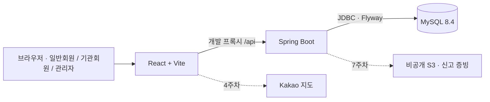
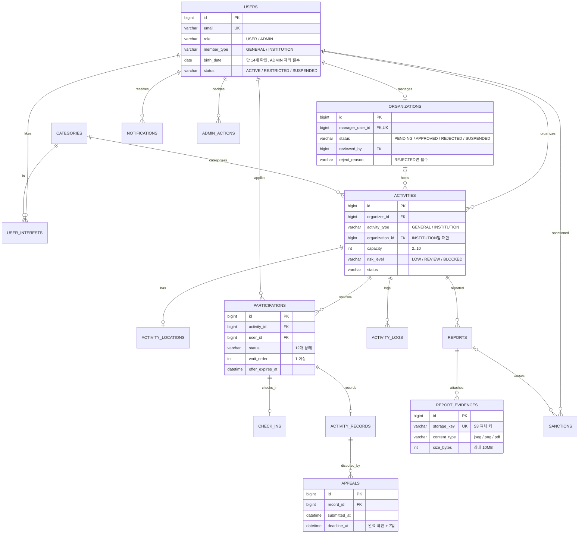
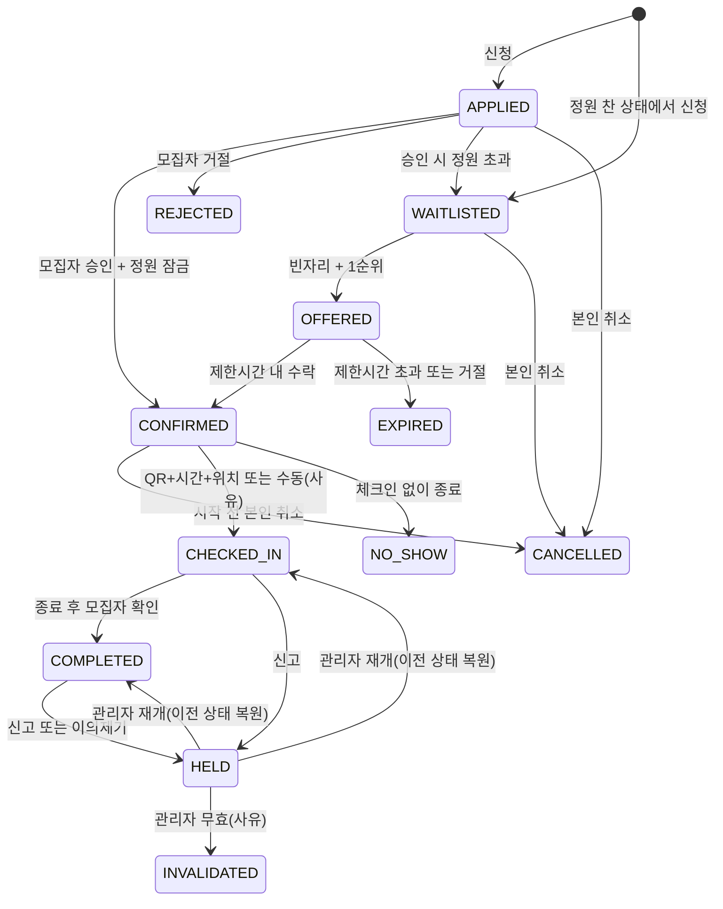
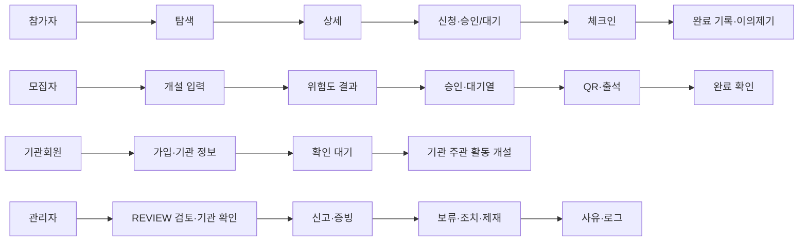
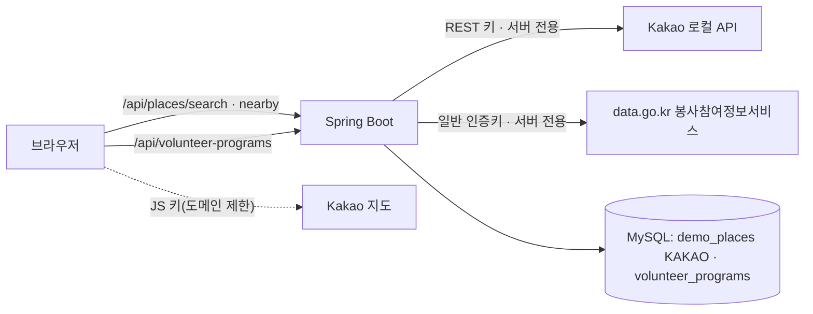

# 구조와 데이터 설계 · 2주차 확정본

2026-10-11 2주차에 1주차 초안을 확정했습니다. 기준 원본은 [계획서](plan.md) 6장과 제출 보고서의 회원 유형(일반회원·기관회원·관리자)입니다.

- **확정** = 테이블·제약을 V3 마이그레이션으로 만들고 실제 MySQL 테스트로 확인했다는 뜻입니다.
- **업무 기능(가입·승인·신청·체크인·신고 등)은 아직 구현하지 않았습니다.** 테이블이 있다고 기능이 동작하는 것은 아닙니다.
- API 명세는 [api.md](api.md), 입력·오류·위험 규칙은 [rules.md](rules.md), 보안·비용은 [security-cost.md](security-cost.md), 테스트 케이스는 [test-cases.md](test-cases.md)를 봅니다.

## 시스템 구성

현재 실제 연결: **React → Vite 프록시 → Spring Boot 시연 조회 API → MySQL**. 인증·JWT(3주차), 공간 검색·첫 배포(4주차), S3(7주차)는 미구현입니다.

## ERD · V1~V3

### 계획서 ERD와 이름 대응

V1은 이미 적용돼 이름을 바꿀 수 없습니다. 계획서 이름과 같은 뜻으로 씁니다.

| 계획서(plan.md 6.6) | 저장소 테이블 | 비고 |
|---|---|---|
| USERS.nickname | users.display_name | |
| ACTIVITIES.host_id | activities.organizer_id | |
| APPLICATIONS | participations | wait_no → wait_order |
| ATTENDANCE | check_ins | in_radius → within_radius |
| COMPLETIONS(dispute_until, voided) | activity_records(status) + appeals(deadline_at) | 이의제기를 별도 테이블로 분리 |
| REPORT_FILES | report_evidences | object_key → storage_key |
| CATEGORIES.base_risk | categories.base_risk (V3) | 지역 돌봄 = REVIEW |
| ACTIVITY_LOCATIONS.checkin_radius_m | activity_locations.checkin_radius_m (V3, 기본 200) | POINT·공간 인덱스는 4주차 |
| CREWS, CREW_MEMBERS | 없음 | 계획서의 선택 항목. 일정 여유 시 추가 |
| (계획서에 없음) | organizations, users.member_type | 제출 보고서의 기관회원 반영 |

### V3에서 DB가 직접 막는 것

| 규칙 | 제약 |
|---|---|
| 관리자는 기관회원이 될 수 없음 | `ck_user_admin_general` |
| 일반·기관회원은 생년월일 필수 | `ck_user_birth_date` (만 14세 계산은 서버에서, 날짜 함수는 CHECK에 못 씀) |
| 기관 1명당 1곳, 승인·반려는 처리자·시각 필수, 반려는 사유 필수 | `UNIQUE manager_user_id`, `ck_org_reviewed`, `ck_org_reject_reason` |
| 기관 주관 활동은 기관 필수, 자율 활동은 기관 없음 | `ck_activity_type_org` |
| 신청 상태 12개만 허용(REJECTED 추가), 대기 순번 1 이상 | `ck_participation_status`, `ck_wait_order` |
| 관리자 조치·제재는 사유 필수 | `ck_admin_action_reason`, `ck_sanction_reason` |
| 신고 내용 10자 이상, 처리 완료면 처리자·결과 필수 | `ck_report_description`, `ck_report_handled` |
| 증빙 파일은 jpeg·png·pdf, 10MB 이하 | `ck_evidence_type`, `ck_evidence_size` |
| 이의제기는 마감 시각 안에만 | `ck_appeal_deadline` (마감 = 완료 확인 + 7일, 서버가 계산) |
| 제재 기간은 끝이 시작보다 뒤 | `ck_sanction_period` |

DB가 못 막는 것(서버 서비스에서 막음): 만 14세 계산, 관심 분야 최대 3개, 정원 잠금, 체크인 기록이 같은 신청의 것인지, 증빙 최대 3개, 실제 파일 형식 검사.

## 권한표 · 확정

역할(`role`)은 USER·ADMIN 두 개, 회원 유형(`member_type`)은 GENERAL·INSTITUTION입니다. **모집자 = 해당 활동의 organizer_id인 USER**입니다. 회원가입에서 ADMIN은 고를 수 없고, 관리자 계정은 운영자가 DB에서 직접 만듭니다.

| 작업 | 비회원 | 일반회원 | 기관회원(확인 대기·반려) | 기관회원(확인 완료) | 해당 활동 모집자 | 관리자 |
|---|---|---|---|---|---|---|
| 공개 활동 탐색·상세 (LOW, 승인된 REVIEW) | ○ | ○ | ○ | ○ | ○ | ○ |
| 회원가입 (만 14세 이상) | ○ | - | - | - | - | 선택 불가 |
| 자율 활동 개설 | × | ○ | ○ | ○ | - | × |
| 기관 주관 활동 개설 | × | × | × | ○ (자기 기관) | - | × |
| 신청·취소·내 기록 | × | 본인만 | 본인만 | 본인만 | 자기 활동 신청 불가 | × |
| 신청자 목록·승인·거절·QR 발급 | × | × | × | × | 자기 활동만 | 조회만(감사 로그) |
| 수동 체크인·완료 확인 | × | × | × | × | 자기 활동만, 사유 필수 | × |
| 신고·증빙 첨부 | × | 참여한 활동 | 참여한 활동 | 참여한 활동 | 자기 활동 | - |
| 완료 기록 이의제기 (7일) | × | 본인 기록 | 본인 기록 | 본인 기록 | × | - |
| REVIEW 검토·기관 확인·신고 처리·제재·기록 보류/무효 | × | × | × | × | × | ○ 사유 필수 |
| 알림 조회·읽음 | × | 본인 | 본인 | 본인 | 본인 | 본인 |

계정 상태: `RESTRICTED`(노쇼 누적 등 신청 제한) = 신청·개설 불가, 조회 가능. `SUSPENDED` = 로그인 외 모든 쓰기 불가.

## 상태 전이 · 확정

### 신청(participations)

1주차에 남긴 결정 사항을 이렇게 정했습니다.

| 질문 | 결정 | 이유 |
|---|---|---|
| 거절 상태 | `REJECTED` 추가, 같은 활동 재신청 불가 | 모집자 판단 존중, 반복 신청 방지 |
| 취소 후 재신청 | 시작 전이면 같은 행을 `APPLIED`로 되돌려 1회 허용, 두 번째 취소 후엔 불가 | `(activity_id,user_id)` UNIQUE 유지, 이력은 activity_logs |
| 보류 후 복원 | activity_logs의 보류 직전 `from_status`로 복원 | 별도 컬럼 없이 기록으로 복원 |
| 제안 자리 예약 | `OFFERED`는 정원에 포함(확정 수 + 제안 수 ≤ 정원) | 제안 중 다른 사람이 자리를 가져가는 문제 방지 |
| 모집자 정원 포함 | 포함하지 않음 | 정원 2~10명은 참가자 수 |
| 대기열 마감 | 시작 2시간 전, 이후 취소 자리는 비워 둠 | 계획서 6.2 |
| 제한시간 | 시작까지 24시간 이상 6시간, 미만 1시간, 1분마다 만료 처리 | 계획서 6.2 |

모든 신청 상태 변경은 `activity_logs`에 변경 전·후, 처리자, 사유와 함께 남깁니다(5주차 구현).

**5주차 구현에서 정한 것(2026-10-16):** ① 정원이 찬 뒤의 **승인은 409 `CAPACITY_FULL`로 거부**합니다(그림의 ‘승인 시 정원 초과 → 대기’ 대신 API 명세·P-03을 따름). 대기는 정원이 찬 뒤의 새 신청에만 붙습니다. ② 만료(EXPIRED)된 사람은 다시 신청할 수 있습니다(맨 뒤 순번). ③ 모든 신청 변경 트랜잭션은 **READ COMMITTED**입니다. MySQL 기본 REPEATABLE READ에서는 활동 행 잠금 뒤에도 잠금 전 스냅샷으로 인원을 세서 동시 승인이 모두 성공했습니다(P-02 테스트로 발견). ④ 시작 2시간 전 대기 마감 때 남은 대기자는 EXPIRED로 바꾸고 알립니다. 기관 확인·신고·이의·제재 처리는 `admin_actions`에 남깁니다.

### 활동(activities)

| 전환 | 조건 |
|---|---|
| 개설 → RECRUITING | 위험도 LOW |
| 개설 → DRAFT(비공개) | 위험도 REVIEW, 관리자 승인 시 RECRUITING / 반려 시 CANCELLED |
| 개설 거부 | 위험도 BLOCKED, 저장하지 않음 |
| RECRUITING → IN_PROGRESS → FINISHED | 시작·종료 시각 (스케줄러) |
| RECRUITING → CANCELLED | 모집자 취소(사유), 신청자에게 알림 |
| 모든 진행 상태 → HELD | 신고 접수 후 관리자 보류 |

### 기관(organizations)

`PENDING` → 관리자 확인 → `APPROVED`(기관 주관 활동 개설 가능) 또는 `REJECTED`(사유 필수, 다시 신청 가능). `APPROVED` → `SUSPENDED`(제재). 기관 확인은 공식 봉사실적 인증이나 보험 적용을 뜻하지 않습니다.

### 신고·이의제기

신고: `RECEIVED` → `REVIEWING` → `ACTION_TAKEN` / `DISMISSED`(처리자·결과 필수). 이의제기: 완료 확인 후 7일 안 `SUBMITTED` → `ACCEPTED`(기록 재검토) / `REJECTED`.

## 사용자 화면 흐름

공개 서비스에는 활동 찾기·상세·만들기·내 활동·로그인·회원가입 6개 화면만 있습니다.

## 현재 API

| 요청 | 용도 | 비고 |
|---|---|---|
| `GET /actuator/health` | 실제 DB 포함 건강 확인 | 상세 연결정보 미노출 |
| `GET /api/project/status` | 3주차 상태·DB 확인 | dev/test 전용 |
| `GET /api/demo/catalog` | 장소·시연 계정 정의·활동 시안 조회 | dev/test 전용·읽기 전용 |

3주차에 회원가입·로그인·리프레시·로그아웃, 내 정보·관심 분야, 활동 개설·공개 목록·상세·내 활동, 관리자 기관 확인·검토 활동 처리를 구현했습니다. 전체 목록과 이후 주차 API는 [api.md](api.md)를 봅니다. V4로 `activities.place_id`(시연 장소 후보, 4주차 실제 좌표로 교체 예정)·`risk_reasons`·`review_note`와 `refresh_tokens`(해시만 저장)를 추가했습니다.

## 4주차 보완 · 외부 연결 (2026-10-21)

검색 장소는 활동을 등록할 때만 `demo_places`(source=KAKAO)에 저장하고, 1365 상세는 공개 항목만 `volunteer_programs`에 캐시합니다. 두 외부 API 키가 없으면 각각 등록 장소 검색·1365 숨김으로 동작합니다.
